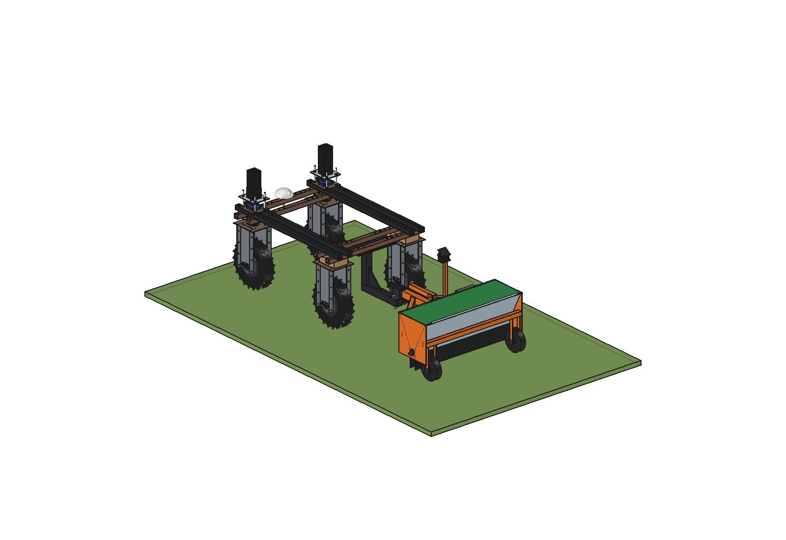
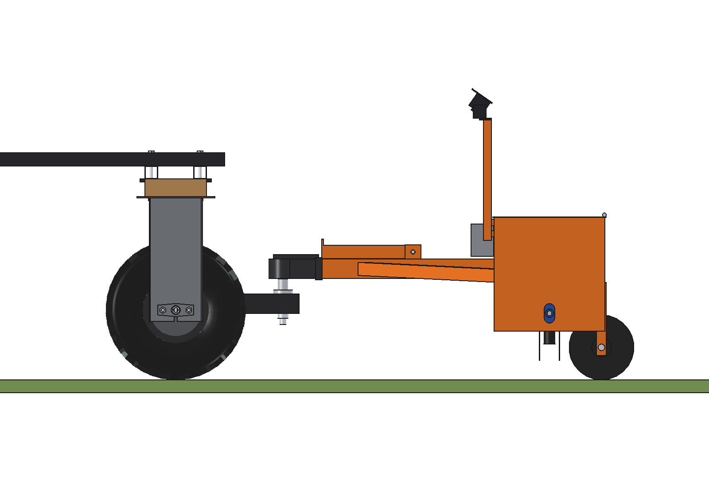
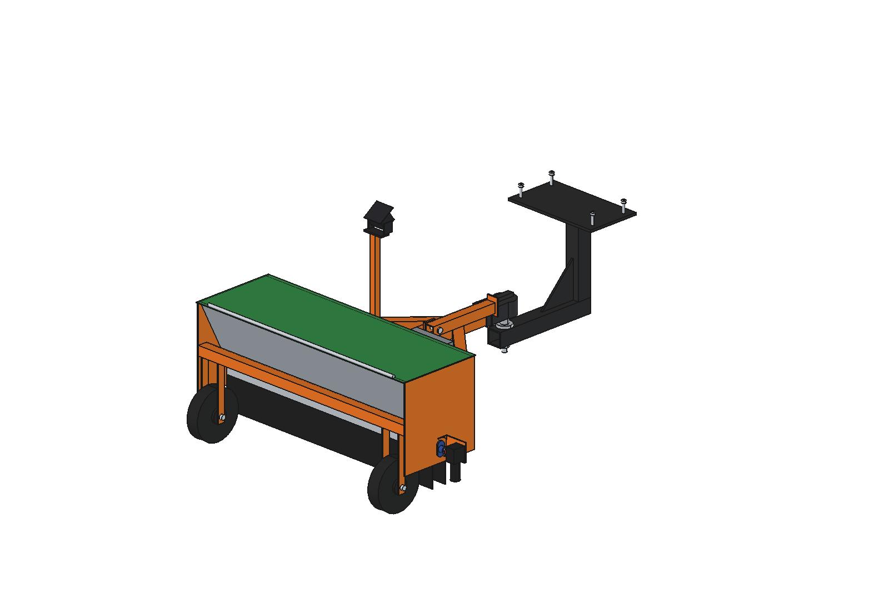
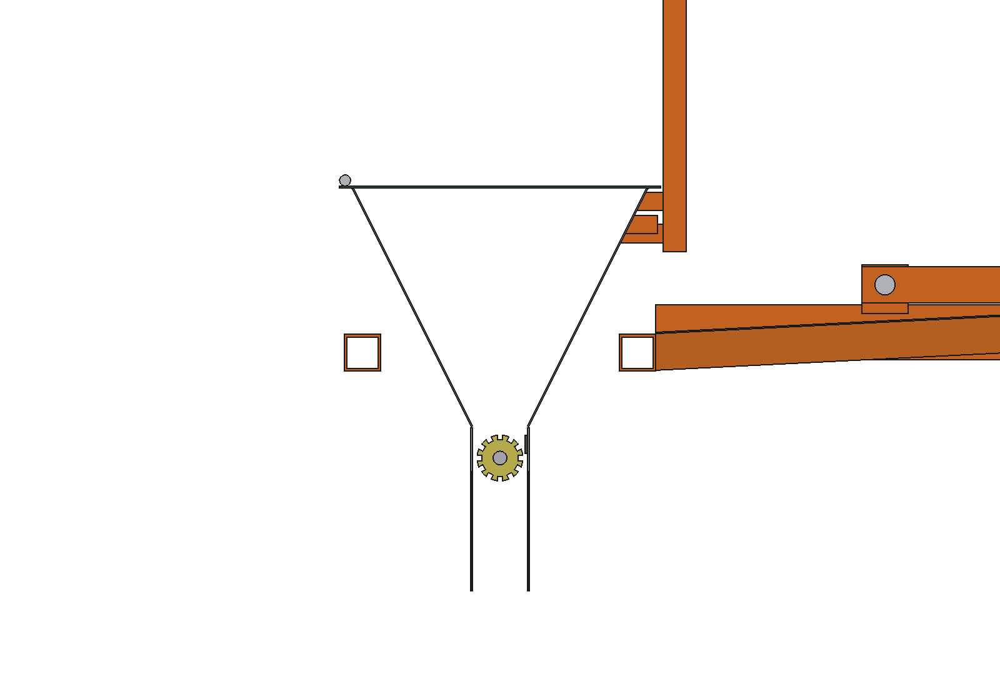
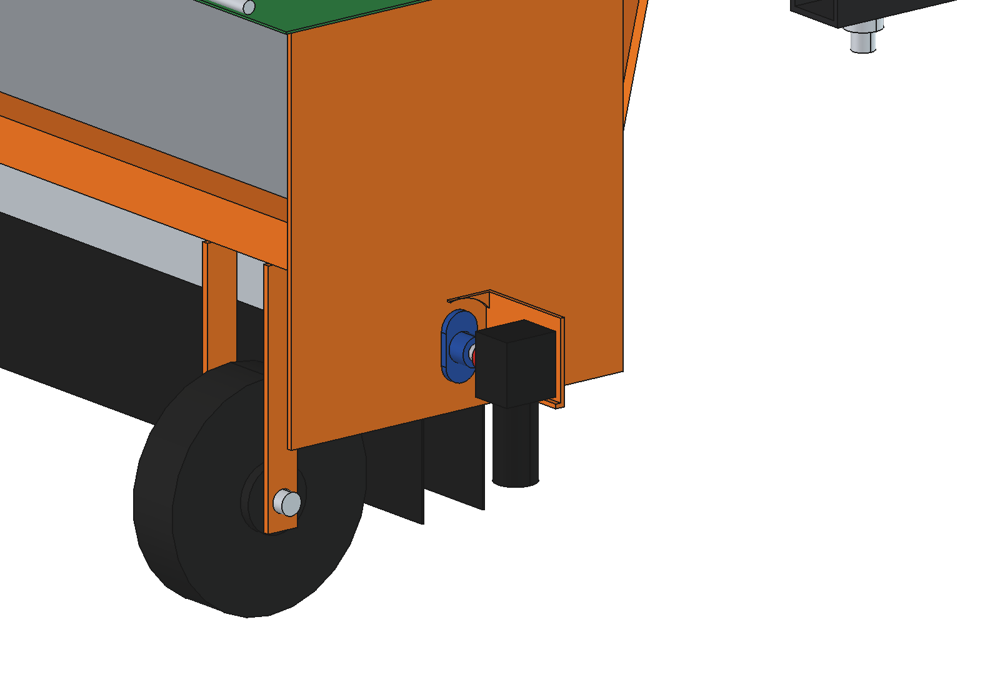

# Overseeder, simple drop seeder

A 1 m drop seeder that lets grass seed fall on the lawn, trailed behind the Bruut on the tow hitch of the
[Cambridge roll](../cambridge%20roll/). Simple and cheap: a galvanised hopper, a fluted metering roller on a small
24 V worm gearmotor, two solid wheels. A camera on a short mast sees bare soil in front of the hopper, so the motor
only runs over bare patches and stops on full grass. The seeder unit is one module: here on its own wheels, in the
[combination](../overseeder%20with%20cambridge%20roll/) between the arms of the roll.

Not to be confused with the slit seeders in [overseeder/](../../overseeder/), which cut seed into the sward. This one
broadcasts on the surface (repair of bare patches); a roll behind it presses the seed in.



| | |
| --- | --- |
| Working width | 1000 mm, one section |
| Hopper | 49 l = 17 kg lawn seed (0.35 kg/l) = 490 m² of bare soil at 35 g/m² |
| Metering | fluted roller Ø50, 12 flutes 6 × 5, 101 g per revolution; 10 rpm at 0.5 m/s for 35 g/m² |
| Drive | 24 V worm gearmotor 20 rpm, 2 Nm (up to 0.96 m/s at 35 g/m²) |
| On/off | switch on 220 mm before a patch, off 100 mm before its end (motor start 0.15 s, fall 0.19 s) |
| Camera | looks 0.4 … 1.2 m ahead of the drop line, cells of 50 mm; on/off in time up to 1.0 m/s |
| Mass | 61 kg empty (seeder unit 35 kg), 160 N on the ball empty, 190 N full |
| Articulation | ±75° yaw, ±8° pitch without contact (at 90° the braces touch the hitch bar: the drawbar is shorter than on the roll) |
| Parts | about € 500 (estimated) |

## Construction

- **Hopper** (`Hopper`): two sloping walls of 1.5 mm galvanised sheet between two end plates of 5 mm; throat 60 mm
  wide at z 240, top opening 320 mm at z 500, lid with a hinge at the back.
- **Metering** (`Metering`): fluted roller Ø50 (aluminium) in a housing under the throat, brush strip on the front wall
  (no flow when the roller stands still), rubber wind flaps down to 60 mm above the ground, Ø15 shaft in two small
  flange bearings. The roller is its own sub-Part (`Meter`) so the animation can spin it.
- **Drive** (`Drive`): worm gearmotor (motor pointing down) on a bracket at +x, jaw coupling on the shaft.
- **Sensing** (`Sensing`): camera on a 25 × 25 mast at the front (35° down), control box on the front wall with a
  small computer (Raspberry Pi class), the motor driver and a 48 → 24 V converter.
- **Trailer** (`Seeder_frame` + `Drawbar`): two cross bars 40 × 40 between the end plates, two solid rubber wheels
  200 × 50 behind the drop line (inside the hopper width), and the drawbar, coupling head and parking leg of the roll.

## Control

1. The camera image is cut into cells of 50 mm on the ground (strip 0.4 … 1.2 m ahead of the drop line). A cell is
   bare when the excess-green index (2G − R − B) is low; the cells go into a map in trailer coordinates, moved along
   with the driven distance.
2. The motor runs while at least 2 bare cells lie in the window from `lead_off` to `lead_on` ahead of the drop line
   (`ovd_calc.timing()`, scaled with the speed): seed then lands from 50 mm before to 50 mm after the patch. A single
   bare cell (a mole cast, a shadow) does not switch it on.
3. The roller speed follows the driving speed (`ovd_calc.rpm_for()`), so the rate in g/m² stays constant.

## Files

| File | Contents |
| --- | --- |
| `ovd_params.py` | all dimensions of the seeder unit and the trailer, seed and timing. Reads the hitch from `../cambridge roll/cbr_params.py` |
| `ovd_parts.py` | one function per part (unit coordinates moved by `uy`, the y of the drop line) |
| `build_ovd.py` | model tree (`build_unit()` is reused by the combination), `COLOR`, checks and mass via `build_cbr`, `render_all()`, STEP |
| `ovd_calc.py` | hopper, flute volume and rpm, on/off timing, camera footprint, seed saved by spot seeding |
| `run_in_freecad.py` | macro: reload, build, print the key figures |
| `RATIONALE.md` | why |
| `previews/` | images |

## Use

```python
exec(open(r"F:\veldrobot\aanbouwdelen\cambridge roll\overrseeder\run_in_freecad.py").read())
import build_ovd
build_ovd.check_interference()      # must be empty
build_ovd.check_poses()             # yaw +-75, pitch +-8: must be empty
build_ovd.mass_properties()
build_ovd.render_all()
```









## Estimated, not measured

- Bulk density of the seed mixture (0.35 kg/l) and the filling of the flutes (80 %): calibrate the g per revolution
  with a bag under the roller before use.
- Motor start and stop time (0.15 / 0.10 s), current of the gearmotor (12 W).
- Rolling resistance of the small wheels (0.10).
- Classification of bare soil by the camera: the model assumes every bare cell is found. In the field: shadows, dead
  grass and moss; the threshold and the cell size need tuning.
- Masses of bought parts (gearmotor 0.45 kg, box 1.6 kg, wheels 2.2 kg each) and prices.
