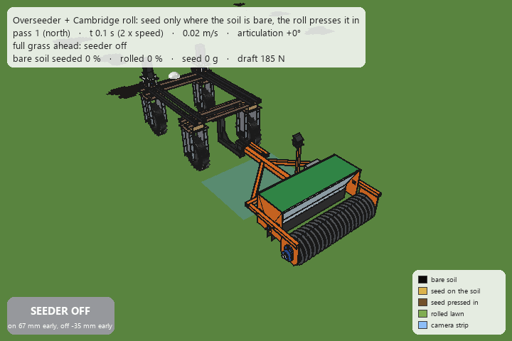
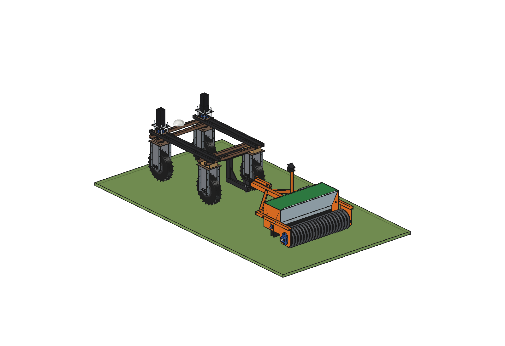
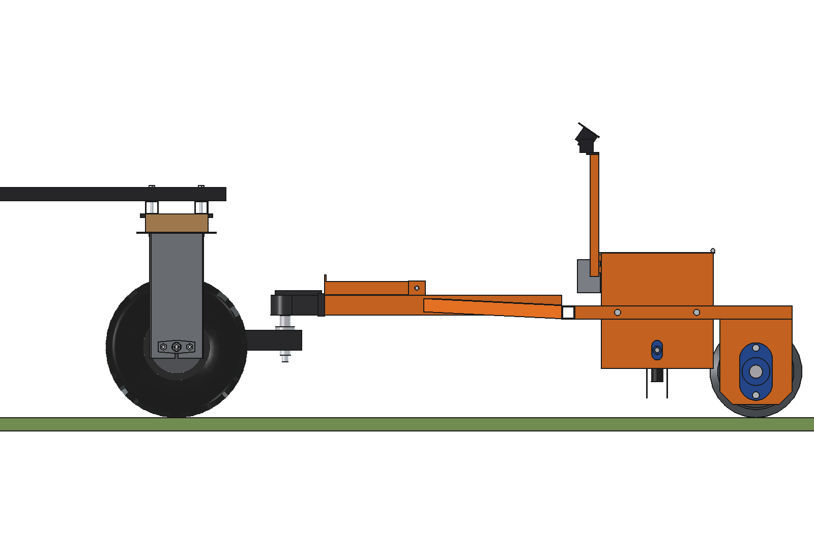
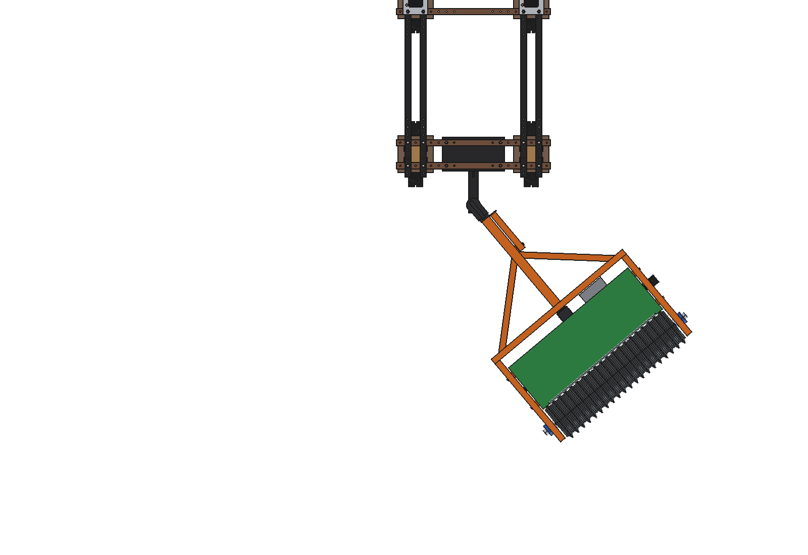
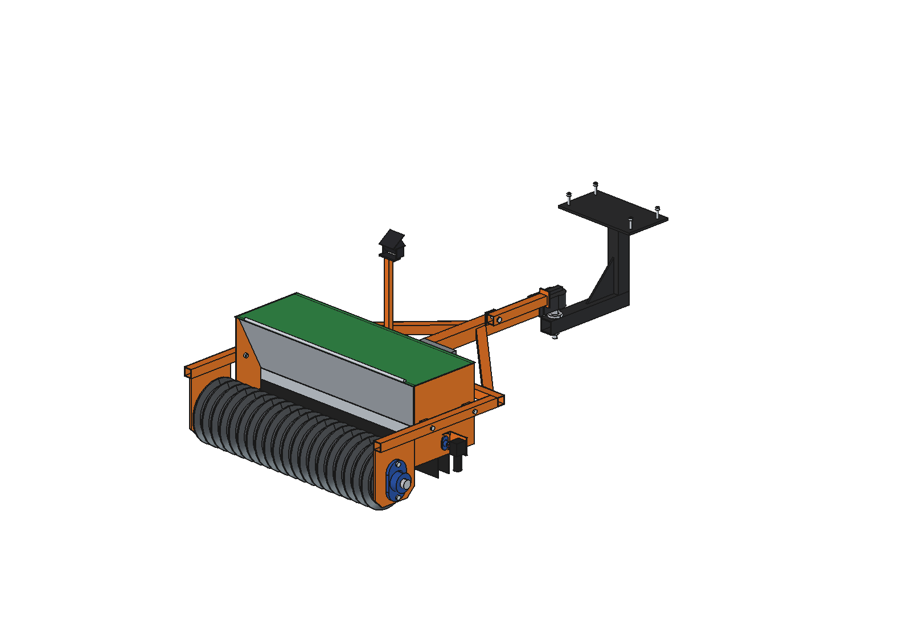
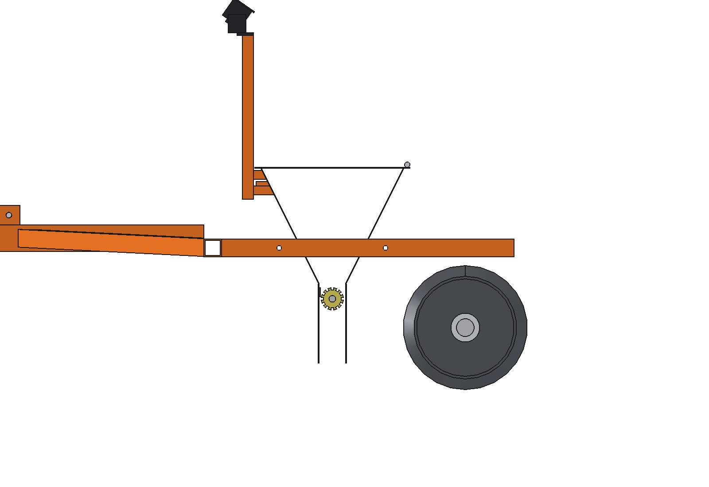

# Overseeder with Cambridge roll

The seeder unit of the [drop seeder](../overrseeder/) hangs between the arms of the [Cambridge roll](../cambridge%20roll/),
in front of the rings, trailed on the same simple tow hitch. Seed falls on a bare patch and the rings press it in
300 mm (0.6 s) later. The roll always rolls; the seeder only runs where the camera has seen bare soil.



*The robot drives one pass north, turns (rear axle radius 2.25 m, front wheels steered with Ackermann, max 28°) and
drives back. Black = bare soil, golden = seed on the soil, brown = seed pressed in by the rings, light green = rolled
lawn, blue = the strip the camera analyses. Six patches: six times on, all bare soil seeded and rolled; two single bare
cells (below the threshold) are ignored.*

| | |
| --- | --- |
| Working width | 1000 mm |
| Mass | 216 kg empty, 234 kg with a full hopper (17 kg seed) |
| Loads | 205 … 241 N on the tow ball, 196 … 210 kg/m on the roll |
| Draft | 185 N moist lawn, 310 N on a bare patch (loose soil); 510 N on a bare patch up 5° |
| Robot pull | 630 N (wet grass) … 980 N (dry) on the level |
| Drop line → roll | 300 mm |
| Turn | smallest rear axle radius 2.11 m (steering stop 30°); at 2.25 m the trailer articulates 47° and the roll runs 0.48 m inside the robot track |
| Hopper | 49 l, 490 m² of bare soil at 35 g/m² |
| Run in the animation | 43 s, 1.21 m² bare in 6 patches: 99.8 % seeded, 100 % rolled, 114 g of seed, 63 % of it on grass (one 1 m section) |
| Parts | about € 1,200 (estimated) |

## Construction

- Hitch, roll, frame, drawbar: as the stand-alone roll (`cbr_parts`), with a longer frame: the axle at y −2260, the
  front cross beam 250 mm in front of the drop line (y −1710).
- Seeder unit: `build_ovd.build_unit()` with the drop line at y −1960, without its wheels and cross bars.
- Hangers (`osr_parts.py`): per side two spacer blocks of 10 mm and two M10 bolts through the arm, the block and the end
  plate (x 505 … 515). The bolts sit outside the hopper walls; the holes are cut in the arms and end plates.

## Files

| File | Contents |
| --- | --- |
| `osr_params.py` | positions of the combination (drop line, axle, cross beam, hangers); everything else from `cbr_params` and `ovd_params` |
| `osr_parts.py` | hanger blocks, bolts, holes |
| `build_osr.py` | model tree, checks (via `build_cbr`), mass with an empty / full hopper, `render_all()`, STEP |
| `osr_calc.py` | mass and ball load, draft and pull, smallest turn, articulation and off-tracking |
| `osr_ground.py` | process model: patches, path, robot and trailer kinematics, camera, on/off control, seeding and rolling |
| `animate_osr.py` | animation on the robot: `build()`, `play()`, `stop()`, `summary()`, `check_fit()`, `render_all(folder)` |
| `make_gif_osr.py` | frames to GIF with caption, ON/OFF indicator and legend |
| `run_in_freecad.py` | macro: reload, build, print the key figures |
| `RATIONALE.md` | why |
| `previews/` | images and the GIF |

## Use

```python
exec(open(r"F:\veldrobot\aanbouwdelen\cambridge roll\overseeder with cambridge roll\run_in_freecad.py").read())
import build_osr, animate_osr
build_osr.check_interference()      # must be empty
build_osr.check_poses()             # yaw +-75, pitch +-8: must be empty
animate_osr.build(); animate_osr.play()
animate_osr.summary()
animate_osr.check_fit()             # trailer vs robot at the articulations of the run: must be empty
```

GIF: `animate_osr.render_all(folder)` (start it with a `QtCore.QTimer.singleShot`, it takes a few minutes), then
`make_gif_osr.main(folder, "previews/animation_spot_seeding.gif")`.











## Estimated, not measured

All items of the [roll](../cambridge%20roll/README.md#estimated-not-measured) and the
[seeder](../overrseeder/README.md#estimated-not-measured), and for the animation:

- The camera finds every bare cell (perfect classification) and the trailer follows the ball without side slip.
- Draft on a bare patch with the rolling resistance of loose soil (0.15) for the share of the roll on bare cells.
- The patches are drawn shapes, not a measured lawn.
