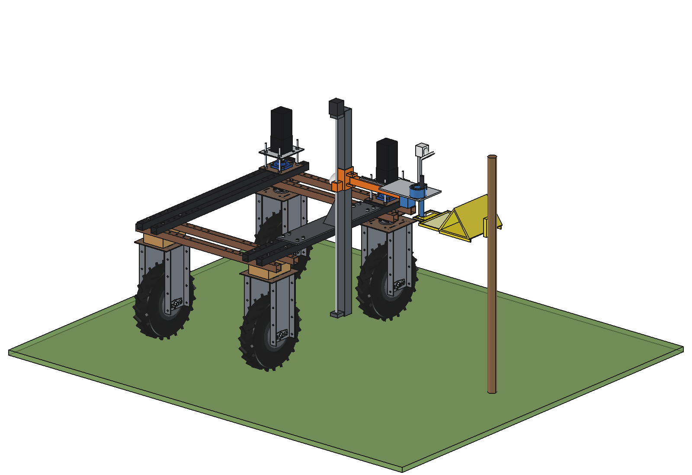
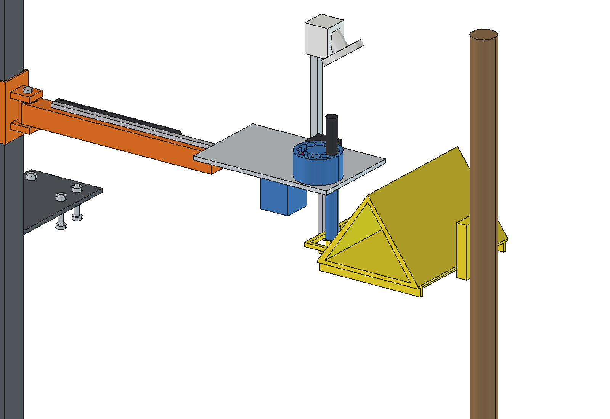
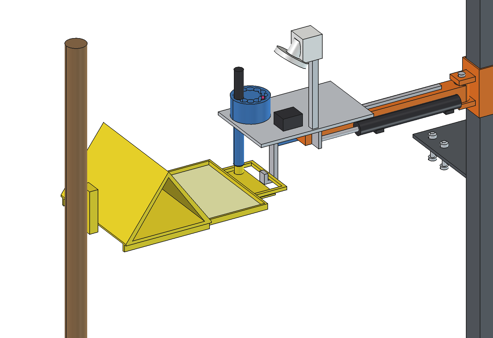
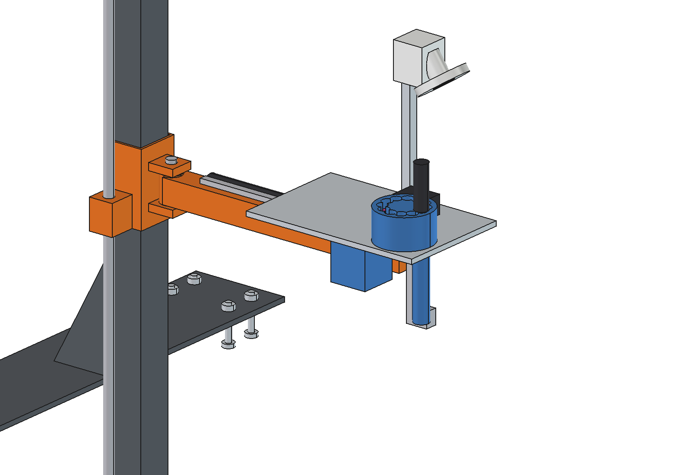
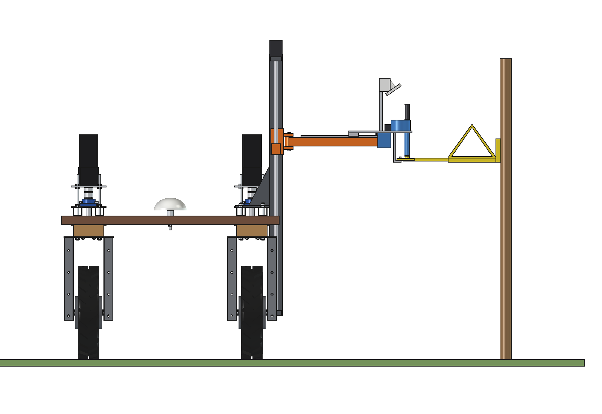

# Pheromone trap service (simple)

The Bruut OpenAgbot (standard robot) visits the pheromone and sticky traps along the field edges on a weekly round,
counts the catch by image and swaps the lure when it is due. Each trap is a delta trap on a post with a **pull-out
drawer** at the bottom (the robot-friendly trap of this implement): the drawer holds the sticky card and, in a clip on
its front shelf, the lure capsule. At a trap the robot stops with the post line 1.54 m to its right; the service head
reaches out, hooks the handle frame of the drawer (Z up 15 mm), pulls the drawer out 160 mm, and a 12 MP camera with
an LED ring photographs the card. When the lure is due, a plunger pushes a fresh capsule from a revolver of 12 down a
guide tube into the clip, which pushes the old capsule out into the bin on the head. Then the drawer is pushed back. A
full card goes on a work list for a person (simple variant).

The mast, lead screw, NEMA 23 stepper and carriage are those of the [fence inspector](../../fence%20inspector/simple/)
(imported); instead of its swinging sensor arm a fixed arm tube carries an MGN12 linear guide and a 24 V actuator
(stroke 220) with the service head.

  

| Head hooks the drawer | Drawer out: photo and lure swap | Head retracted |
| --- | --- | --- |
|  |  |  |

## Build

- Base plate 8 mm on the 2 right upper beams, 8 x M10 in the grid holes y +-275 / +-325; mast 60 x 60 x 3 at x 485
  with gussets, Tr16 x 4 lead screw and NEMA 23 (fin parts).
- Carriage (sub-Part `Carriage`, z 300..1100): fin C-sleeve, keyed hinge pin, fixed arm tube 40 x 40 x 3 to x 960,
  MGN12 rail on top, 24 V actuator (200 N, 20 mm/s, stroke 220) beside it.
- Head (sub-Part `Slide`, x 0..220): MGN12H block, aluminium plate 290 x 185, hook (bar + finger + upturned tip) with a
  servo, lure revolver O90 (12 capsules O16 x 30) with a plunger servo, guide tube to the clip, used-capsule bin,
  camera post with a 12 MP camera and LED ring (55 degrees down).
- Trap (render only): delta body 280 long on a post, drawer 200 x 250 on 2 rails with a handle frame and lure shelf.

Mass ~27 kg (carriage with head 8.6 kg), centre of gravity x 538. Size 750 x 720 x 1266 mm.

## Key figures (`phs_calc.report()`)

| | |
| --- | --- |
| Card image | 560 x 420 mm field at 400 mm, 7.1 px/mm: leek moth 57 px, carrot fly 36 px, thrips 9 px (too small: 12 px needed) |
| Visit | ~50 s per trap (align 8, Z 7.5, reach 11, hook, pull + push 16, photo 3, back); +6 s for a lure swap |
| Weekly round, 40 traps 150 m apart | 7.8 km, ~2.4 h, ~415 Wh (22 % of a charge); ~10 lures per round, revolver refilled every ~1.2 rounds |
| Loads | drawer 15 N (actuator reserve x 13); Z 114 N, 0.21 Nm on the lead screw |
| Axle loads | 187 kg total, 109 / 79 kg front / rear, 74 / 113 kg left / right |
| Checks | `check_interference()` [], `check_holes()` {}, `check_poses()` {} (3 heights x 3 slides x steering +-30, and the trap engaged / pulled out) |

## Estimated, not measured

Drawer pull force 15 N, actuator speed 20 mm/s, align time 8 s, lure life 4 weeks, 12 px per insect for a reliable
count, route detours 30 %, sensor power 35 W, masses of the bought parts. The trap with a drawer is a design of this
implement (a standard delta trap needs a drawer and handle frame added). Not modelled: cables, the trap marker
(AprilTag) used to align.

## Files

`phs_params.py`, `phs_parts.py` (own base plate, arm, rail, actuator, head, trap render via `trap(slide)`; mast,
screw, stepper and carriage from `fin_parts`), `build_phs.py` (model, checks, `mass_properties`, `render_all()`,
STEP), `phs_calc.py` (image, visit, round, loads, axle loads), `run_in_freecad.py`,
`Pheromone_Trap_Service.FCStd` / `.step`, `previews/`. See [RATIONALE.md](RATIONALE.md).
