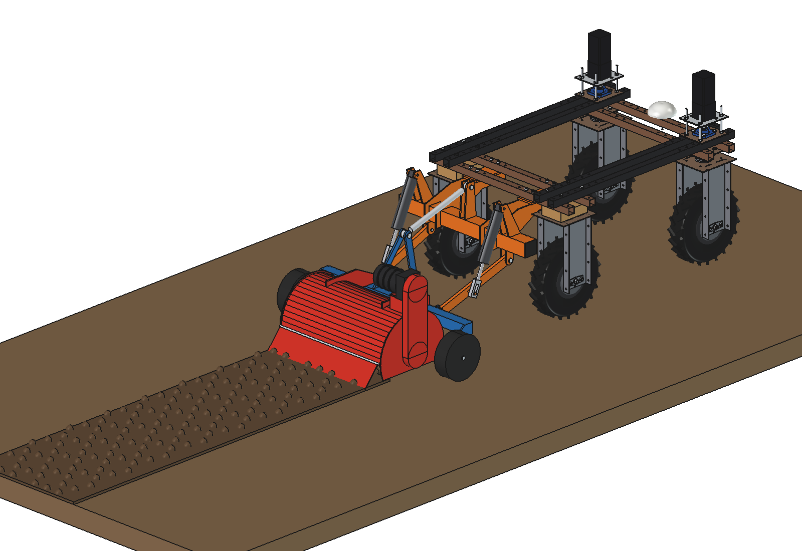
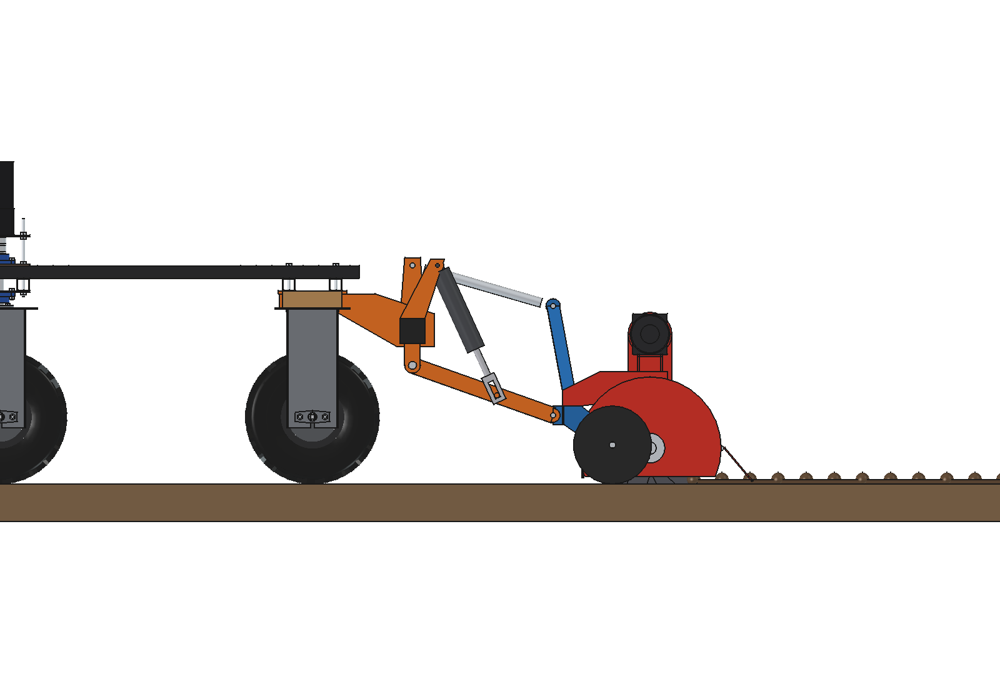
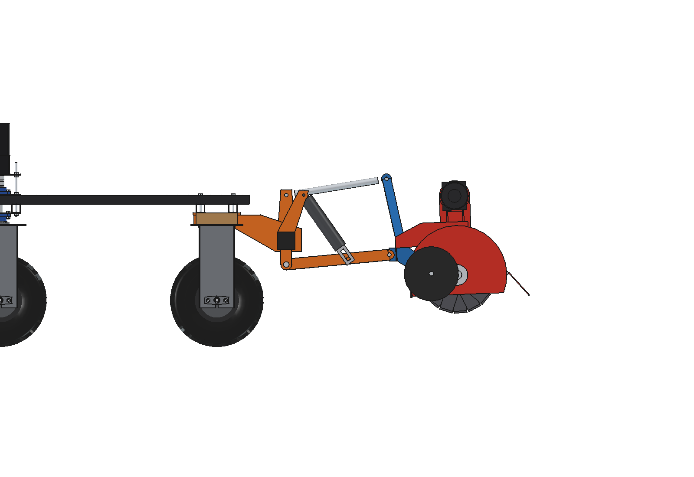
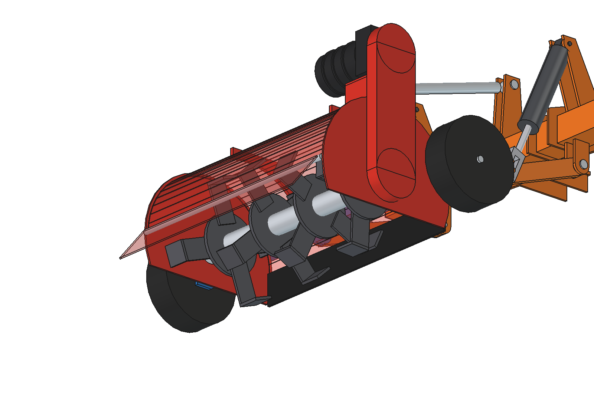
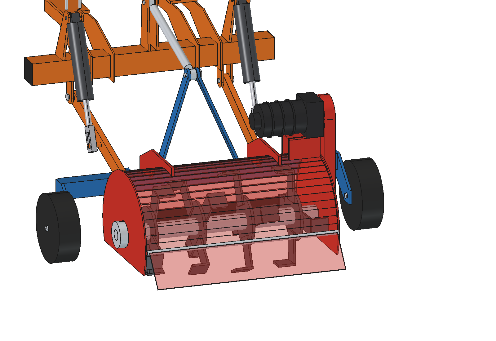

# Power harrow / rotary tiller (simple)

A narrow rotary tiller for seedbeds in strips and for loosening the soil between rows, in the category 0
[three-point hitch](../../three%20point%20hitch/simple/) of the Bruut OpenAgbot (standard robot). The mount, links,
lift rods, the toolbar frame with its A-mast and its 2 gauge wheels are the hitch's (imported, not copied); this folder
adds what hangs behind the toolbar.

- **Rotor** 700 mm wide, O350: tube O60 x 5 on a shaft O40, 4 flanges O180 with 4 **L-blades** each (60 x 7, tips
  bent 60 mm, alternating), flanges turned 22.5 degrees apart so the blades enter one after another. 250 rpm, 60 mm
  deep. It turns **forward (down-cut)** like a tractor tiller: it pushes the light robot instead of pulling it back.
- **Housing**: 5 mm side plates with skids, a 2 mm hood (R 218) from the front over the top, a rubber front skirt,
  a hinged rear **levelling flap** (140 mm at 40 degrees) that smooths the strip; 2 brackets (10 mm) to the toolbar.
- **Drive**: a 48 V BLDC gearmotor (1.5 kW, i = 12) on a stand on the hood, a 1:1 chain case on the right side plate;
  a flange bearing on the left.
- **Depth**: the gauge wheels of the hitch frame run on the untilled soil beside the strip (x +-565); the rotor depth
  is set in slots in the side plates.

<p align="center">
  
</p>

| Work | Lifted (25 degrees) |
| --- | --- |
|  |  |
|  |  |

## Key figures (`pwh_calc.report()`)

| | |
| --- | --- |
| Rotor | 4.6 m/s blade tips; bite 6 mm at 0.1 m/s, 12 mm at 0.2 m/s (fine tilth) |
| Power | firm loam (150 kJ/m3) at 0.1 m/s: 630 W at the rotor, 740 W at the motor (49 % of rated), 24 Nm on the rotor |
| Push | the down-cut rotor pushes ~40 N forward: 4 % of the robot's grip, the drive holds it back |
| Output | 250 m2/h at 0.1 m/s (1.0 kW in all, ~1.6 h, ~400 m2 per charge); 500 m2/h at 0.2 m/s in loose soil |
| Mass | 94 kg behind the hitch (rotor 30, frame and gauge wheels of the hitch ~33, housing and drive ~31), mount 26 kg |
| **Lifted** | the cg is 1.55 m behind the robot centre: with the hitch's standard 40 kg front ballast the front axle keeps only 6 %; **92 kg** front ballast is needed for 20 % (steering) |

So this tiller is for strip and bed work with lifts only at the headland, with ~90 kg on the front beams. A
belly-mounted tiller between the wheels (the space x +-250, y +-280) would avoid the ballast; that variant is not
drawn.

Checks: `check_interference()` [], `check_poses()` {} (lift -4, 0, 12, 25 degrees and 5 rotor angles),
`ground_contact()`: blades at -60 mm, skids 25 mm, flap 8 mm and gauge wheels on the ground in work; all clear of the
ground at 25 degrees (blades +156 mm). See [RATIONALE.md](RATIONALE.md), including the list *Estimated, not measured*.

## Usage

```python
exec(open(r"F:\veldrobot\aanbouwdelen\power harrow\simple\run_in_freecad.py").read())
import build_pwh
build_pwh.set_pose(25); build_pwh.set_rotor(30)
build_pwh.check_interference(); build_pwh.check_poses(); build_pwh.ground_contact()
build_pwh.render_all()
```

```bash
"C:/Program Files/FreeCAD 1.1/bin/python.exe" -B pwh_calc.py
```

## Files

| File | Contents |
| --- | --- |
| `pwh_params.py` | rotor, blades, housing, drive, operation (puts the three-point hitch folder on `sys.path`) |
| `pwh_parts.py` | one function per part in the work pose; soil and tilled strip for the renders |
| `build_pwh.py` | model tree (hitch via `build_tph`/`tph_parts`, rotor as its own sub-Part), checks, mass, `render_all()`, STEP |
| `pwh_calc.py` | tip speed and bite, tilling power and torque, push, output and battery, lifted balance and ballast |
| `run_in_freecad.py` | reload, build, print the key figures |
| `Power_Harrow.FCStd`, `Power_Harrow.step` | generated model (robot hidden in the FCStd) |
| `previews/` | images |
