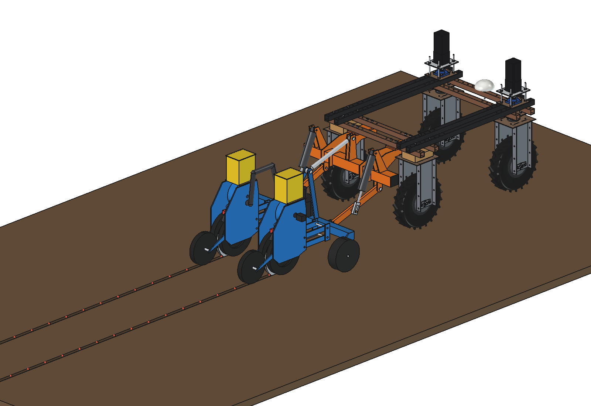
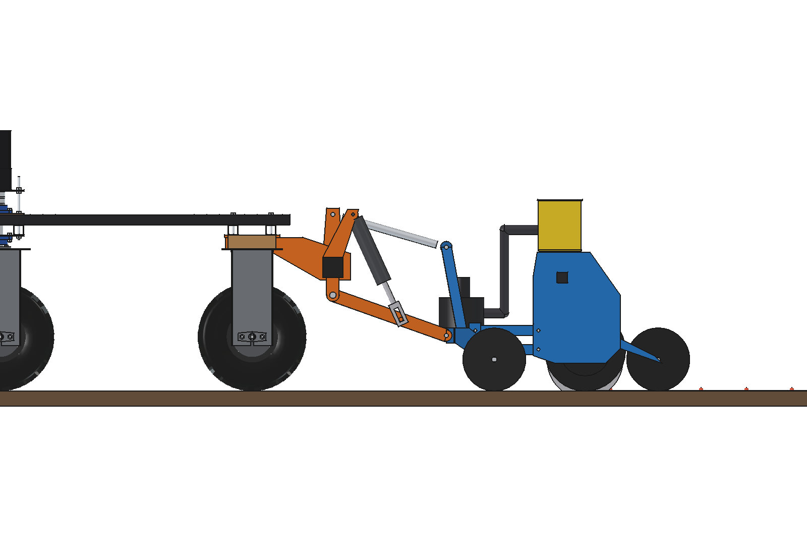
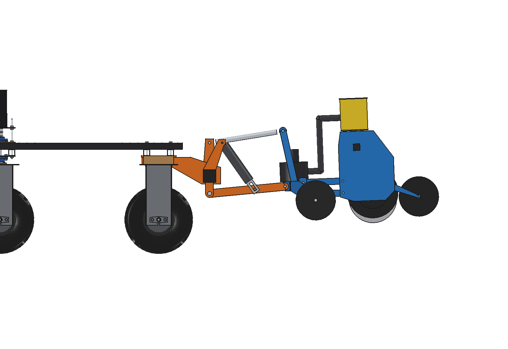
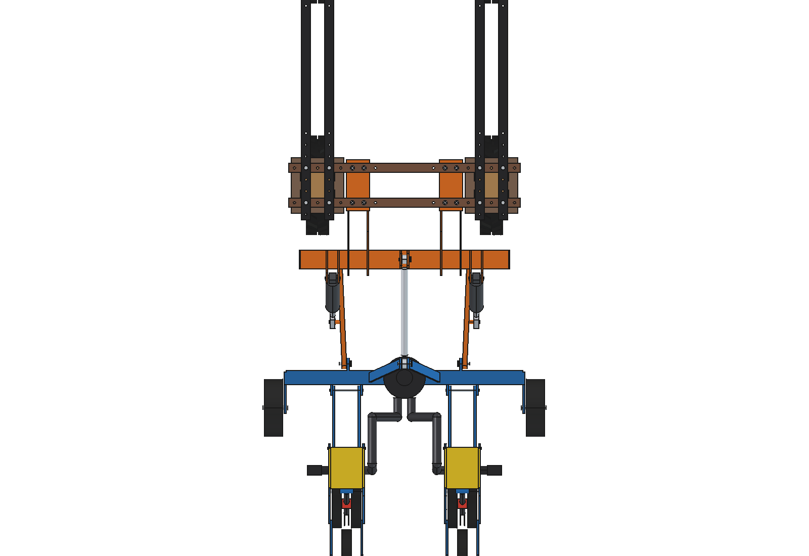
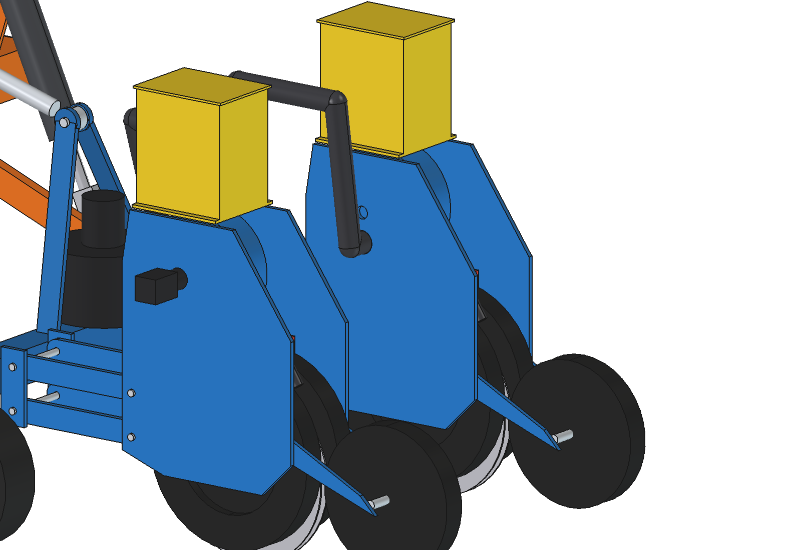
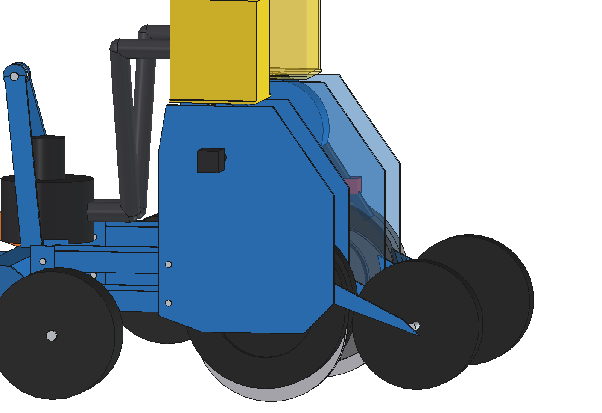

# Precision seeder (simple): FreeCAD model

Sows row crops (sugar beet, vegetables) seed by seed and logs the RTK position of every seed, so a later weeding pass
can hoe around each plant before it is even visible. It hangs in the category 0
[three-point hitch](../../three%20point%20hitch/simple/README.md) of the robot: mount, links, lift rods and the
cultivator's toolbar frame with its 2 gauge wheels are imported, not copied. On the toolbar:

- **2 seeding units** for 2 rows at 500 mm, each on a parallelogram (aluminium links 40 × 10, 250 long) so it follows
  the ground on its own depth wheels:
  - **hopper** 4.2 l on the side plates;
  - **vacuum metering disc** (O180, 30 holes) in a housing O200, turned by its own NEMA 17 stepper with a 5:1 gearbox
    (8.9 rpm for 18 cm at 0.8 m/s): the spacing is set in software per field or even per metre;
  - **seed tube** with an **optical seed sensor**: every passing seed gets a time stamp, which with the RTK position,
    the speed and the fall time gives the seed's position in the furrow;
  - **double-disc opener** (2 × O300) between 2 **depth wheels** O320 (30 mm seed depth), a **press wheel** O250 behind.
- **24 V vacuum blower** on the toolbar, 2 hoses O38 to the meters.

Why it is designed this way: [RATIONALE.md](RATIONALE.md).

| | | |
| --- | --- | --- |
|  |  |  |
| side, at work | lifted 25° (headland) | from above |
|  |  | |
| seeding unit | unit see-through: meter, seed tube, sensor, discs | |

## Key figures

From the model (`build_psd.mass_properties`, checks) and `psd_calc.report()`.

| | |
| --- | --- |
| Mass | 107 kg with the hitch (mount 26 kg, implement 64 kg: frame and gauge wheels ~23 kg, 2 units of 21 kg, blower); actuators 7 kg |
| Rows, spacing | 2 rows at 500 mm, seed every 180 mm: ~111 000 seeds/ha (sugar beet) |
| Meter | 4.4 seeds/s per row at 0.8 m/s, disc 8.9 rpm; hopper 4.2 l = ~25 km of row, ~2.5 ha per fill |
| Logged position (estimated) | 1σ ~13 mm along the row (RTK 10, fall-time jitter 5, bounce 6), ~12 mm across (heading 6) |
| Fall time | 0.12 s = 96 mm behind the sensor at 0.8 m/s: corrected in the log, not an error |
| Work | 0.23 ha/h (1 m per pass, 80 % field efficiency), ~500 W: ~3.8 h, ~0.9 ha per charge |
| Pull | 240 N openers + 197 N rolling, grip 827 N: margin 1.9 |
| Lifted | front axle 15 % with the hitch's 40 kg front ballast; 57 kg gives the 20 % the robot needs to steer |
| Ground | discs at −30, depth wheels and press wheel at 0 in work; 196 mm free when lifted |
| Size | 1222 × 1845 × 789 mm (behind the robot to y −2235) |

Checks: `check_interference()` = [], `check_poses()` = {} (lift −4 / 0 / 12 / 25°).

## Files

| File | Contents |
| --- | --- |
| `psd_params.py` | all dimensions, seeding and logging figures; imports `tph_params` |
| `psd_parts.py` | unit parts (`unit(x)`: brackets, links, pins, side plates, shank, discs, depth wheels, press wheel, meter, stepper, hopper, seed tube, sensor), blower, hoses, scene |
| `build_psd.py` | model (mount, links, lift rods from `build_tph`), `set_pose`, checks, `ground_contact`, mass, `render_all` |
| `psd_calc.py` | seeding rates, position error budget, area and energy, pull, front-axle load lifted |
| `run_in_freecad.py` | reload, build, print the report |
| `Precision_Seeder.FCStd`, `.step` | generated |

## Estimated, not measured

- Fall time 0.12 s and its jitter 6 ms, bounce in the furrow 6 mm, RTK 10 mm, heading 0.15°.
- Singulation (2 % misses, 2 % doubles for pelleted beet), vacuum 4 kPa and 10 l/s, blower efficiency 40 %.
- Draft 120 N per unit, driving power 350 W in a seedbed; 33 000 pelleted beet seeds per litre.
- Unit parts in aluminium (side plates, links, brackets, arms); robot 161.5 kg.
