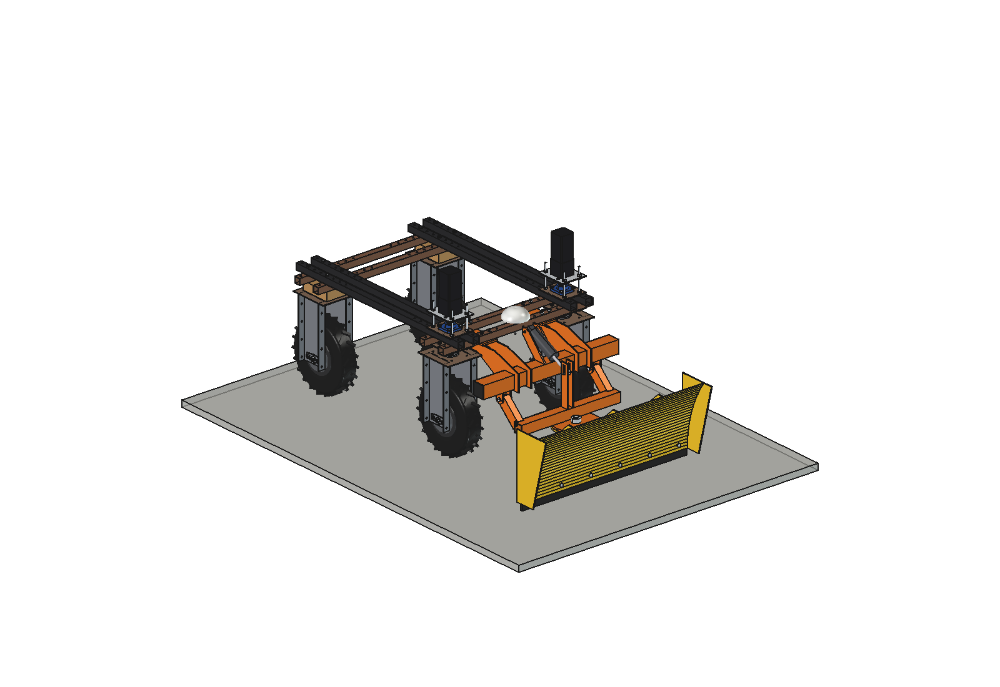
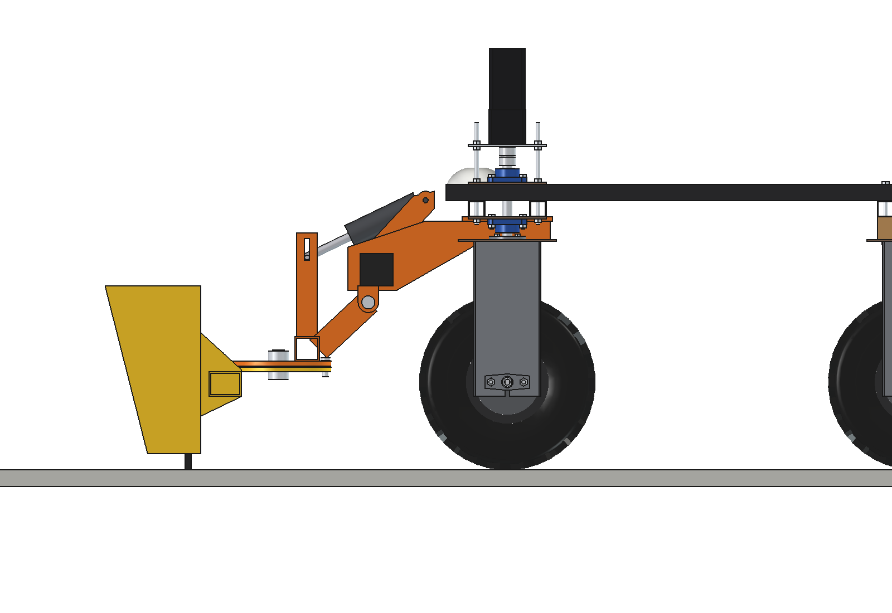
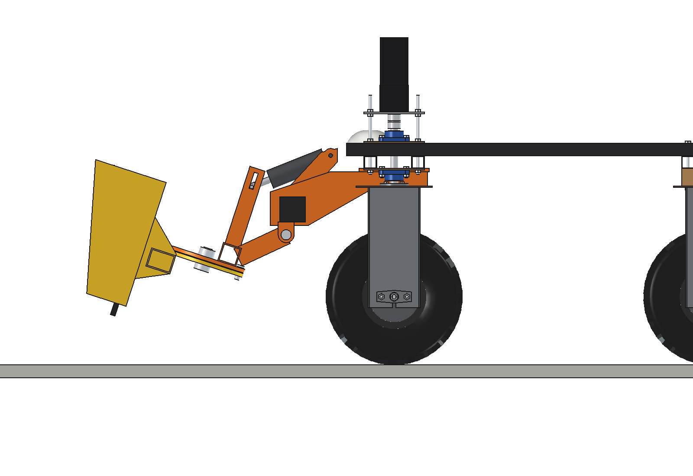
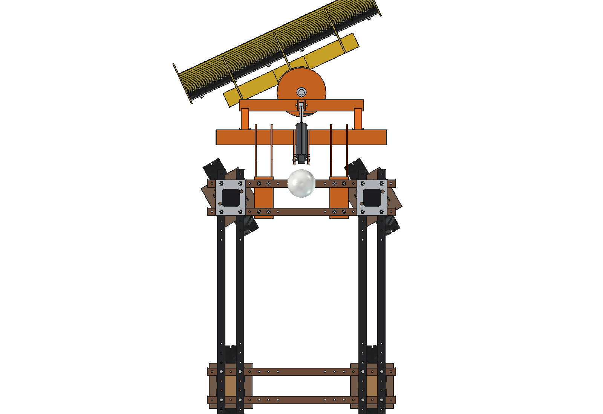
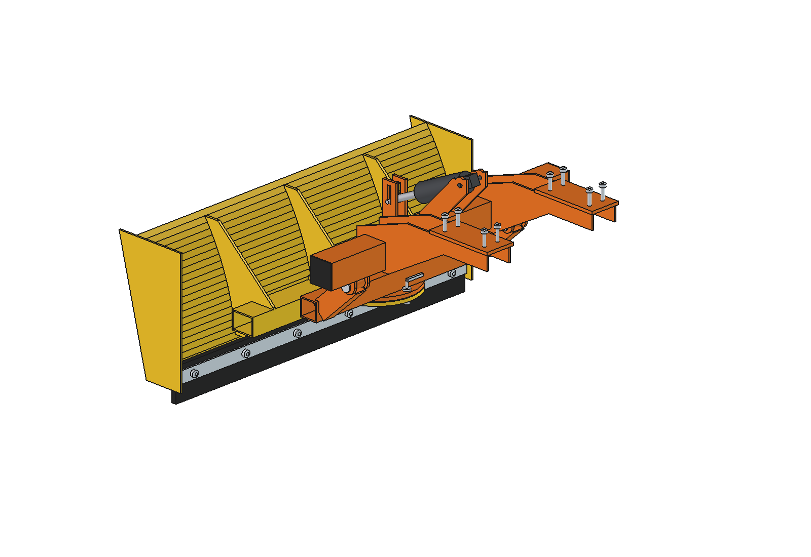

# Push blade (simple)

Front-mounted dozer / grader blade for the Bruut OpenAgbot (standard robot): pushes feed back to the feed fence,
scrapes slurry and snow, and grades soil and paths. 1100 mm wide, angle +-25 degrees, lifted 159 mm by a linear actuator,
floats on a rubber edge.

<p align="center">
  
</p>

| Work (floating on the rubber edge) | Transport (lifted 18 degrees) |
| --- | --- |
|  |  |
|  |  |

## Build

- **Mount**: front toolbar 80 x 80 x 4 (L 900) on 2 hangers under the front lower beams, 8 x M10 in the hole grid
  (x = +-175 / +-225). Pivot forks for the arms under the toolbar, a mast for the actuator on top. The toolbar can carry
  other front tools.
- **Lift**: weldment of 2 arms 60 x 40 x 3, cross tube 60 x 60 and a round head plate (12 mm), on O20 pivot pins.
- **Blade**: moldboard 1100 x 450 x 3 on R700, beam 80 x 60, 3 ribs, round swivel plate with 5 lock holes
  (-25, -12.5, 0, 12.5, 25 degrees), end plates, rubber edge 110 x 15 with clamp bar (steel edge for soil).
  Turns on an M30 king pin, locked with a O16 pin.
- **Actuator**: 24 V, 1500 N, stroke 100, rod pin in a 40 mm float slot.

Mass ~81 kg (lift group 56 kg, mount 22 kg). Size 1112 x 1094 x 682 mm (x, y, z).

## Key figures (`pbl_calc.report()`)

| | |
| --- | --- |
| Net push force, dry concrete / with manure / grass | 801 / 348 / 481 N |
| Full blade of silage / slurry / wet snow | 34 / 139 / 55 kg, all within reach |
| Grading loose soil, 20 mm deep | pile at its limit (119 kg) after ~3.9 m |
| Actuator force to lift | ~1190 N (rating 1500 N), lift time ~5 s |
| Axle load front / rear, transport | 202 / 36 kg (rear 15 %) |
| Power at full push, 0.6 m/s | ~880 W |

Why and how these come out: see [RATIONALE.md](RATIONALE.md), including the list *Estimated, not measured*.

## Files

| File | Contents |
| --- | --- |
| `pbl_params.py` | all dimensions, robot interface, poses, work parameters, masses from the model |
| `pbl_parts.py` | one function per part, robot coordinates, work pose |
| `build_pbl.py` | model tree, `set_pose(lift, angle)`, checks (`check_interference`, `check_holes`, `check_poses`, `clearance`), mass, `render_all()`, STEP |
| `pbl_calc.py` | axle loads, push force against grip and motors, piles per material, grading, actuator |
| `run_in_freecad.py` | reload, build, print the key figures |
| `Push_Blade.FCStd`, `Push_Blade.step` | generated model (robot hidden in the FCStd) |
| `previews/` | images |

## Use

```python
exec(open(r"F:\veldrobot\aanbouwdelen\push blade\simple\run_in_freecad.py").read())
import build_pbl
build_pbl.set_pose(lift=18, angle=25)
build_pbl.check_poses()        # lift -4..18 x angle -25..25 x steering -30..30: must be {}
```

No animation yet (simple variant): the poses are checked statically with `check_poses()`.
