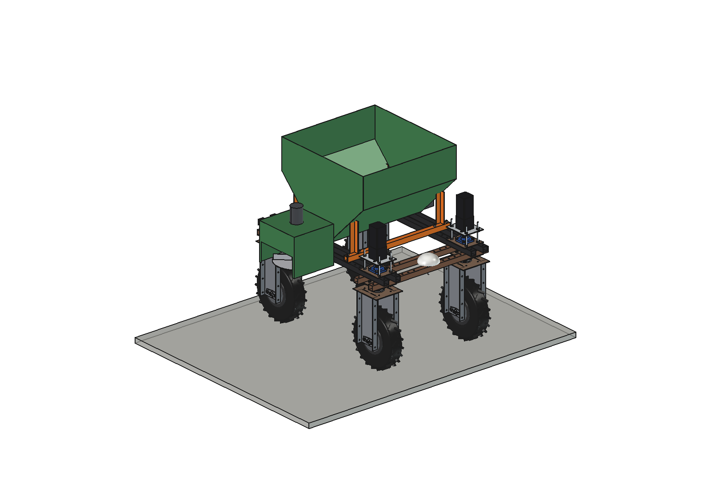
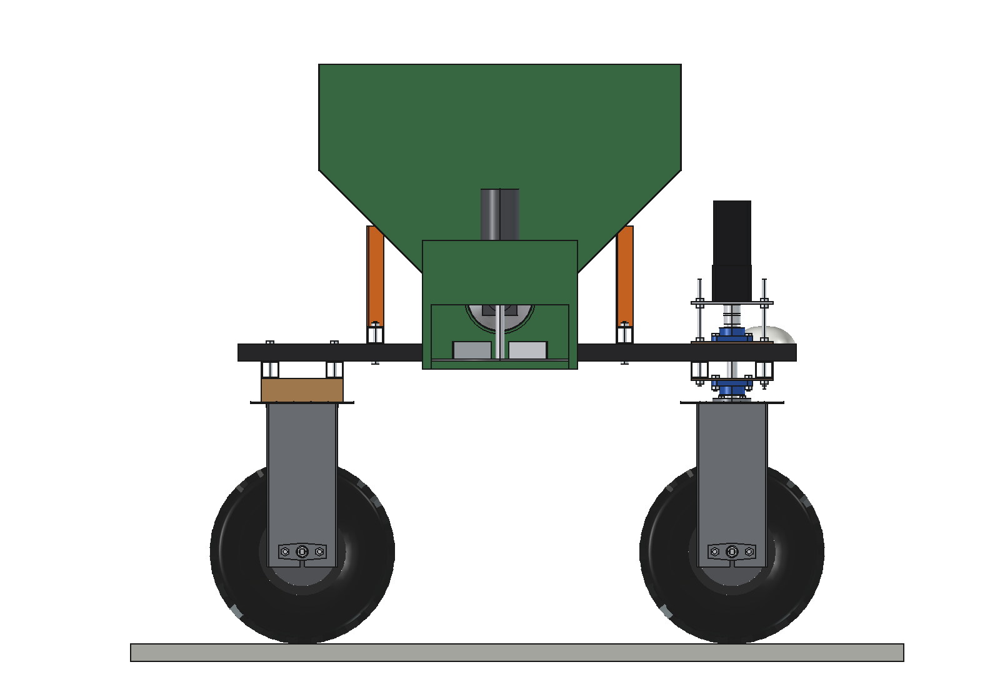
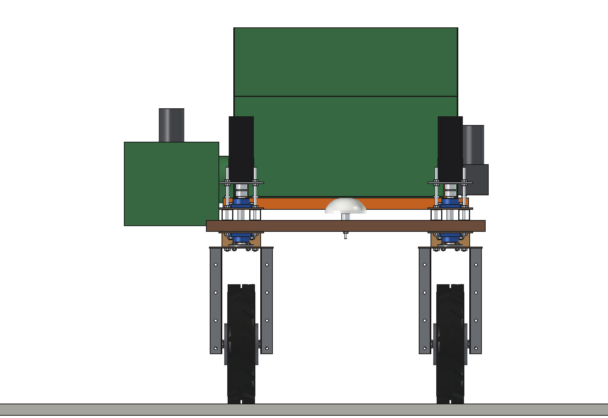
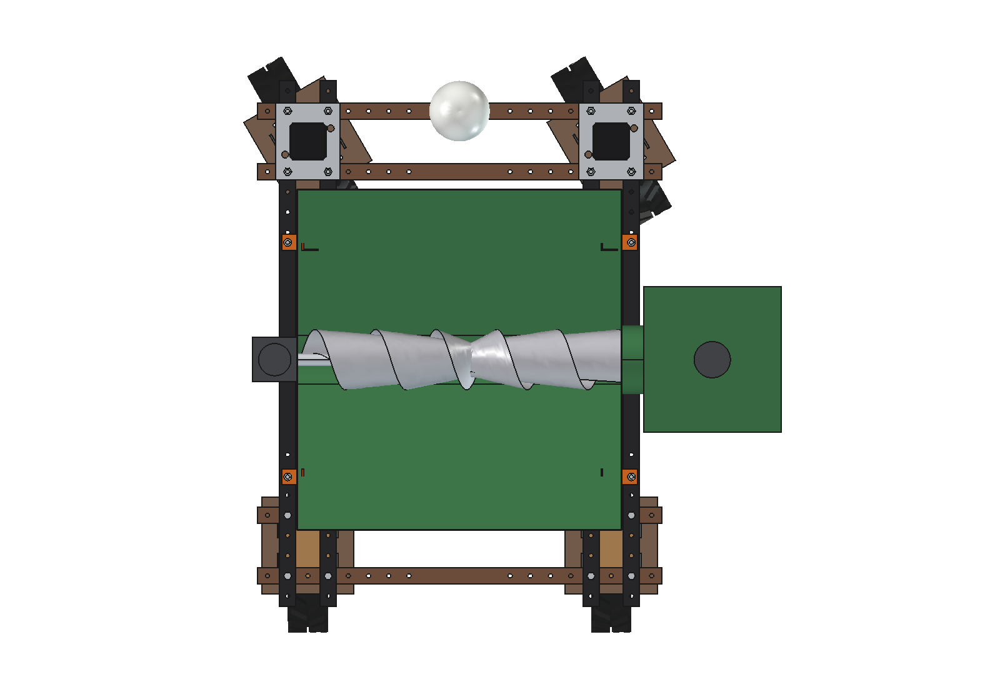
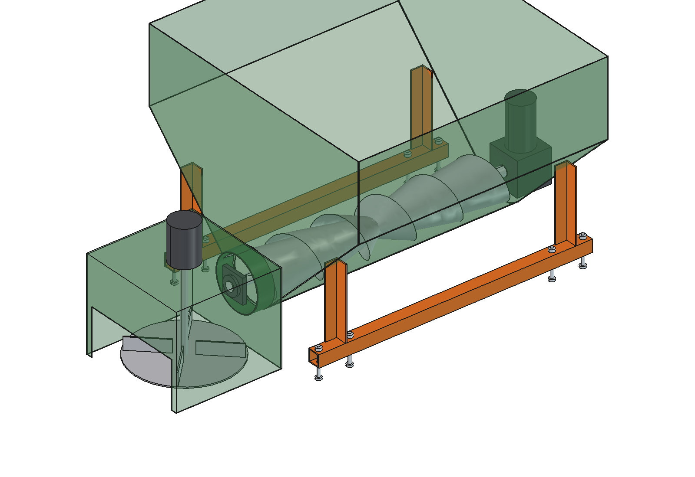
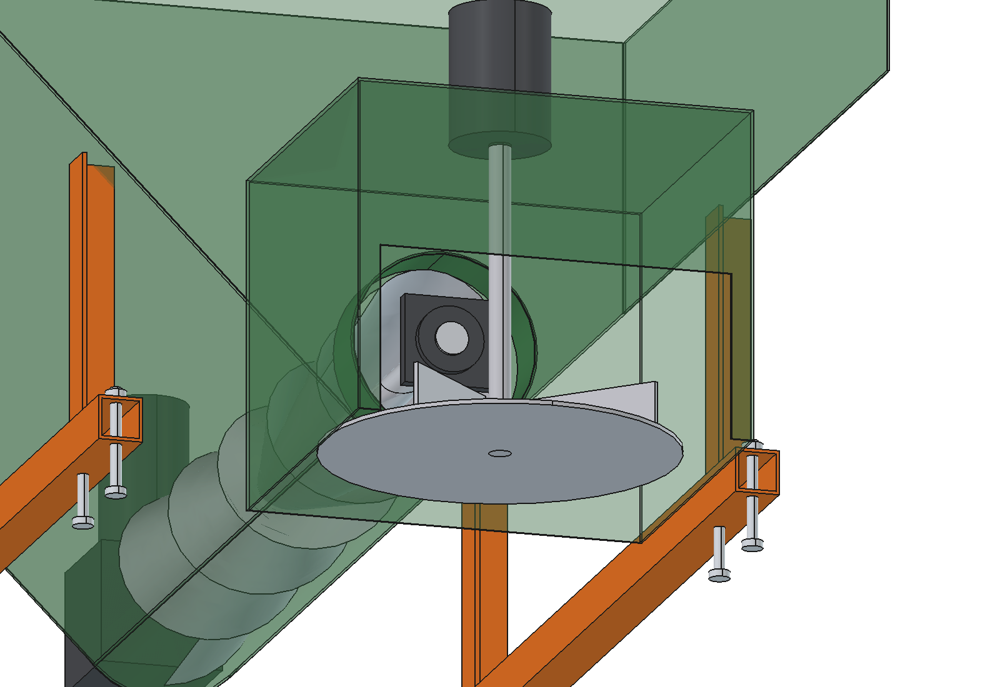

# Sawdust spreader (simple)

Bedding spreader for loose housing on the Bruut OpenAgbot (standard robot): a 308 l bin on the upper beams with
45 degree walls down to an auger across the robot, which feeds a spinner disc in a housing on the right side. The disc
throws sawdust (or chopped straw, or a lime-sawdust mix) sideways into the cubicles while the robot drives along the
alley. The dose per cubicle follows from the auger speed and the driving speed.

  

| Side | Front |
| --- | --- |
|  |  |
|  |  |

## Build

- **Mount**: 2 bearers 40 x 40 x 3 across the upper beams (y 250 and -330, 8 x M10), 4 legs (angle 40 x 4) to the
  bin slopes.
- **Bin**: 2 mm steel, 800 wide, y -460..380, 45 degree front and rear walls to a U-trough (R85) at z 805, top at
  z 1350: 308 l.
- **Auger**: flight O150 pitch 150 on a shaft O30, across the robot, 24 V 200 W worm gearmotor on the left, end bearing
  in the spinner housing; outlet tube O170 over the right upper beams.
- **Spinner**: housing 2 mm outside the right outer upper beam (x 455..795), open at the bottom and to the right; disc
  O320 with 4 vanes at z 660, 24 V motor on the roof.

Mass 75 kg empty. Size 1307 x 844 x 710 mm (z 640..1350). No interference; 104 mm from the steered front wheel units.

## Key figures (`sds_calc.report()`)

| | Sawdust | Chopped straw | Lime-sawdust mix |
| --- | --- | --- | --- |
| Load (308 l) | 62 kg | 22 kg | 139 kg |
| Dose per cubicle | 1.0 kg | 0.4 kg | 1.5 kg |
| Cubicles per fill | 61 | 53 | 92 |
| Auger at 0.5 m/s | 109 rpm | 125 rpm (over 120: drive 0.45 m/s) | 73 rpm |
| Cubicles per hour (3 min refill) | 568 | 520 | 719 |
| Side tip angle full (to the right) | 28.9 deg | 30.9 deg | 26.6 deg |

Disc tip 5.9 m/s, throws ~1.3 m beyond the wheel line. ~13 Wh per fill of sawdust.

Why and how these come out: see [RATIONALE.md](RATIONALE.md), including the list *Estimated, not measured*.

## Files

| File | Contents |
| --- | --- |
| `sds_params.py` | all dimensions, bin section and volume, robot interface, materials and work parameters |
| `sds_parts.py` | one function per part, robot coordinates |
| `build_sds.py` | model tree, checks (`check_interference`, `check_poses`, `clearance`), mass, `render_all()`, STEP |
| `sds_calc.py` | load per material, auger speed per dose, throw, stability, cubicles per hour and energy |
| `run_in_freecad.py` | reload, build, print the key figures |
| `Sawdust_Spreader.FCStd`, `Sawdust_Spreader.step` | generated model (robot hidden in the FCStd) |
| `previews/` | images |
