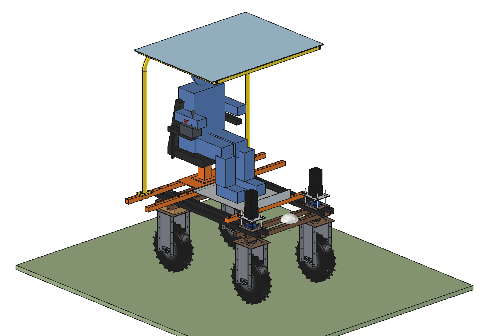
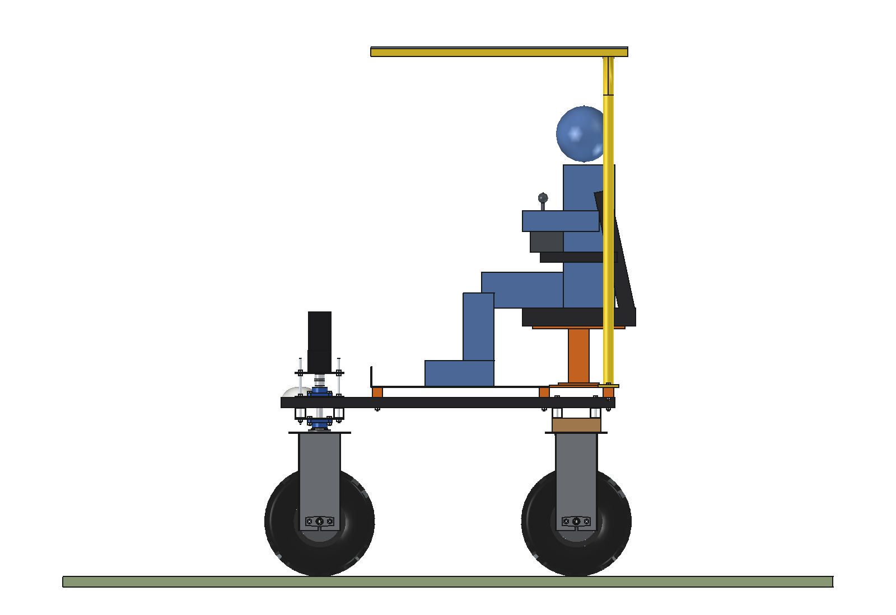
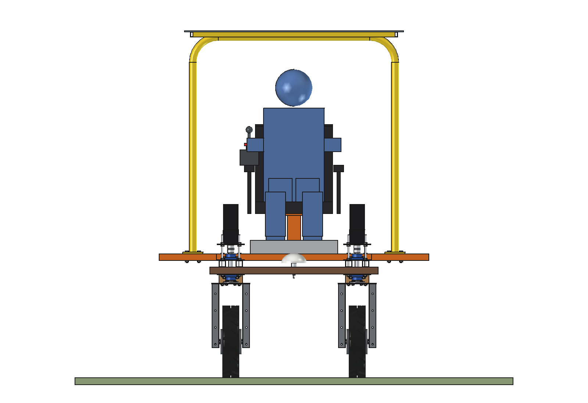
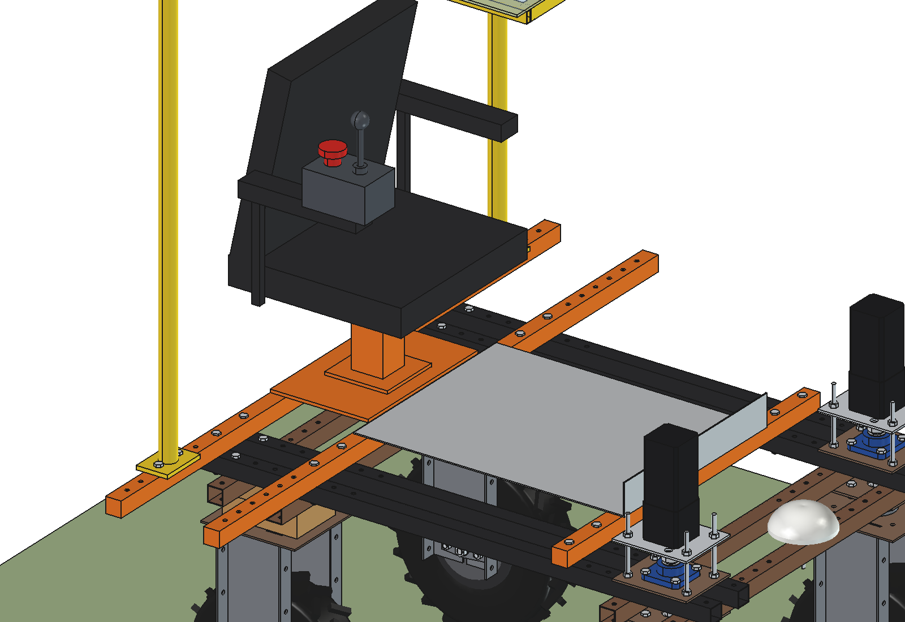
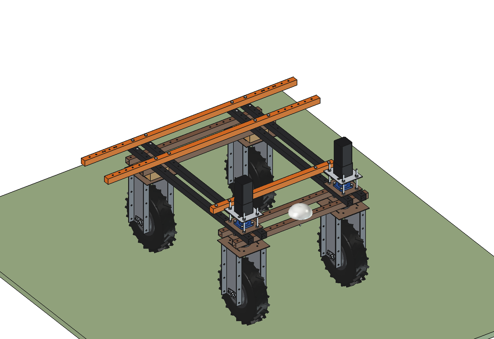

# Seat, canopy and frame extension (simple)

A seat so a person can ride on the Bruut OpenAgbot (standard robot) and drive it by hand, a roll bar with a light
canopy, and side extensions of the frame for wider implements.

- **Frame**: 3 cross tubes 40 x 40 x 3 on the upper beams (2 x M10 per beam). The 2 rear ones (y -625 and -375) are
  1600 mm long: a stiff pair of **side extensions** to x +-800 with a 50 mm hole grid (x 500..750). Over the front
  wheels the steering bearing plates and the GNSS antenna leave no room, so there is no front extension.
- **Seat** over the rear axle: 8 mm plate, pedestal 80 x 80 with a seat slide, tractor seat with a **seat switch**
  (dead man: the robot stops when nobody sits on it), armrests, a **console on the right armrest** with a drive
  joystick and an **emergency stop** mushroom.
- **Footplate**: checker plate 3 mm with a toe board, on the tubes at y -375 and 275.
- **Roll bar** O42 x 3 standing on the rear extension at x +-600 (outside the seat), top at 2.05 m, with a 6 mm
  polycarbonate canopy reaching forward over the operator.

  

| Side | Front |
| --- | --- |
|  |  |
|  |  |

## Key figures (`sfe_calc.report()`)

| | |
| --- | --- |
| Mass | ~94 kg (frame, seat, footplate, roll bar, canopy) |
| Axle load front / rear | 114 / 231 kg with a 90 kg operator (rear 67 %, front 33 %: enough to steer); 116 kg per wheel at most |
| Centre of gravity | 889 mm high with the operator (779 without) |
| Static tip angle | 23 degrees sideways, 20 degrees fore-aft with the operator |
| Turn | 1.5 m/s on a 3 m radius: 0.75 m/s2, tipping at 4.1 m/s2 (factor 5.5) |
| Slope rule | ride only on side slopes up to 10 degrees (half the tip margin: 11.9 degrees) |
| Side extension | 15 kg implement at x 700, factor 2.5 for bumps: 101 Nm, 20 MPa in the tube |

Riding rules: manual mode only, at most 1.5 m/s, seat switch and emergency stop wired into the robot's safety
circuit, no autonomous driving with a person on board, no riding on side slopes over 10 degrees.

Checks: `check_interference()` [], `check_steering()` {} (front wheels at +-30 degrees). See
[RATIONALE.md](RATIONALE.md), including the list *Estimated, not measured*.

## Files

| File | Contents |
| --- | --- |
| `sfe_params.py` | cross tubes, seat, controls, footplate, roll bar, canopy, operator, riding rules |
| `sfe_parts.py` | one function per part, robot coordinates; operator dummy for the renders |
| `build_sfe.py` | model tree, checks (`check_interference`, `check_steering`), mass, `render_all()`, STEP |
| `sfe_calc.py` | axle loads, centre of gravity, tip angles, turn and slope limits, extension bending |
| `run_in_freecad.py` | reload, build, print the key figures |
| `Seat_Frame_Extension.FCStd`, `Seat_Frame_Extension.step` | generated model (robot hidden in the FCStd) |
| `previews/` | images |
