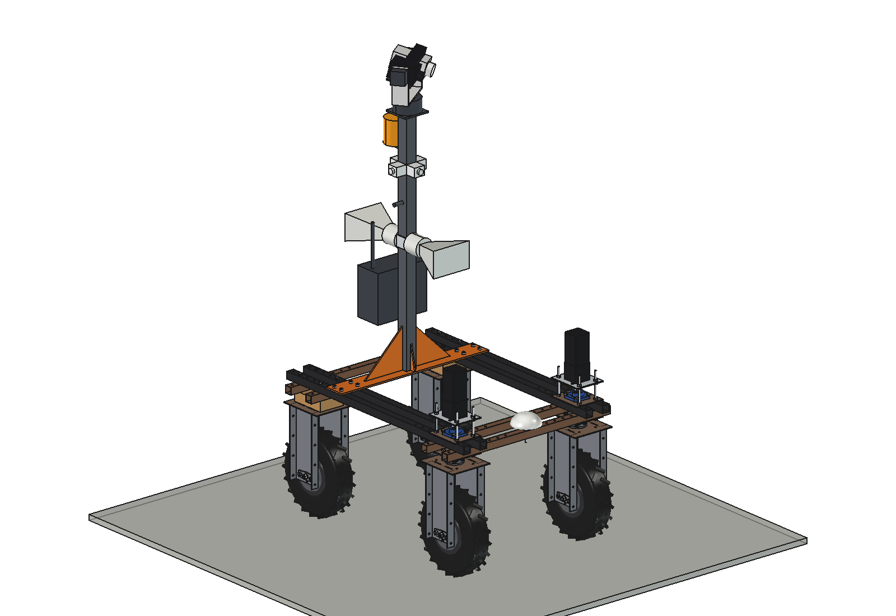
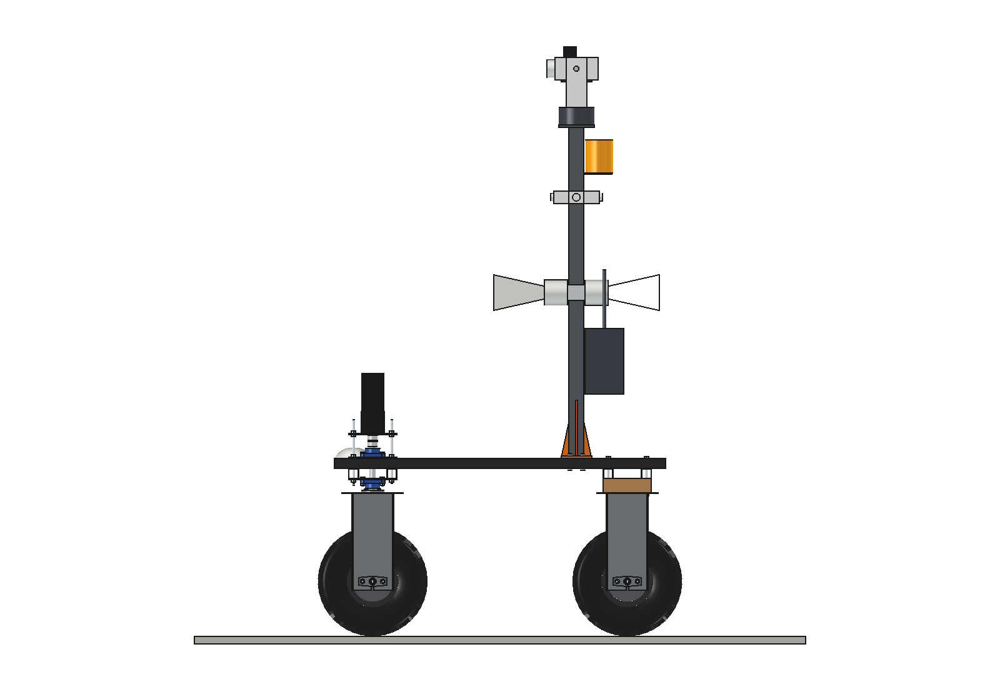
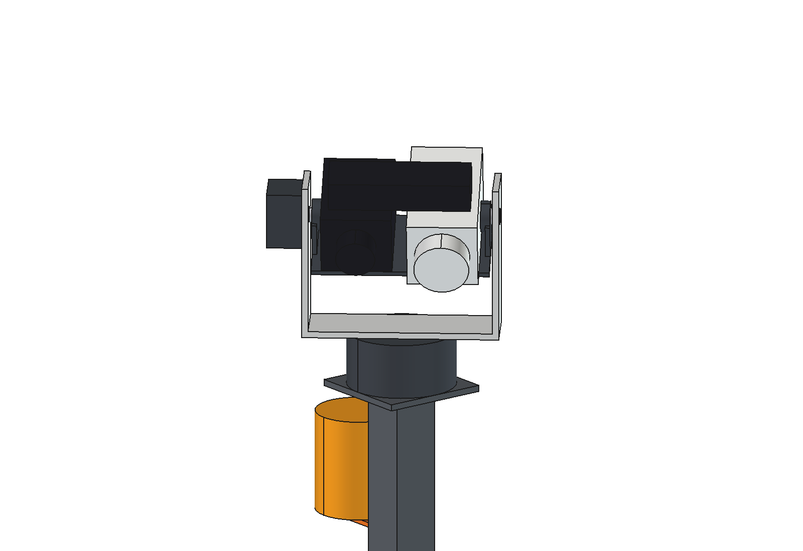
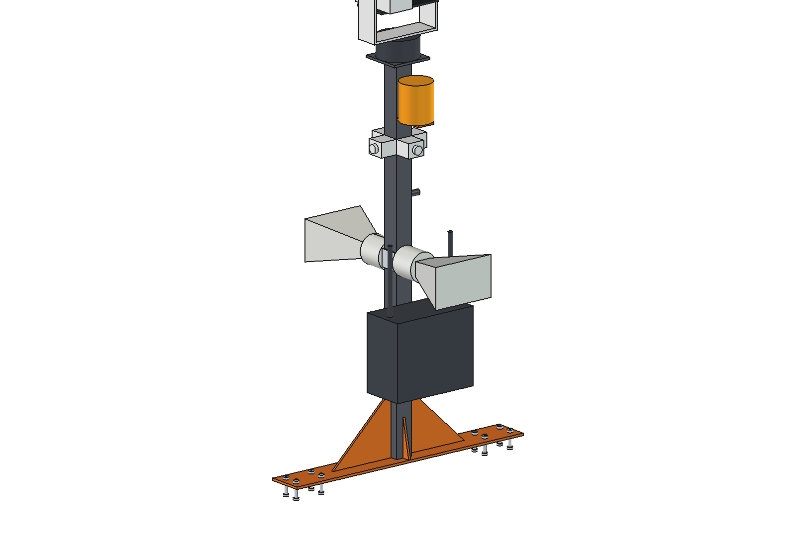

# Security patrol (simple)

A 2 m camera mast on the Bruut OpenAgbot (standard robot) that patrols the farmyard, the sheds and the field edges at
night. A pan/tilt head on top carries a 4 MP 30x zoom day/night camera, a 640 x 512 thermal camera and an 850 nm IR
illuminator; 4 fixed wide-angle cameras lower on the mast watch all round for motion. Two horn speakers (the horn of
the [speech speaker](../../speaker/simple/), imported) warn intruders, an amber beacon shows the robot is on duty and a
microphone listens. The robot drives a set route, stops at viewpoints for a 360 degree thermal sweep and sends the
farmer an alert with a clip when it sees a person or vehicle where none should be, or an animal out of its pen.

  

| Side | Pan/tilt head | Mast from behind |
| --- | --- | --- |
|  |  |  |

## Build

- Base plate 8 mm, 900 x 120, across the 4 upper beams behind the robot centre (8 x M10 in the grid holes
  y -325 / -275, x +-325 / +-425); mast 60 x 60 x 3 welded on with 4 gussets, up to z 2000, top flange 140 x 140.
- Pan unit O140 on the flange; aluminium U-yoke (sub-Part `Pan`, turns about z) with the tilt motor; camera bracket
  on 2 stub axles (sub-Part `Tilt`, turns about x, -30..+30 degrees) with the zoom camera (left), the thermal camera
  (right) and the IR illuminator on top. Tilt axis at z 2230.
- 4 fixed cameras (2 MP, 100 degrees) on the mast faces at z 1700; 2 horns on a clamp band at z 1350 (front and
  rear); beacon on a bracket behind the mast; microphone on the right face; IP65 box (video recorder, LTE router,
  PoE switch) with 2 LTE antennas on the back of the mast at z 950.

Mass ~38 kg, centre of gravity at z 1356 (y -314). Size 900 x 650 x 1662 mm above the beams (top z 2315).

## Key figures (`scp_calc.report()`)

| | |
| --- | --- |
| Thermal camera (17.5 degrees, 0.48 mrad) | person: detect ~780 m, recognise ~195 m, identify ~98 m; cow: detect ~1.5 km |
| Zoom camera | identify (250 px/m) ~10 m wide, ~290 m tele (daylight); at night limited by the IR illuminator (~60 m) |
| Fixed cameras | detect (25 px/m) ~32 m all round, 40 degrees overlap |
| 360 degree thermal sweep | 23 frames, ~14 s per viewpoint |
| Route 2 km at 0.8 m/s, a sweep every 80 m | ~47 min per round, ~154 Wh: ~12 rounds (~9.7 h) per charge; parked on watch ~22 h |
| Wind 20 m/s from the side | 80 N, 73 Nm at the mast foot (6 N/mm2), tipping only above ~48 m/s |
| Axle loads | 198 kg total, 102 / 96 kg front / rear; centre of gravity z 700, side tilt limit 28 degrees |
| Checks | `check_interference()` [], `check_holes()` {}, `check_poses()` {} (8 pan x 3 tilt), `check_steering()` {} |

## Estimated, not measured

Camera, pan/tilt, beacon and box masses (datasheet class), IR illuminator range 60 m, Johnson critical dimensions
(person 0.75 m), settle time 0.6 s per sweep frame, sensor power (86 W), rolling resistance 0.06, drag coefficient
1.2. Robot: mass 160 kg and its centre of gravity (see the robot README). Not modelled: cables, the robot computer and
the alert software.

## Files

`scp_params.py` (dimensions, sensors, route), `scp_parts.py` (plate, mast, gussets, pan/tilt head, fixed cameras,
horns via `spk_parts.horn`, beacon, box), `build_scp.py` (model, `check_interference/holes/poses/steering`,
`mass_properties`, `render_all()`, STEP), `scp_calc.py` (ranges, sweep, patrol energy, wind, axle loads),
`run_in_freecad.py`, `Security_Patrol.FCStd` / `.step`, `previews/`. See [RATIONALE.md](RATIONALE.md).
