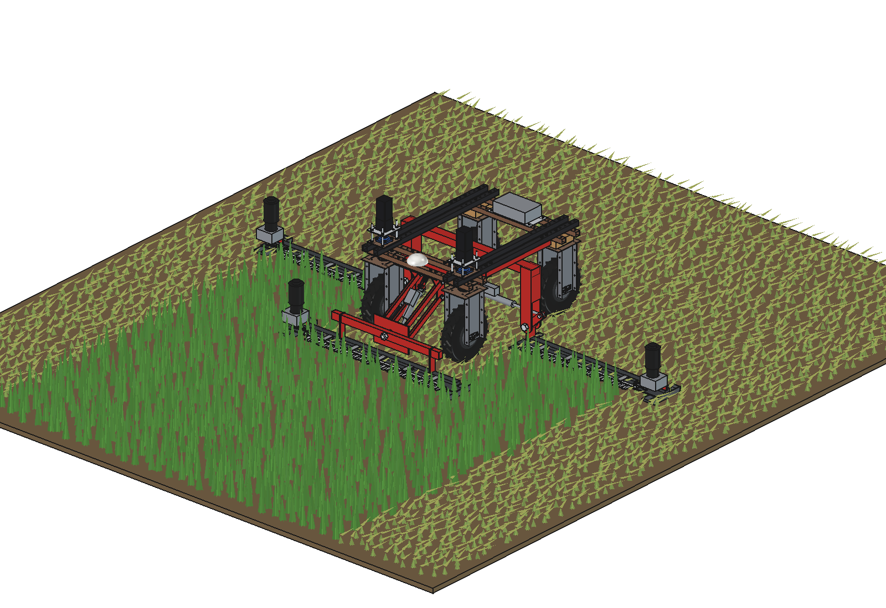
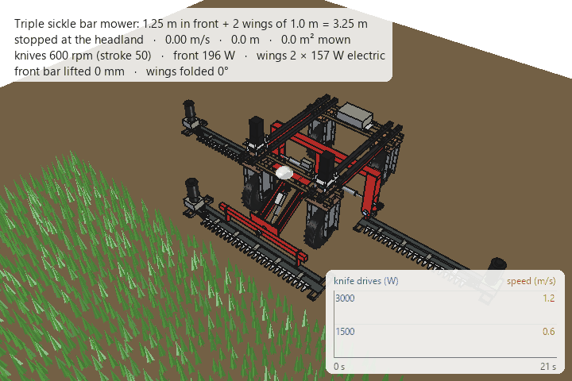

# Sickle bar mower for the Bruut

Mows grass and topping plants with **cutter bars** instead of rotating blades: a clean cut at low power, the grass
left lying in a swath to dry. The robot keeps driving through the field; a bar follows the ground on its shoes.

| | Variant | Contents |
| --- | --- | --- |
| [Triple](triple/README.md) | `triple/` | FreeCAD model: 3 double-knife bars, 1.25 m in front and 2 × 1.0 m wings in the middle of the frame, 3.25 m working width; front bar on a parallel linkage with float link and roll pin, wings on hinges that fold up for transport; calculations, animation (mowing, then folding), parts list (≈ €3,200); why: [RATIONALE](triple/RATIONALE.md) |

## Concept

1. **Double knife:** two knives move against each other, driven by a gearbox with two cranks 180° apart. No guards
   (fingers), half the power of a finger bar, and the inertia forces of the knives cancel.
2. **One module:** bar, knives, gearbox and a 48 V BLDC motor; the same for every bar, only the length differs.
3. **Front bar** on a parallel linkage with an actuator and a float link (as the weed picker), plus a roll pin so it
   also follows the ground across.
4. **Wings** in the middle of the frame, on a mid frame bolted under the top beams; each folds up about a hinge at
   its inner shoe, with an actuator whose anchor slides in a slot (float).

## Requirements

| | |
| --- | --- |
| Cut width | 1.25 m in front, 2 × 1.0 m in the middle of the frame, 3.25 m in total |
| Cut height | low (≈ 60 mm, on shoes), adjustable |
| Working | keeps driving through the field, follows the ground; folds for transport |
| Robot | 48 V battery, mounted on the 50 mm hole grid, no changes to the robot, clear of the steering |
| Cost / making | bought drive parts, laser-cut plates, standard profiles |

## Open questions

- Overlap between the front strip and the wing strips (now exactly 3.25 m without overlap).
- Swath handling: the cut grass is left lying; swath boards to keep the wheel tracks free.
- Stone and molehill protection: a breakaway for the wings.
- Cutting power and knife wear measured on a real bar.
