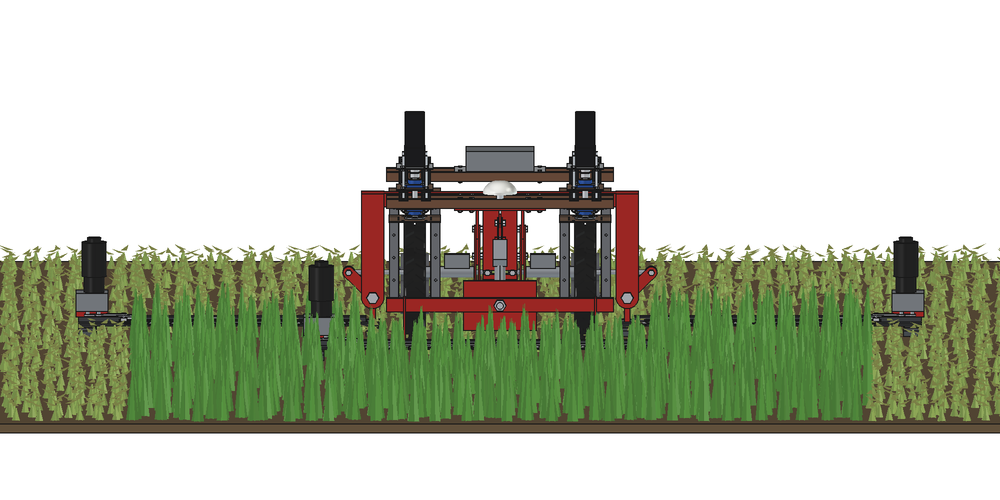
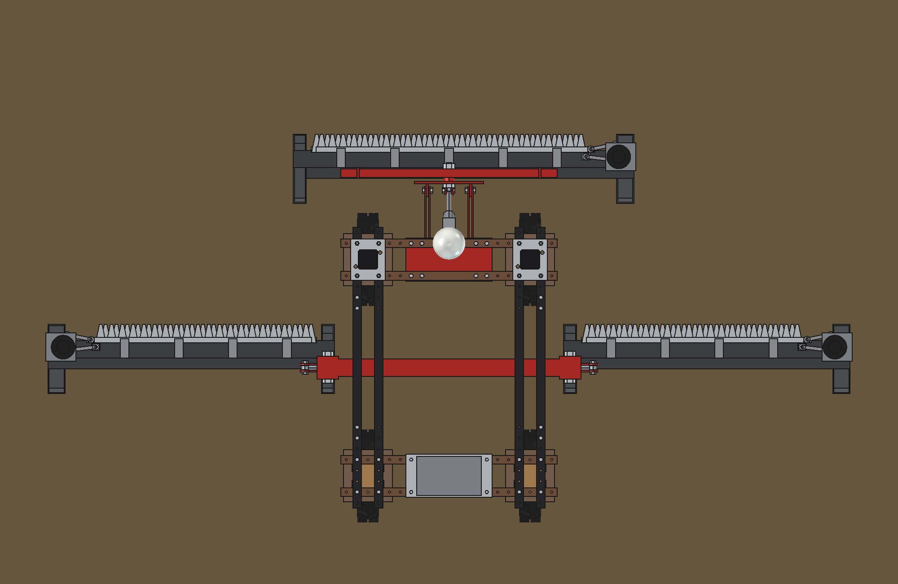
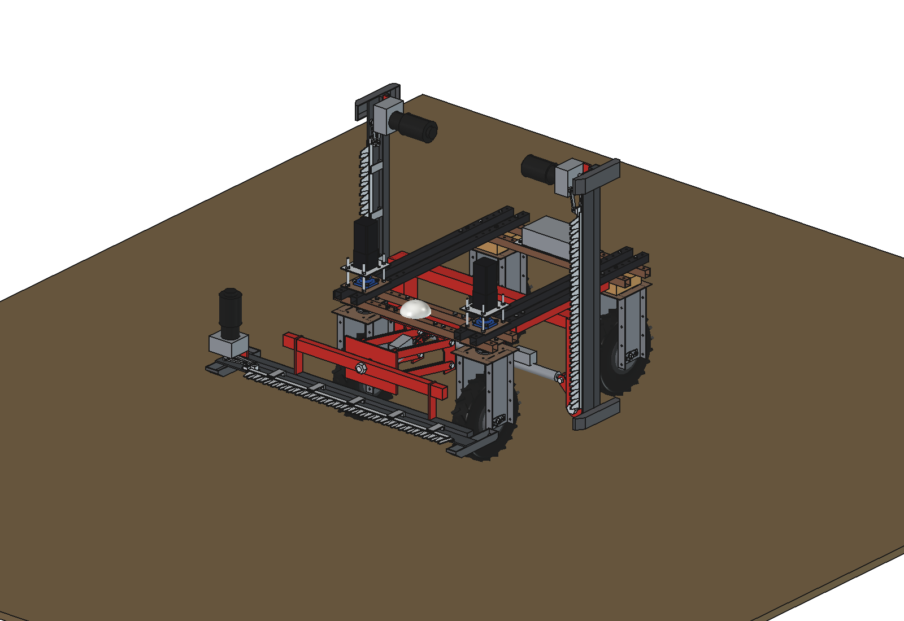
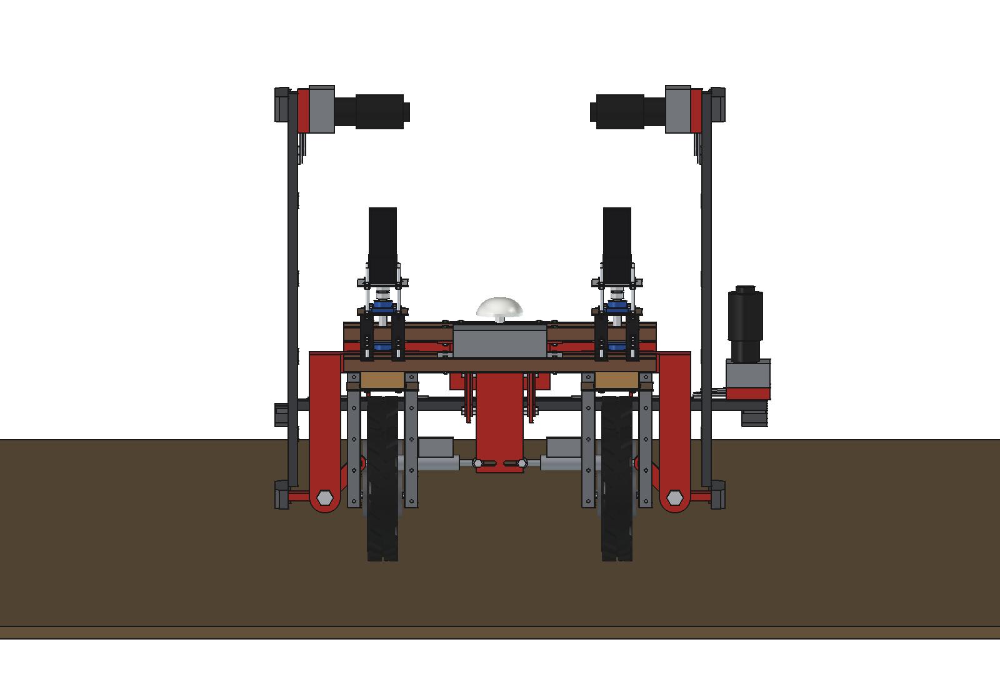
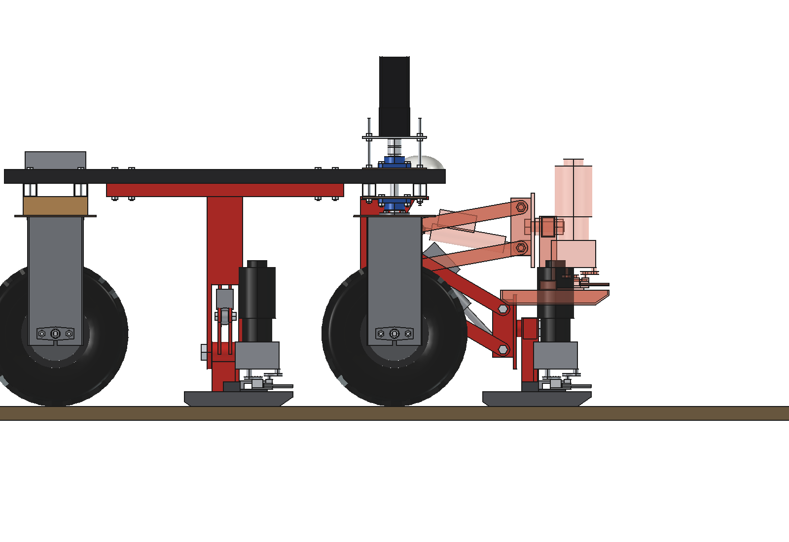
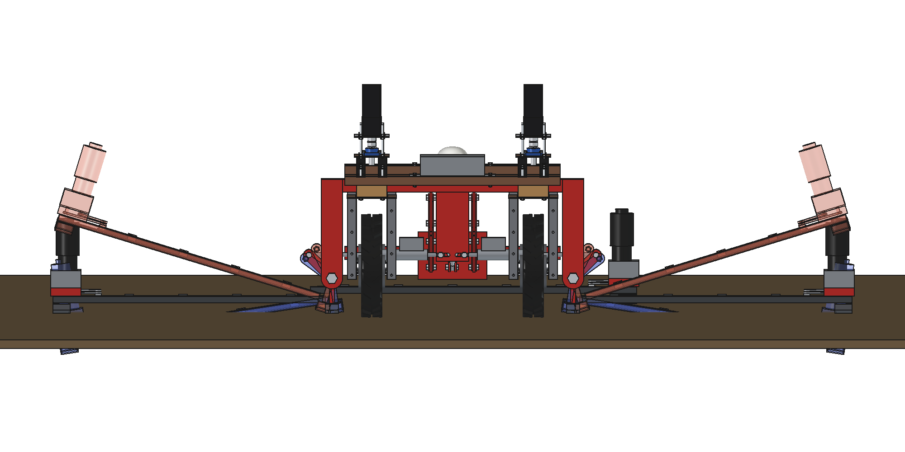
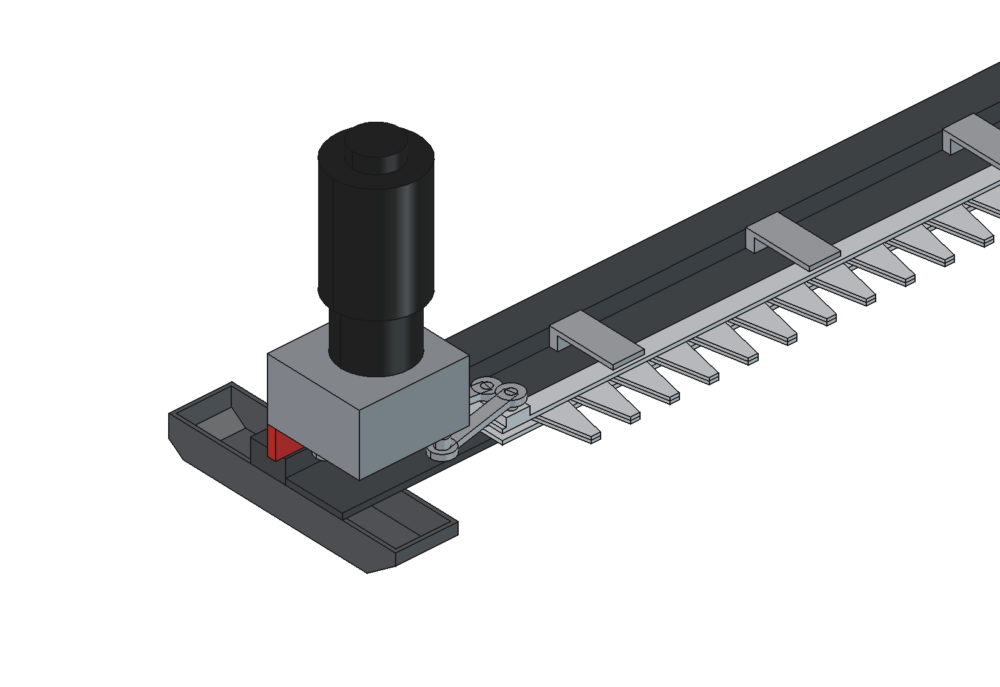
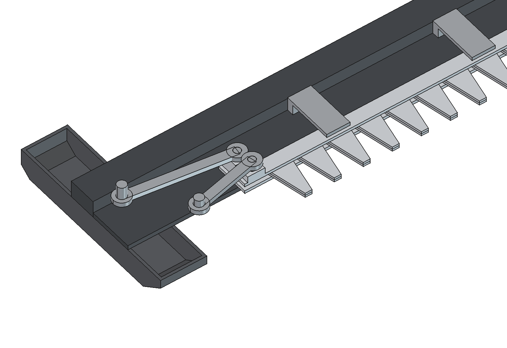
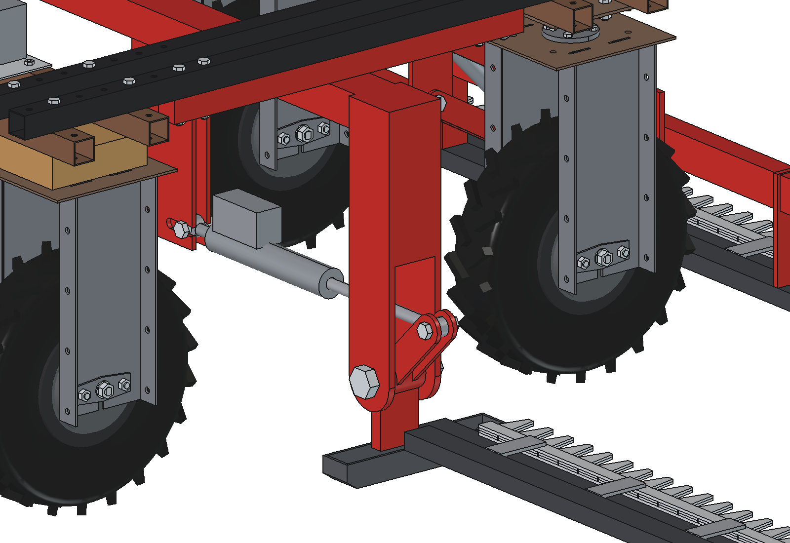
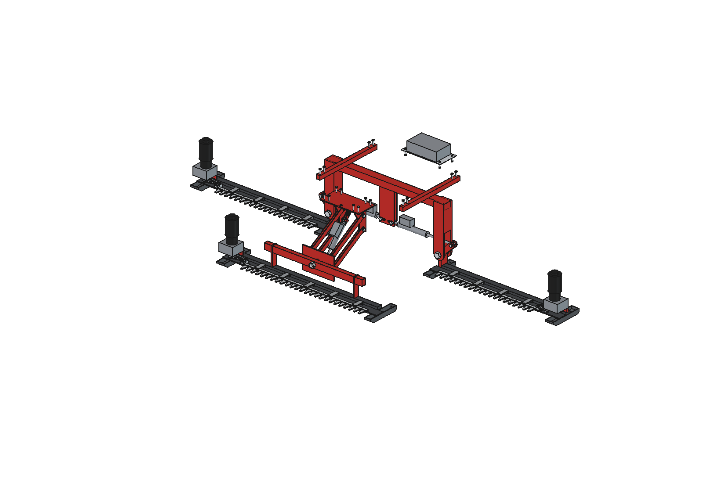

# Triple sickle bar mower: FreeCAD model

Three **double-knife cutter bars** on the standard Bruut OpenAgbot: one of **1.25 m in front** of the robot and two
wings of **1.0 m left and right in the middle of the frame**, between the front and rear wheels. Together they mow a
strip of **3.25 m** in one pass.

- **Clean cut at low power:** two knives move against each other (stroke 50, 600 rpm), no guards, no rotating
  blades. ≈ 0.55 kW per metre at 1 m/s in a dense sward, against 3–5 kW/m for a rotary mower. The grass is left
  lying in a flat swath to dry.
- **Follows the ground:** the front bar hangs on a parallel linkage with a float link and a roll pin, the wings on a
  hinge with a slotted actuator anchor. All three bars run on their shoes (cut height 60 mm).
- **Folds for transport:** an actuator per wing folds it up to vertical in 11 s and the front actuator lifts the front
  bar 300 mm: 1.59 m wide (the front bar sets it), 1.47 m high.
- **One module, three times:** the same bar, knives, gearbox and 48 V BLDC motor (1000 W) for all three, only the
  length differs. About **€3,200** in parts.

Why it is designed this way is explained in [RATIONALE.md](RATIONALE.md); the concept is in the
[concept README](../README.md).


*The robot drives into the grass at 1 m/s; first the front bar cuts, then the wings. At the headland it stops, the
front actuator lifts the front bar and both wings fold up. Panel: electric power of the three knife drives and the
driving speed. The knife motion is shown slowed down (the real 600 rpm would alias).*

| | | |
| --- | --- | --- |
|  |  |  |
| from the front: 1.25 + 2 × 1.0 m, drives at the outer ends | from above: front bar at y 1020, wings at y 140 | transport: front bar up 300 mm, wings vertical |
|  |  |  |
| transport from behind: 1.59 m wide | side: front bar in work and lifted 300 (transparent) | wings float −8.7° … +17° (transparent) |
|  |  |  |
| drive end of a wing: gearbox, motor, outer shoe | gearbox hidden: 2 cranks 180° apart, con-rods to the knife heads | mid frame under the top beams, hanger, hinge, wing actuator |
|  | | |
| the mower without the robot | | |

## Key figures

From the model (`build_sbm.mass_properties`, `check_poses`, `clearance`, `size`), `sbm_calc.report()` and
`animate_sbm.summary()`. Robot 161.5 kg (agbot comparison, not weighed).

| | |
| --- | --- |
| Working width | 3250 mm: front x −625 … 625 (1.25 m), wings x ± 625 … 1625 (1.0 m each), no overlap |
| Knives | double knife, sections 50 mm pitch, stroke 50, 600 rpm = 1200 strokes/min; knife speed 1.0 m/s mean, 1.57 max; 50 mm of travel per stroke at 1 m/s |
| Cut height | 60 mm (shoes), 40–90 by moving the shoe soles |
| Power | at 1 m/s in 3 t DM/ha: front 650 W at the crank (motor at 72 %), each wing 520 W (58 %); 2.2 kW electric for mowing, 3.4 kW with driving (71 A at 48 V) |
| Speed | up to 1.5 m/s in 1–2 t DM/ha, 1.3 m/s in 3 t, 1.0 m/s in 4 t (front motor at 90 %) |
| Capacity | 1.0 ha/h at 1 m/s (85 % field efficiency); 0.6 h per charge of the 2.4 kWh battery → ≈ 0.6 ha |
| Knife forces | each knife 260–345 N peak inertia; the two knives cancel to < 20 N on the gearbox (a single knife would give 550–670 N) |
| Front bar | float −40 … +141 mm on the float link, roll ± 6°; lifted 300 mm in 7.6 s; actuator 1.6–1.7 kN of 4 kN |
| Wings | fold 0–90° in 10.6 s (11.4 s with the slot), actuator 2.6 kN max of 4 kN; float −8.7° … +17° |
| Mass | 210 kg: front bar with head frame 52 (bar 43), front mount 10.5, links 6.9, front actuator 3.8, mid frame 48.6, wings 2 × 37, wing actuators 2 × 4.4, controller box 5.5 |
| On the ground | in work the bars rest on their shoes (front 512 N, each wing 362 N): the robot carries 85 kg of the mower |
| Axle loads | work 246 kg (front 147, rear 98); transport 372 kg (front 267 = 72 %, rear 104); spec 500 kg per axle |
| Draft | ≈ 690 N (cutting 195, shoe friction 495) |
| Overall size | work 3730 × 1430 × 705 mm (x × y × z), y −350 … 1080; transport 1585 × 1483 mm, 1465 mm high |
| Interference | none, in work (4 crank angles), front float down / up + rolled, front lifted, wings floated down / up, wings at 45°, transport |
| Clearance | ≥ 55 mm from the wheel units, front wheels steered ± 30°, in work and in transport |

## How it works

1. **Cutting:** each bar has two knives on top of each other: the lower one slides on the flat bar, the upper one is
   held down by hold-down clips. A gearbox at the end of the bar has two output cranks 180° apart; a con-rod per
   knife drives it. The sections of both knives move against each other and shear the grass between them, like a
   hedge trimmer. Because the knives move in opposite directions their inertia forces cancel: the bar hardly shakes.
2. **Front bar:** hangs on a parallel linkage under the front beams (the mount of the weed picker). The bar frame
   turns on a roll pin (M30 along y) in the head frame, so the bar follows the ground across. The actuator sits on
   the diagonal of the parallelogram with a slotted float link: in work it is set 40 mm "below the ground", so the
   bar rests on its shoes and can drop 40 mm into a dip or ride up 141 mm over a hump.
3. **Wings:** a mid frame bolted under the outer top beams (4 × M10 per side in the existing grid holes) carries a
   cross tube at y 0 with a hanger at each end. The wing hangs on a hinge pin (M30 along y) at its inner shoe. A lever
   on the hinge and an actuator from a post in the middle lift it; the actuator's anchor pin sits in a slot, so the
   wing floats with the ground (−8.7° … +17°) while working.
4. **Headland and transport:** for a turn the front actuator lifts the bar and the wings are lifted a few degrees
   (or folded completely); for transport the wings stand vertical next to the robot and the front bar is 300 mm up.

The animation and the report use the same numbers: idle power and cutting energy from `sbm_calc`, the actuator
lengths and speeds from `sbm_params`.

## Parts list

Quantities for one mower. Prices are rough estimates (2026) to give an idea of the total, not quotes.

| Qty | Part | Specification | Where to get it | Price (est.) |
| --- | --- | --- | --- | --- |
| 3 | BLDC motor + driver | 48 V, 1000 W, 3000 rpm, flange ≈ 110, with driver 48 V / 30 A (speed control, brake, current output) | e-mobility / automation shops | €600 |
| 3 | Planetary gearbox | 5:1, input for the motor flange, output shaft into the crank gearbox | automation shops | €240 |
| 3 | Crank gearbox | 2 spur gears 1:1 in a housing ≈ 140 × 130 × 80, 2 vertical shafts with eccentric pins (e = 25) 180° apart; make it (bearings, gears, shafts) or buy a double-knife drive | machine shop / mower parts | €750 |
| 1 set | Double knives | upper + lower knife for 1.25 m and 2 × 1.0 m: sections 50 mm pitch (4 mm, serrated) riveted to a knife back 25 × 5, knife heads with a pin hole | mower parts (double-knife bars for two-wheel tractors) | €400 |
| 3 | Linear actuator | front: 24 V, 4000 N, 150 mm stroke, 300 pin to pin closed; wings: 24 V, 4000 N, 250 mm stroke, ≈ 375 closed; eyes for M16, IP65+ | automation shops | €370 |
| | Steel S235 / S355 | flat 80 × 8 (4.8 m), RHS 50 × 30 × 3 (4.6 m), RHS 60 × 40 × 3 (1 m), RHS 80 × 60 × 4 (1.22 m), RHS 40 × 40 × 3 (1.4 m); laser cut: shoes 5 (pressed), clips 6, mount plate 8, lugs 10, head frame 10, arms 10, hanger plates 12, post plates 8, levers 8, 8 link bars 40 × 6, 2 float bars 30 × 6 | steel merchant, laser cutter | €550 |
| | Bolts and pins | 16 × M10 (8 rail, 8 mount), 3 × M30 (roll pin, 2 hinges), M16 pins with lock nuts, M8 for the clips | hardware store | €70 |
| 1 | Controller box | IP66 ≈ 300 × 180 × 90, the 3 motor drivers, DC-DC 48/24 V, 3 reversing relays for the actuators, fuses, cable glands, cable | electronics shops | €140 |
| | Paint or galvanizing | welded parts | | €80 |
| | | | **total, roughly** | **≈ €3,200** |

## Making it

- **Bars:** weld the RHS 50 × 30 behind the flat bar 80 × 8 (bottom flush) and the shoes under both ends. Lay the
  lower knife on the flat bar, the upper knife on top, then bolt the hold-down clips over them (they must slide with
  0.2–0.5 mm play). The drive plate on the stiffener carries the gearbox; set the con-rods with the cranks at 90° so
  both knives are in the middle of their stroke.
- **Front:** bolt the mount plate under the two front lower beams (8 × M10, x ± 125 / ± 175, hole in the middle for the
  GNSS stud). Weld the head frame (plate, 2 link lugs, double actuator lug) and the bar frame (cross tube + 2 arms
  welded on the stiffener of the front bar). Put the roll pin through the head plate, the spacer and the cross tube.
- **Mid frame:** weld rails, cross tube, hanger plates with their webs and the post. Bolt it from the top through the
  outer top beams (4 × M10 per side, y ± 275 / ± 325). Hinge pins M30 through the hangers and the hinge tubes.
- **Robot:** nothing to drill. Controller box on the rear lower beams (M8 at x ± 175), cables along the frame.

## Settings

| What | How |
| --- | --- |
| Cut height | shoe soles in another hole (40–90 mm); the front bar and the wings rest on their shoes |
| Knife speed | motor speed (BLDC driver), standard 3000 rpm = 600 rpm at the crank; lower in thin grass to save energy |
| Front float | actuator in the work setting (419 mm pin to pin): bar can drop 40 mm, rise 141 mm |
| Wing float | actuator in the work setting (611 mm): anchor pin 15 mm in from the end of its slot |
| Headland | front up 150 mm (≈ 4 s), wings up 15–20° (≈ 3 s), turn, back down |
| Transport | front up 300 mm, wings 90° (≈ 11 s) |

## Files

| File | Contents |
| --- | --- |
| `Sickle_Bar_Mower.FCStd`, `.step` | the model (generated, work position, robot hidden in the FCStd) |
| `sbm_params.py` | all dimensions, including the robot interface |
| `sbm_parts.py` | one function per part; the cutter bar module in its own frame (`place()` maps it to the robot) |
| `build_sbm.py` | model tree, poses (`set_front`, `set_wing`, `set_knives`, `set_transport`), interference over all poses, clearance, mass, images |
| `sbm_calc.py` | knives, power, speed limit, capacity, shoe loads, draft, axle loads, actuator forces, stresses |
| `sbm_grass.py` | grass field for the renders and the animation |
| `animate_sbm.py` | animation on the robot: `build()`, `play()`, `stop()`, `summary()`, `render_all(folder)` |
| `make_gif_sbm.py` | frames to GIF with caption and power / speed panel |
| `run_in_freecad.py` | macro: reload, build, print the key figures |
| `previews/` | images and the GIF |

## Use

In FreeCAD (1.1), Python console:

```python
exec(open(r"F:\veldrobot\aanbouwdelen\sickle bar mower\triple\run_in_freecad.py").read())
import build_sbm
build_sbm.check_poses()              # all poses must give []
build_sbm.set_transport(App.ActiveDocument, 0.5)   # half way to transport
build_sbm.render_all()               # previews/
```

Animation:

```python
import animate_sbm
animate_sbm.build(); animate_sbm.play()
animate_sbm.render_all(r"C:\temp\sbm_frames")
import make_gif_sbm; make_gif_sbm.main(r"C:\temp\sbm_frames", r"previews\animation_mow_fold.gif")
```

## Estimated, not measured

- Robot 161.5 kg, CG (0, 95, 543) and the 2.4 kWh battery (agbot comparison); the robot's steering stack, wooden
  blocks, hub motors and tyres as in the robot model.
- Cutting energy 400 J/m² in a dense sward (3 t DM/ha) and idle 120 W per metre of knife: from finger-bar data,
  lower for a double knife; not measured on this bar.
- Cutting resistance 60 N per metre, shoe friction μ 0.4, driving 300 W on grassland.
- Motor 1000 W / 6.5 kg with planetary, crank gearbox 4.5 kg, actuators 3.0 / 3.5 kg, controller 3.5 kg; their
  dimensions.
- Wing actuator 375 mm pin to pin closed with 250 mm stroke, 20 mm/s; front actuator 15 mm/s.
- Knife sections and knife back sizes (50 mm pitch, 4 mm, back 25 × 5) and the play between the knives.
- 1 kN backwards on a wing tip when a shoe hits something (stress check of the hangers).
