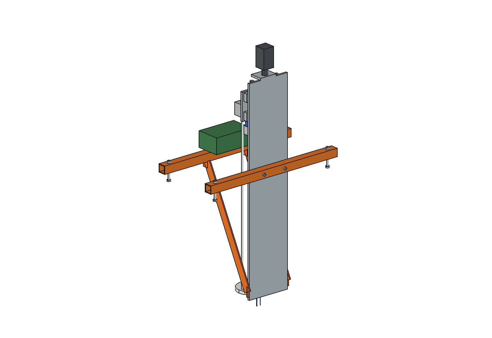
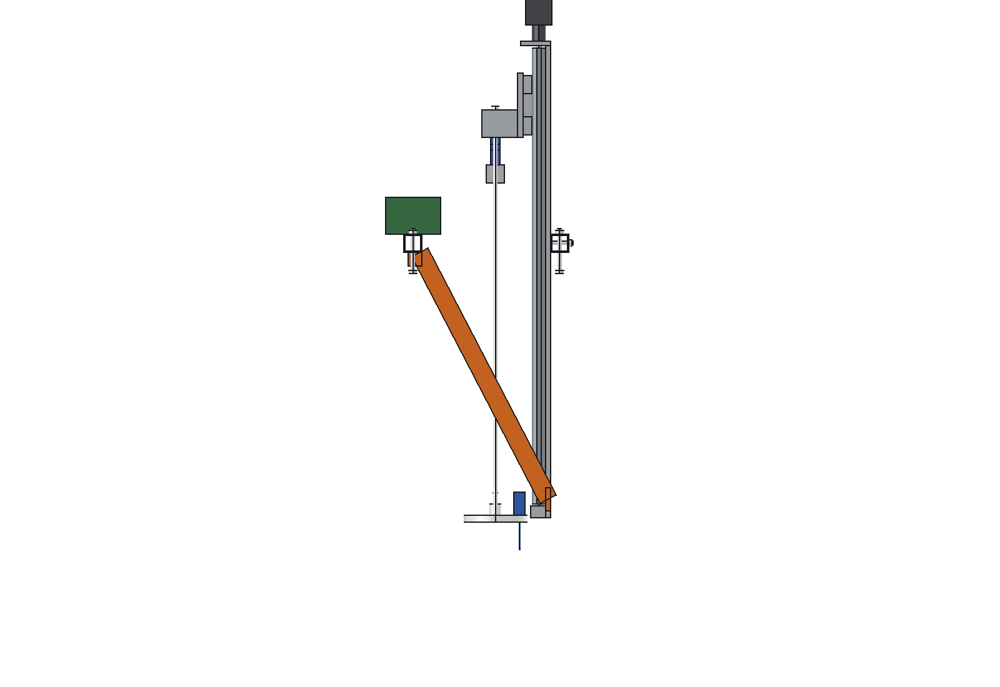
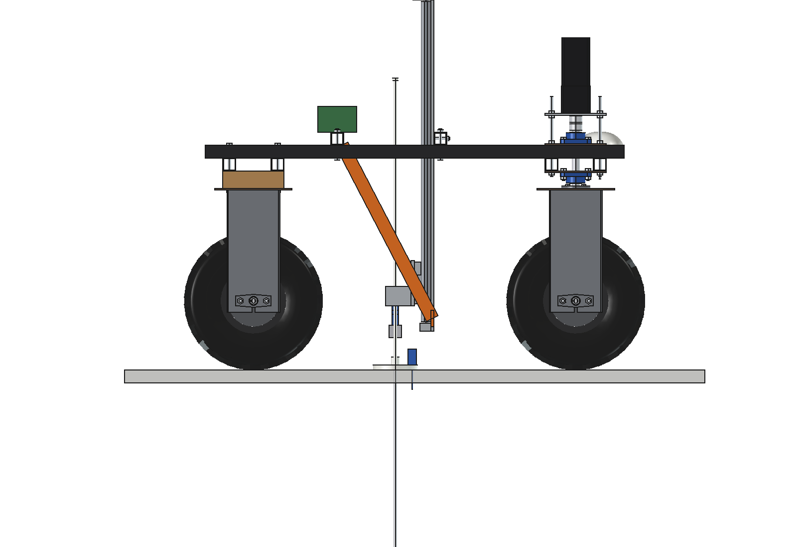
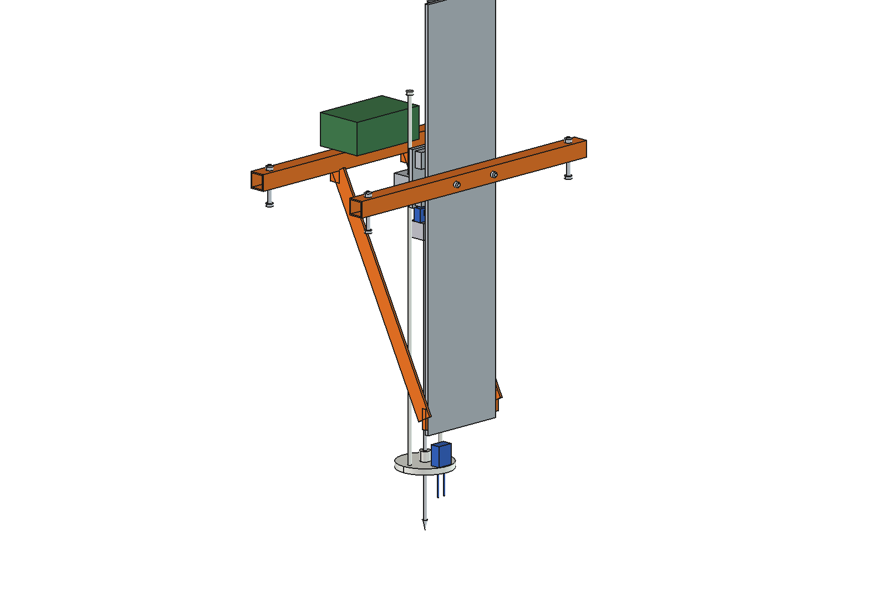
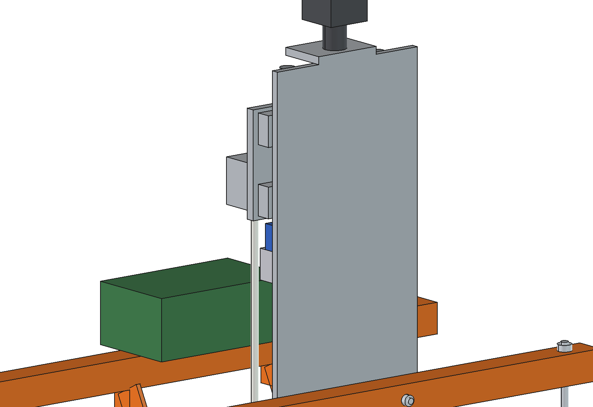
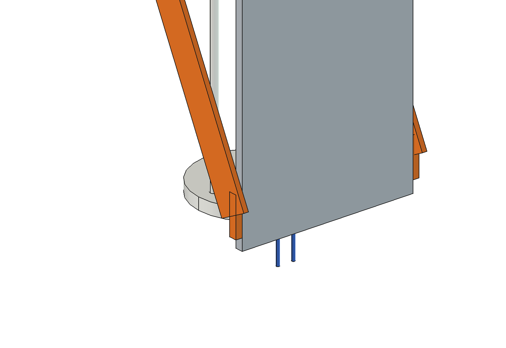

# Soil compaction meter (simple)

Automatic cone penetrometer in the middle of the Bruut OpenAgbot (standard robot). A ball-screw Z axis (as the
[soil sampler](../../soil%20sampler/simple/)) pushes a rod with a 30 degree cone into the soil at a constant 30 mm/s
down to 600 mm; a load cell reads the force, the screw the depth. A sprung foot finds the ground surface and carries a
moisture probe. Readings are logged per GNSS point: a compaction map per depth layer.

<p align="center">
  
</p>

| Side, park | Side, 600 mm deep |
| --- | --- |
|  |  |
|  |  |



## Build

- **Mount**: 2 bridges 40 x 40 x 3 on the inner upper beams (y 80 and -240, 2 x M10 each), mast plate 10 mm aluminium
  (z 120..1150) bolted to the front bridge, 2 flat stays 40 x 6 to the rear bridge, a logger box on the rear bridge.
- **Z axis**: 2 x SBR20 rails, ball screw SFU1605, NEMA23 closed loop.
- **Carriage**: plate with 4 rail blocks and the nut, holder, S-type load cell 2 kN, rod clamp, rod O9.5 x 700 with an
  ASABE small cone (30 degrees, O12.83, 1.29 cm2).
- **Foot**: PE ring O140 with a PTFE bush that guides the rod, 2 rods O10 through the holder, capacitive moisture probe.

Mass 32 kg. Size 730 x 410 x 1245 mm. No interference from park (tip 150 above the ground) to 600 mm deep; the carriage
stays on the rails over the whole travel.

## Key figures (`scm_calc.report()`)

| | |
| --- | --- |
| Push force | 1320 N (70 % of the robot weight; the screw gives 2262 N at 30 mm/s) |
| Measuring range | up to 10.2 MPa (3 MPa = 388 N) |
| Rod | 700 mm free, buckling 3.3 kN |
| Resolution | a reading every 0.4 mm, 1600 per profile |
| One profile (600 mm) | 35 s (20 s measuring) |
| Capacity | ~47 points per hour, 4 points per ha: ~12 ha per hour |
| Energy | ~2.5 Wh per point, ~750 points per battery |

Why and how these come out: see [RATIONALE.md](RATIONALE.md), including the list *Estimated, not measured*.

## Files

| File | Contents |
| --- | --- |
| `scm_params.py` | all dimensions, robot interface, cone and rod, carriage height per tip height, work parameters |
| `scm_parts.py` | one function per part, robot coordinates (moving parts in park) |
| `build_scm.py` | model tree, `set_pose(tip)`, checks (`check_interference`, `check_poses`, `travel_ok`), mass, `render_all()`, STEP |
| `scm_calc.py` | push force and range, rod buckling, resolution, time per profile, capacity and energy |
| `run_in_freecad.py` | reload, build, print the key figures |
| `Soil_Compaction_Meter.FCStd`, `Soil_Compaction_Meter.step` | generated model (robot hidden in the FCStd) |
| `previews/` | images |

## Use

```python
exec(open(r"F:\veldrobot\aanbouwdelen\soil compaction meter\simple\run_in_freecad.py").read())
import build_scm
build_scm.set_pose(-600)        # cone at full depth
build_scm.check_poses()         # must be {}
```

Cannot be fitted together with the soil sampler (same place); swapping is 4 bolts on the bridges.
