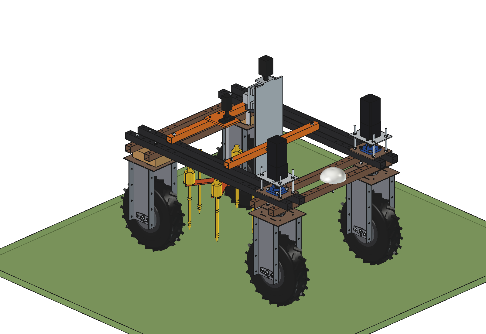
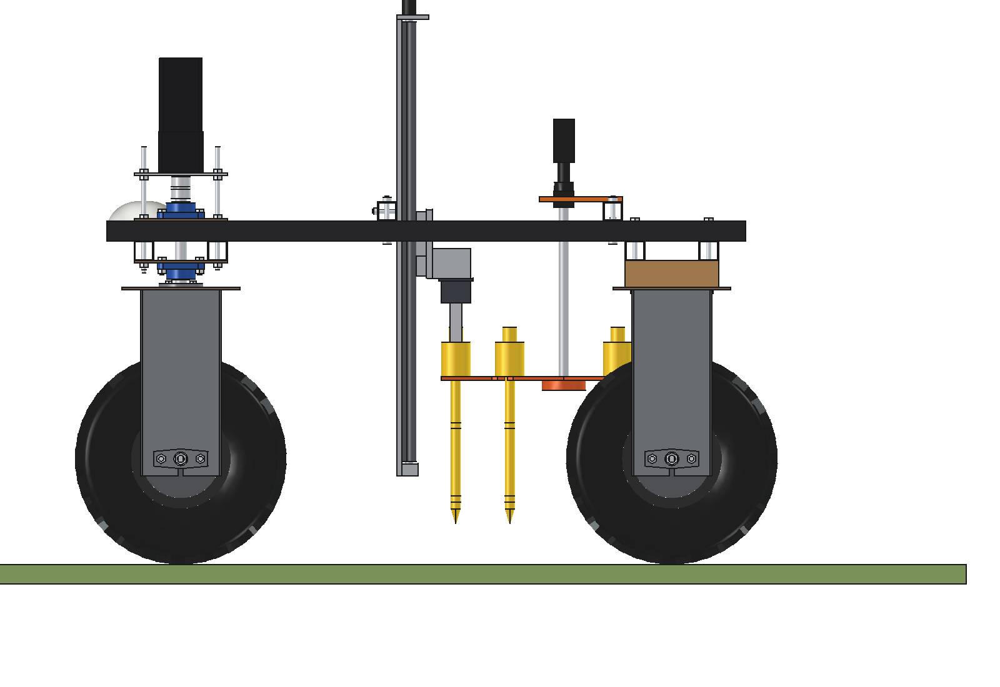
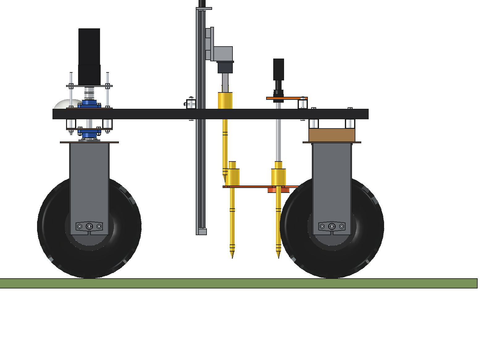
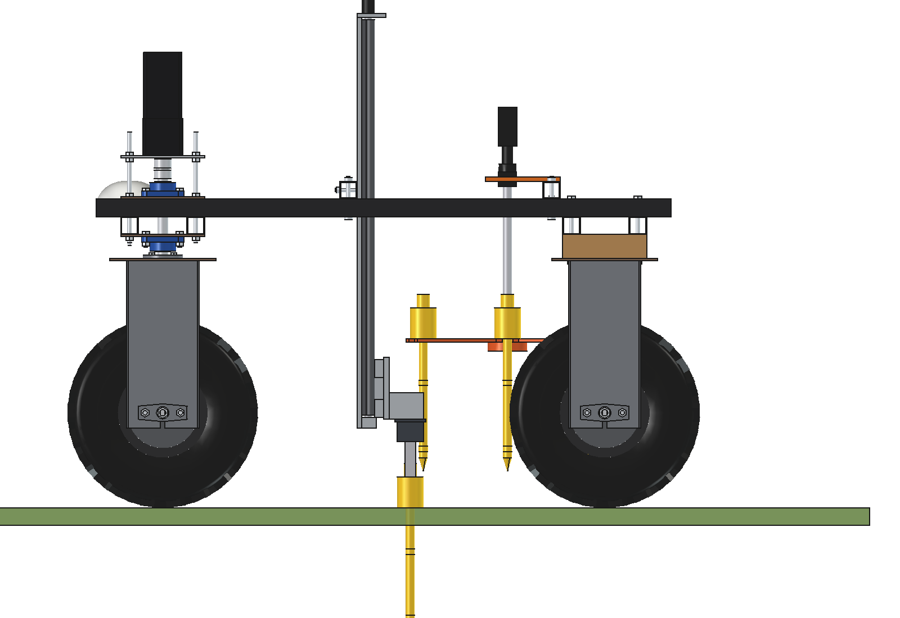
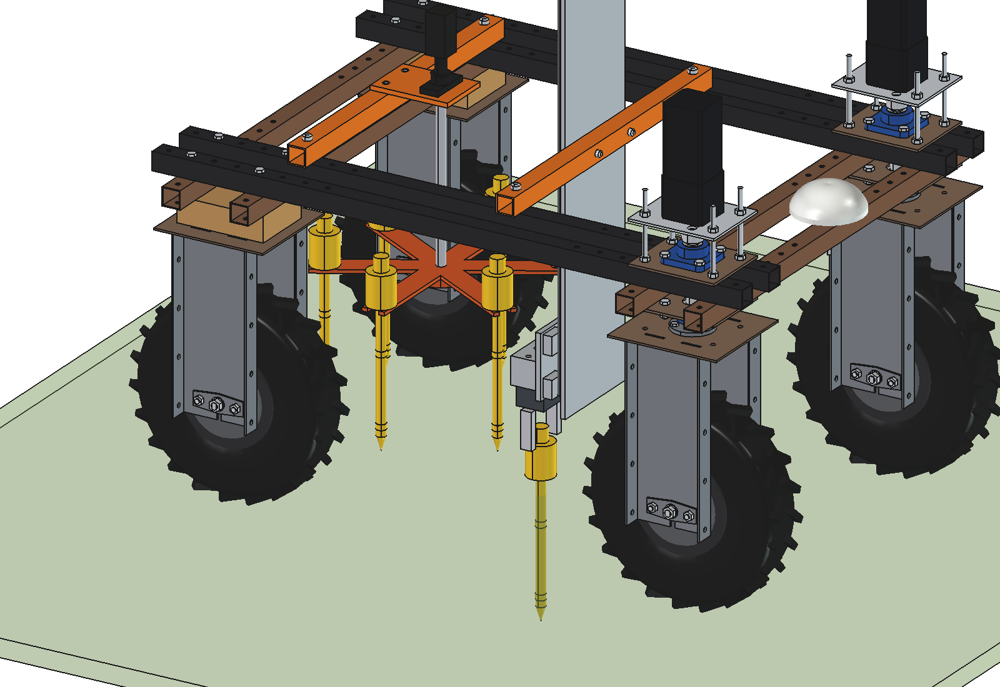
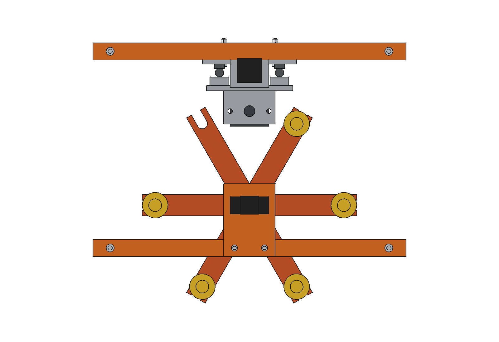
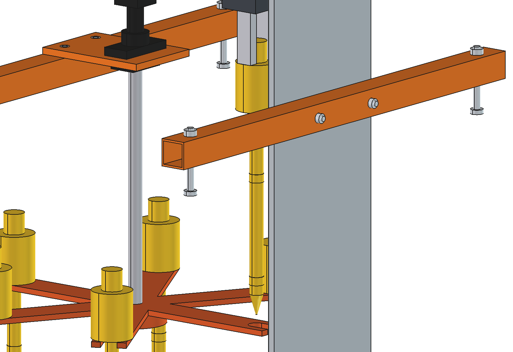

# Soil moisture sensor placer (simple)

Places wireless soil moisture sensors at set GNSS points, reads them by radio on every visit, and picks them up again
at the end of the season. Mounted in the middle of the robot, so the weight of robot and placer pushes the sensor in.

The Z axis of the [soil sampler](../../soil%20sampler/simple/README.md) is imported, not copied: 2 bridges on the upper
beams, mast plate, SBR20 rails, ball screw SFU1605 with a NEMA23 and the carriage. New:
- a **24 V parallel gripper** under the carriage (instead of the gouge), 2 jaws that hold a sensor by its top knob;
- a **magazine star**: 6 fork arms on a shaft behind the Z axis, driven by a NEMA17 with a 5:1 gearbox from a
  cantilever plate on the rear bridge; each sensor hangs in a fork by its cap;
- **6 sensors**: cap O60 x 70 (electronics, LoRa radio, 2 x AA lithium) with a knob O30, stem O20 x 300 with a cone tip
  and capacitive rings at 100 and 250 mm depth.

Cycle: the index fork (at +y) stands under the gripper -> the gripper takes the knob and lifts the whole sensor out of
the fork -> the star turns half a step, so there is a gap under the gripper -> the Z axis pushes the sensor 300 mm into
the soil at 10 mm/s -> the gripper lets go and goes up. Picking up is the reverse, with an empty fork at the index.

<p align="center">
  
</p>

| Pick (gripper on the knob) | Lifted, star turned half a step | Pushed in (cap on the ground) |
| --- | --- | --- |
|  |  |  |

| Placed | Magazine from above | Gripper |
| --- | --- | --- |
|  |  |  |

## Key figures (`smp_calc.report()`)

| | |
| --- | --- |
| Push force, O20 x 300 | moist grass ~850 N, dry grass ~1320 N, loose arable ~690 N, compact ~1160 N |
| Available | ball screw ~1470 N, 70 % of robot + placer weight ~1350 N: all four soil states OK (dry grass just) |
| Pull-out | ~380 N side friction |
| Cycle | ~64 s per sensor (Z at 75 mm/s, pushing at 10 mm/s, star 2 x 3 s) |
| Field | 6 sensors per trip = 3 ha at 2 sensors per ha; ~27 points per hour at 71 m spacing |
| Sensor battery | ~0.6 mAh per day (measure every 30 min, send 4 x per day): > 20 years by use, so ~10 years (shelf life) |
| Mass | ~36 kg incl. the 6 sensors |

Why and how these come out: see [RATIONALE.md](RATIONALE.md), including the list *Estimated, not measured*.

No animation: the cycle is shown as poses (`build_smp.POSES`) and checked with `check_poses()`.

## Files

| File | Contents |
| --- | --- |
| `smp_params.py` | sensor, gripper, magazine, carriage heights of the cycle, work figures; the Z axis via `ssa_params` |
| `smp_parts.py` | gripper and jaws, sensor, magazine star, shaft, cantilever plate and drive |
| `build_smp.py` | model tree (Z axis from ssa_parts), `set_pose(name)` over `POSES`, checks (`check_interference`, `check_poses`, `clearance`), mass, `render_all()`, STEP |
| `smp_calc.py` | push and pull-out force, cycle time, points per trip and hour, sensor battery life |
| `run_in_freecad.py` | reload, build, print the key figures |
| `Soil_Moisture_Placer.FCStd`, `Soil_Moisture_Placer.step` | generated model (robot hidden in the FCStd) |
| `previews/` | images |

## Use

```python
exec(open(r"F:\veldrobot\aanbouwdelen\soil moisture placer\simple\run_in_freecad.py").read())
import build_smp
build_smp.set_pose("plant")
build_smp.check_poses()        # every pose + star full turn (parked) and half step (sensor lifted): {}
build_smp.clearance()          # 46.8 mm, star to the rear wheel bracket
```
