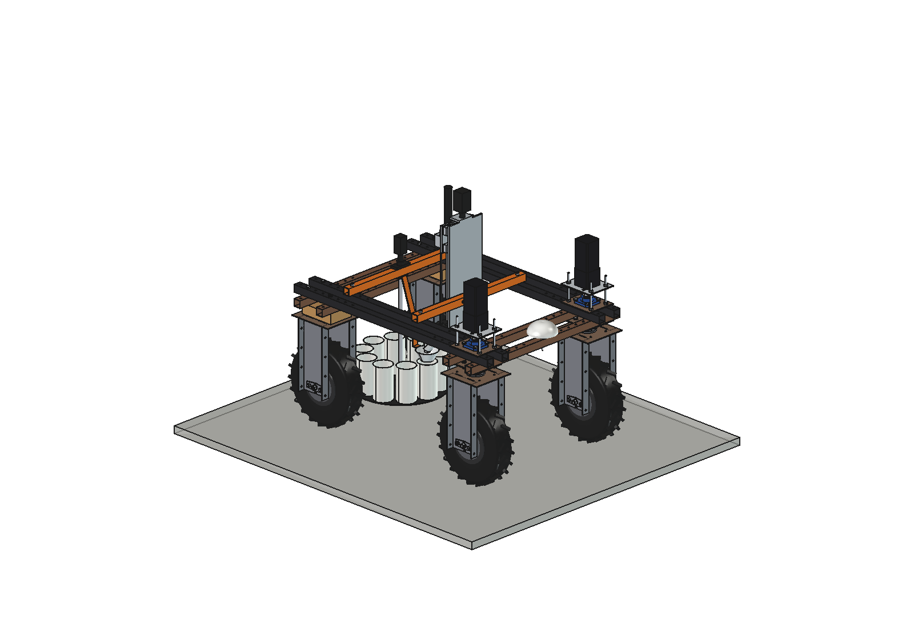
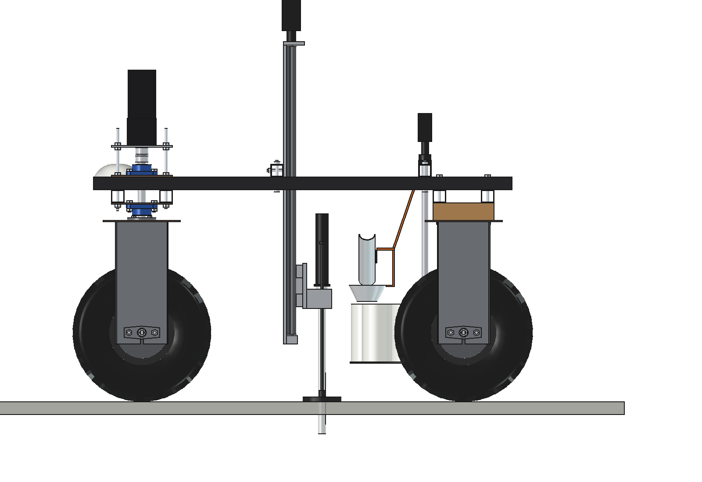
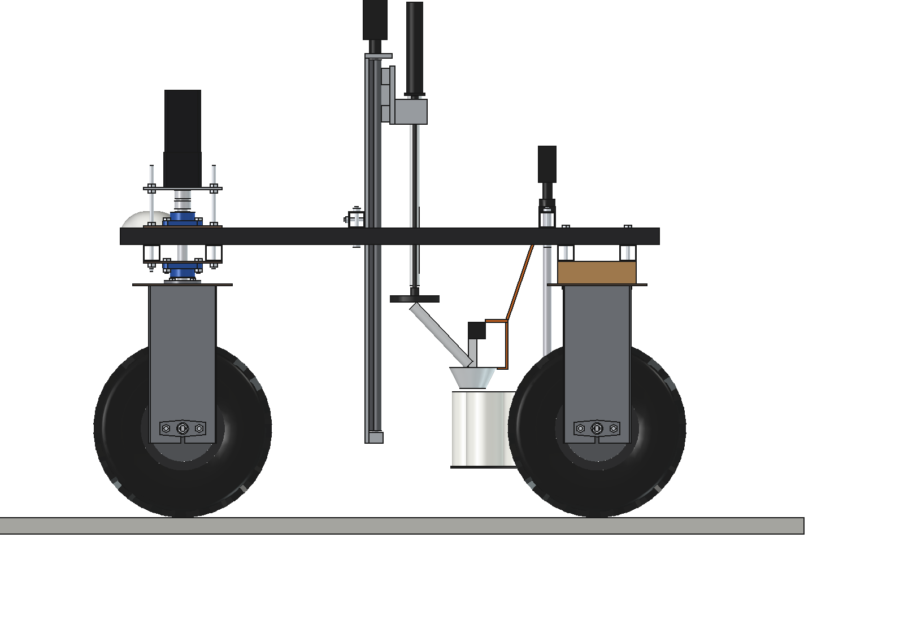
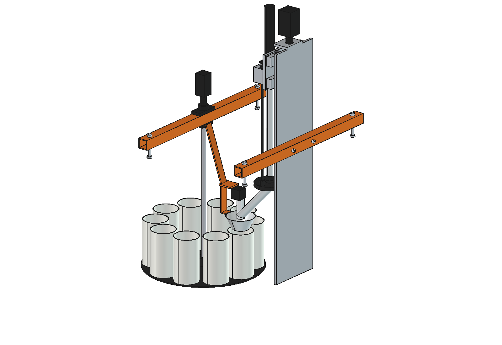
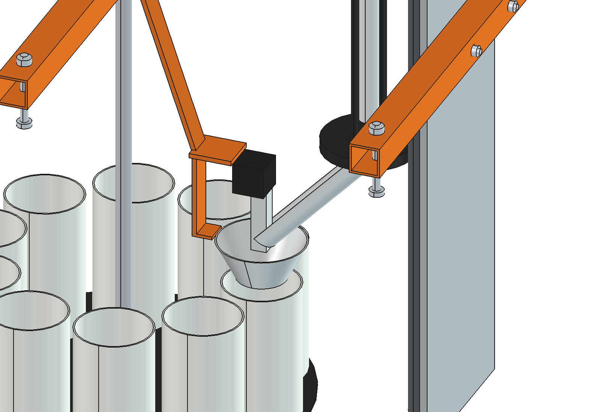

# Soil sampler (simple)

Automatic soil sampler in the middle of the Bruut OpenAgbot (standard robot). A ball-screw Z axis pushes a O25 gouge
into the soil at GPS points (0-10 cm grassland, up to 0-20 cm with this mast), a swing chute and an ejector put each
core into the cup under the funnel, and a carousel of 10 cups holds one composite sample (40 cores) per plot. The whole
robot weight is above the probe, so no anchoring is needed.

  

| Sampling (probe 100 mm deep, foot on the ground, chute aside) | Park (core ejected into the chute) |
| --- | --- |
|  |  |
|  |  |

## Cycle

1. Robot stops on the point (RTK), chute swings aside (servo).
2. Z axis goes down: the sprung foot touches the turf first (ground sensing), the gouge goes to depth.
3. Up: the foot holds the sod down while the gouge comes out, the core stays in the gouge.
4. In park the chute swings under the tip, the ejector rod pushes the core out; it slides into the funnel and the cup.
5. After 40 cores the carousel turns one cup on; the position of every core is logged.

## Build

- **Mount**: 2 bridges 40 x 40 x 3 on top of the inner upper beams (2 x M10 each), between the wheel-unit bolts.
- **Z axis**: aluminium mast plate 10 mm on the front bridge, 2 x SBR20 rails, ball screw SFU1605 with a NEMA23 on top,
  carriage with the probe holder. Travel 760 mm (tip 560 above to 200 below the ground).
- **Probe**: stainless gouge O25 (core O19) x 450, open over the lower 160 mm; ejector: 24 V actuator, stroke 150, rod
  inside the probe. Sprung PE foot O120 on 2 rods.
- **Chute and funnel**: stainless half pipe O50 on a servo, funnel O110/O60, held by a flat bar from the rear bridge.
- **Carousel**: PE turntable O470 with 10 PP cups O100 x 180 (1.3 l), on a O20 shaft from the rear bridge, NEMA17 with
  5:1 gearbox.

Mass ~33 kg, centre of gravity (0, -71, 694). Size 730 x 725 x 1135 mm; the motor stands 1255 mm above the ground.

## Key figures (`ssa_calc.report()`)

| | |
| --- | --- |
| Push force allowed (70 % of robot + sampler weight) | 1318 N |
| Needed, 0-10 cm grass moist / dry | 528 / 839 N |
| Needed, 0-20 cm compact arable | 952 N; 0-30 cm needs up to 1272 N (dry grass) and a longer mast |
| Ball screw torque at 1318 N | 1.17 Nm (NEMA23 ~1.3 Nm at 900 rpm), 75 mm/s |
| Core / sample | 28 ml per core, 1.13 l per 40 cores (88 % of a cup), ~1.5 kg dry soil |
| Time | 38 s per core (15 m between cores), 25 min per plot, 10 plots in ~4.2 h per trip |

Why and how these come out: see [RATIONALE.md](RATIONALE.md), including the list *Estimated, not measured*.

## Files

| File | Contents |
| --- | --- |
| `ssa_params.py` | all dimensions, robot interface, cycle poses, soil and work parameters |
| `ssa_parts.py` | one function per part, robot coordinates, park pose |
| `build_ssa.py` | model tree (carriage, foot, chute, carousel as sub-Parts), `set_pose(tip, chute, step)`, checks (`check_interference`, `check_holes`, `check_poses` over the cycle, `clearance`), mass, `render_all()`, STEP |
| `ssa_calc.py` | push force per soil and depth, available weight, ball screw torque and speed, core and cup volume, cycle time |
| `run_in_freecad.py` | reload, build, print the key figures |
| `Soil_Sampler.FCStd`, `Soil_Sampler.step` | generated model (robot hidden in the FCStd) |

No animation yet (simple variant): the cycle poses are checked with `check_poses()`.
