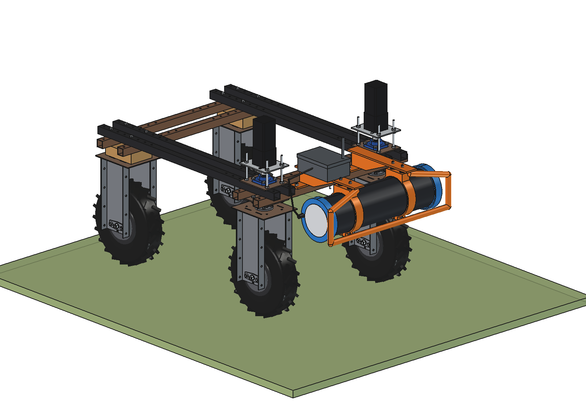
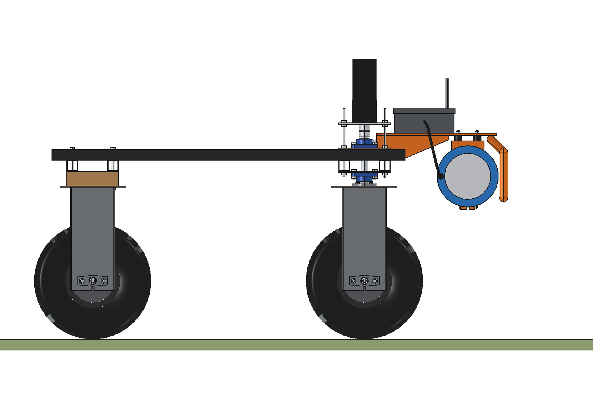
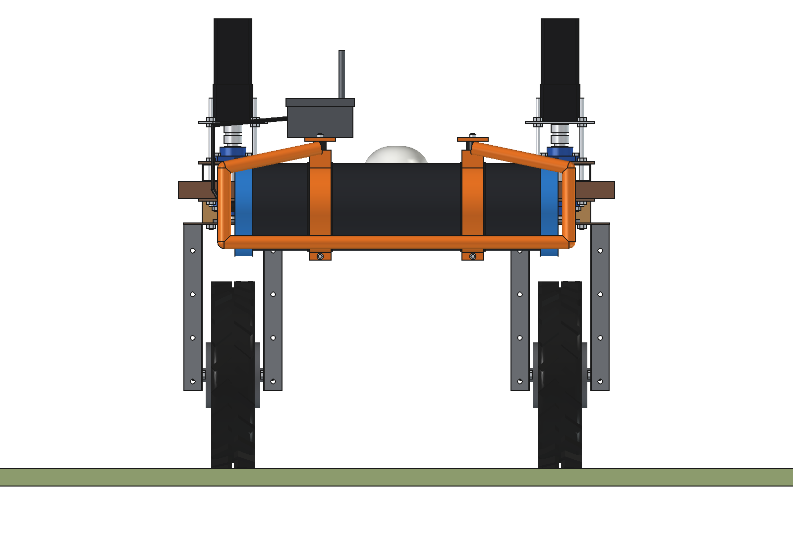
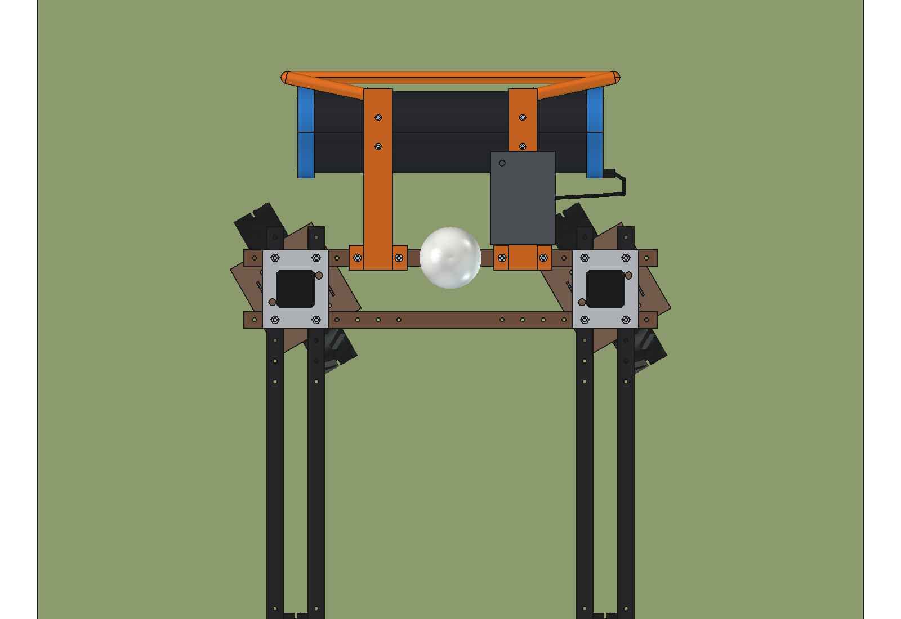
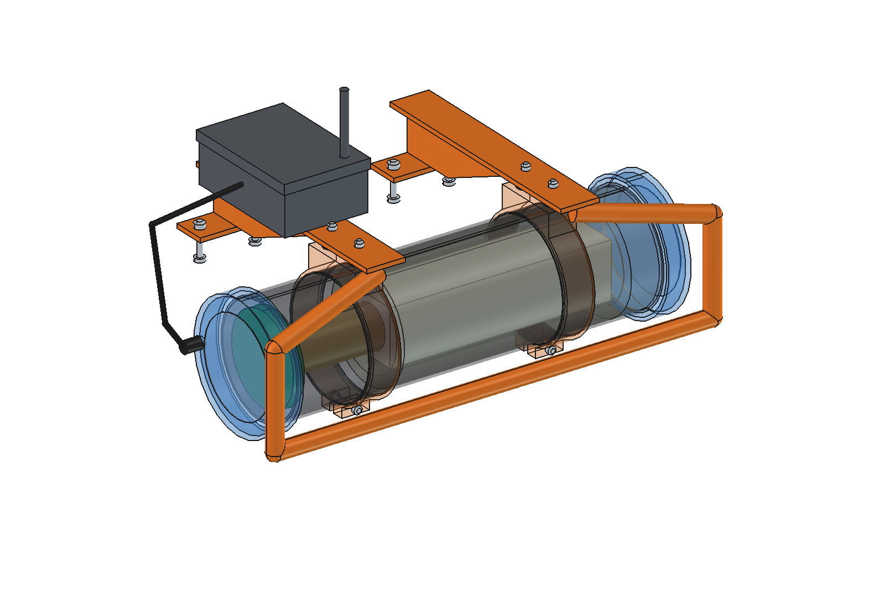
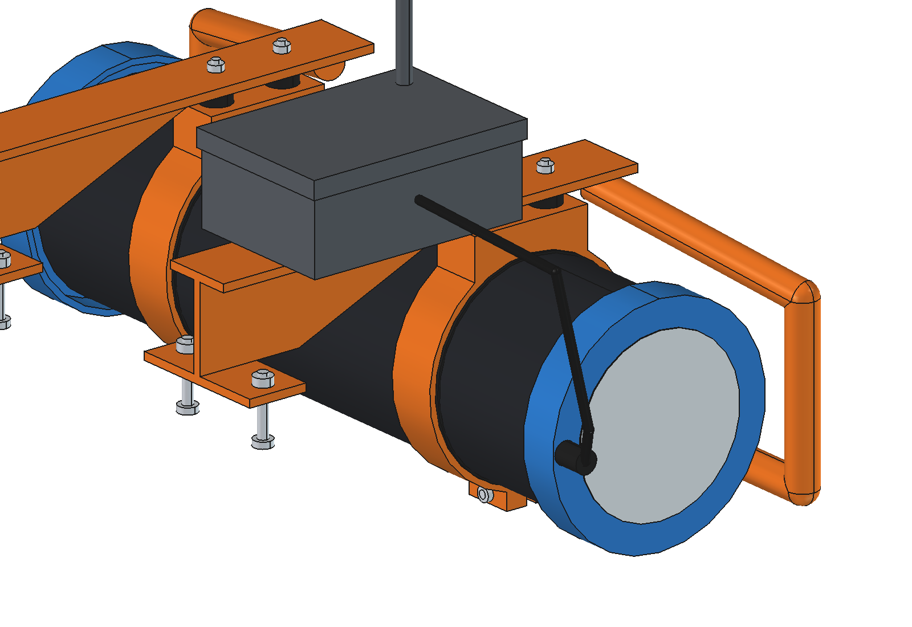
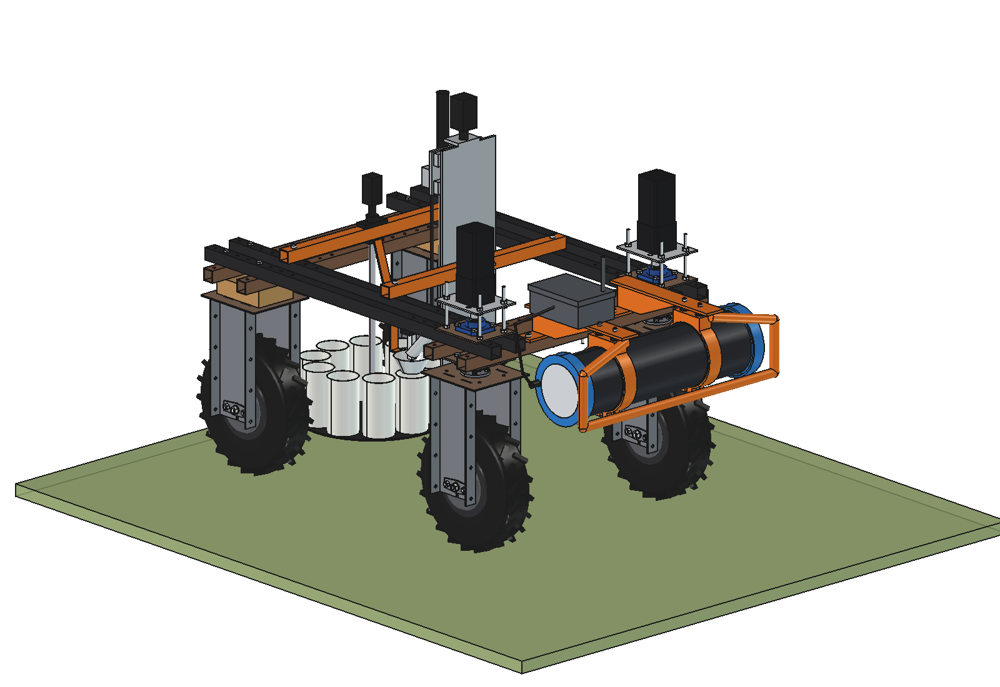

# Soil scanner (simple)

Passive gamma-ray soil scanner in front of the Bruut OpenAgbot (standard robot), modelled on the Interra Scan /
SoilOptix sensor that is driven over the field on a utility vehicle. A CsI(Tl) crystal in a sealed tube 600 mm above
the ground counts the natural gamma radiation of **Cs-137, U-238, K-40 and Th-232** from the topsoil. The robot drives
lanes 10 m apart at 1.2 m/s and stores one spectrum per second: blocks of 10 x 1.2 m, **~830 data points per ha**.
With calibration samples (at least 4 per field and 2 per ha, lab analysis) the spectra become map layers: texture
(lutum, sand), water holding capacity, pH, organic matter, P, K, CEC, micronutrients. Those maps drive task maps
(variable liming, variable planting of potatoes). The sensor does not measure nitrogen.

<p align="center">
  
</p>

| Side: crystal 600 mm above the ground | Front |
| --- | --- |
|  |  |
|  |  |
|  |  |

## Build

- **Mount**: 2 welded steel brackets (base plate on the front outer lower beam with 2 x M10 in the grid holes at
  x +-125 / +-225, side plate, arm plate 8 mm forward to y 985). Under each arm 2 rubber mounts O30 x 20 (M8) carry a
  clamp ring 50 x 6 with an EPDM liner around the detector tube. A guard tube O30 runs from the arm ends around the
  front of the detector. The processor box (spectrum processor, logger, 4G modem) sits on the right arm.
- **Detector**: aluminium tube O200 x 4, length 660, blue end caps O226; inside a CsI(Tl) crystal 100 x 100 x 400
  (4 l, 18 kg) in a PE foam sleeve, a photomultiplier O76 and the MCA / high-voltage board. Cable gland in the right
  cap, cable to the processor box.
- The detector lies across the robot at y 880, axis 600 mm above the ground, in front of the front wheels: above the
  tyres (top z 480) and clear of the steering sweep at +-30 degrees. The robot's own GNSS (RTK) gives the position.
- **Optional**: the [soil sampler](../../soil%20sampler/simple/) in the middle of the robot takes the calibration
  samples in the same run (`build(with_sampler=True)`, and in the animation). No interference between the two.

Mass 45 kg (detector 26 kg of which crystal 18 kg, mount 19 kg). Size 834 x 482 x 481 mm. No interference, all 4
bolts in grid holes, free at steering -30 / 0 / +30 degrees; smallest distances: tyre 207 mm, steering stack 47 mm,
GNSS dome 35 mm.

## Key figures (`ssc_calc.report()`)

| | |
| --- | --- |
| Data points | block 10 x 1.2 m (1 spectrum/s at 1.2 m/s): 833 per ha |
| Footprint at 0.6 m (K-40) | 50 % of the counts from within 1.1 m, 90 % from within 4.6 m: fits lanes 10 m apart |
| Depth (uncollided gammas) | 90 % from the top 10 cm (Cs-137) to 18 cm (Th-232) |
| Height | 0.3 m: r90 2.4 m; 0.6 m: 4.6 m; 1.0 m: 7.1 m |
| Counts per block (4 l, K window) | sand 29 (+-19 %), loess 77 (+-11 %), clay 106 (+-10 %) |
| 2 l vs 4 l crystal | K error in sand 26 % vs 19 % per block; 4 l weighs 9 kg more |
| Sand at 10 % K error | 3.5 s per block: 0.35 m/s (or map with a moving average over blocks) |
| Field of 18 ha (450 x 400 m) | 40 lanes, 18.6 km, 4.3 h, 4.2 ha/h, 53 Wh/ha: ~36 ha per battery |
| Calibration (18 ha) | 36 samples of 10 cores: ~1.6 h with the soil sampler |
| Axle load | robot + scanner 205 kg, CG 187 mm forward: 69 % on the front axle |

Why and how these come out: see [RATIONALE.md](RATIONALE.md), including the list *Estimated, not measured*.

## Animation

| Animation | File (generated, not in git) |
| --- | --- |
| Scan of a 30 x 36 m field (3 lanes, pH map appears block by block), then 4 calibration samples with the soil sampler | `previews/animation_scan_and_calibrate.gif` (no text), `previews/animation_scan_and_calibrate_text.gif` (caption + pH legend) |

The pH field in the animation is synthetic (4.4 .. 5.1, as the maize field in the Interra webinar).

## Files

| File | Contents |
| --- | --- |
| `ssc_params.py` | all dimensions, robot interface, detector, gamma lines and attenuation, sensitivities, work parameters |
| `ssc_parts.py` | one function per part, robot coordinates; map blocks and sample squares for the animation |
| `build_ssc.py` | model tree, checks (`check_interference`, `check_holes`, `check_steer`, `clearance`), mass, `render_all()`, STEP |
| `ssc_calc.py` | footprint and depth (numerical integral over the soil), counts and error per block, capacity, calibration, axle load |
| `animate_ssc.py` | animation on the robot: `build()`, `play()`, `stop()`, `summary()`, `render_all(folder)` |
| `make_gif_ssc.py` | frames to GIF (`text=True` for caption and pH legend) |
| `run_in_freecad.py` | reload, build, print the key figures |
| `Soil_Scanner.FCStd`, `Soil_Scanner.step` | generated model (robot hidden in the FCStd) |
| `previews/` | images |

## Use

```python
exec(open(r"F:\veldrobot\aanbouwdelen\soil scanner\simple\run_in_freecad.py").read())
import build_ssc
build_ssc.check_steer()          # must be {}
import animate_ssc
animate_ssc.build(); animate_ssc.play()
```
