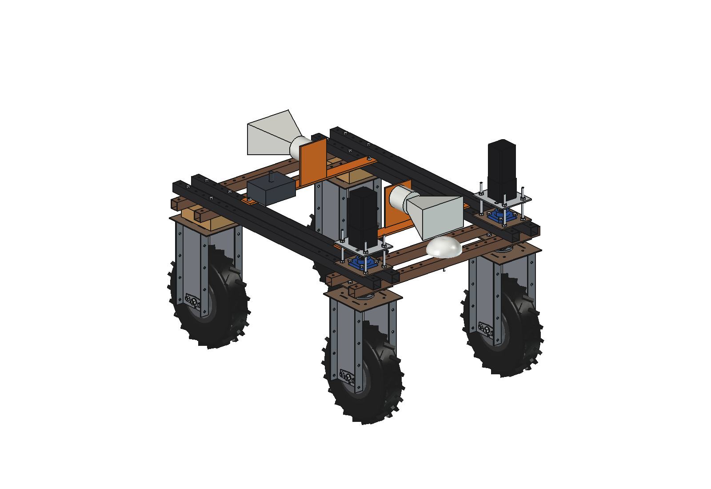
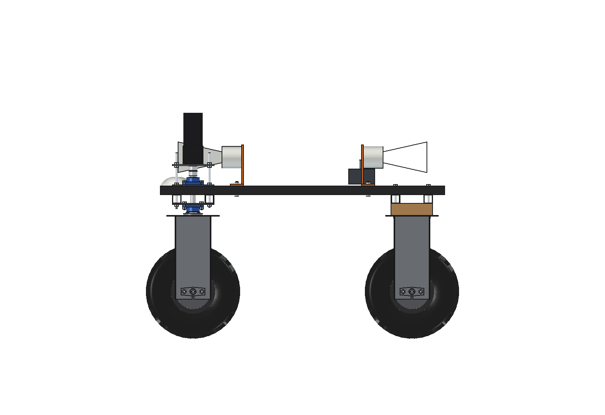
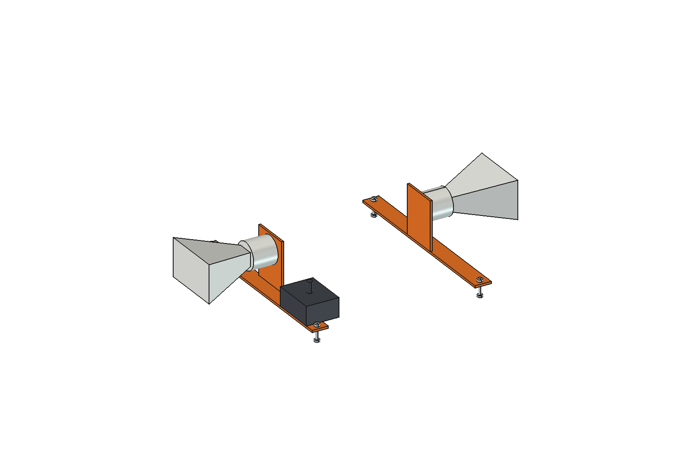

# Speech speaker (simple)

Two weatherproof 30 W horn speakers on the Bruut OpenAgbot (standard robot), one looking forward and one back, with a
2 x 30 W amplifier and a microphone in an IP65 box. The robot computer speaks with offline text-to-speech: warnings
when people come near ("robot is turning"), status ("tank empty", "battery low") and instructions; an operator can
talk and listen through the robot over the radio link. The volume follows the distance to the nearest person, with a
ceiling near animals.

  

| Side | Horns and amplifier |
| --- | --- |
|  |  |

## Build

- 2 flat bars 8 mm x 60 across the inner upper beams (M10 into the grid holes x +-325, y +-300), each with a 140 mm
  upright plate in the middle.
- Horn 220 x 140 x 200 with an O100 driver on each upright, axis at z 830: the front horn passes over the GNSS dome
  and stays clear of the steering stacks.
- Amplifier box 160 x 120 x 70 and microphone on the rear bar.

Mass ~13 kg (estimated parts). Size 690 x 1136 x 247 mm.

## Key figures (`spk_calc.report()`)

| | |
| --- | --- |
| Full power | 120 dB at 1 m |
| Speech 10 dB over the noise | up to ~1.7 km in a quiet field, ~300 m on a farmyard, ~30 m next to a running tractor |
| Talking to a person on a farmyard | 0.03 W at 10 m, 0.3 W at 30 m: the volume control keeps it low |
| Near animals | at most 0.25 W (85 dB at 5 m) |
| Energy | ~3 W average, ~31 Wh per 10 h |

Estimated, not measured: horn sensitivity (105 dB/W/m), noise levels, the 85 dB animal and 55 dB neighbour limits,
talk share (5 %), masses. Not modelled: cables, the computer and radio link.

## Files

`spk_params.py` (dimensions, acoustics), `spk_parts.py` (bars, horns via the reusable `horn(origin, direction)`,
amplifier, microphone), `build_spk.py` (model, checks, `render_all()`, STEP), `spk_calc.py` (SPL, reach, power per
distance, caps), `run_in_freecad.py`, `Speaker.FCStd` / `Speaker.step`, `previews/`.
