# Spot sprayer with a folding 3.75 m boom: FreeCAD model

Sprays weeds **plant by plant** instead of the whole field. A camera on a mast **in front** of the standard Bruut
OpenAgbot looks at the strip ahead; a computer detects the weeds (in the model: broad-leaved dock in grassland) and a
**3.75 m boom behind the robot** opens only the nozzles that are above a plant, for just as long as the plant is under
them.

- **Boom:** 15 nozzles at 250 mm, each on its own PWM solenoid valve. Centre section of 1.25 m, fixed under the rear of
  the robot; **two wings of 1.25 m that fold up and down in the field**, each with its own 24 V linear actuator
  (3.2 s up), to pass posts, trees, gates and ditch sides. Below the hinge the end plates of wing and centre tube lie
  against each other: a hard stop, the actuator carries no bump loads.
- **Camera:** wide-angle global-shutter camera (2/3", 5 MP, 4 mm lens) 1.48 m high, 55° down. The image is wider than
  the boom from 1.8 m ahead of the robot; every plant is seen in about 60 frames, and 2.65 s pass between the last
  look and the nozzle.
- **Tank:** 120 l PE tank on a cradle on the upper beams; diaphragm pump, suction filter and pressure regulator with
  bypass under the rear beams; control box (vision computer, 16-channel valve driver) behind the tank.
- **GNSS:** the mast would shade the robot's antenna, so that antenna moves to the top of the mast.

Why it is designed this way is explained in [RATIONALE.md](RATIONALE.md); the concept and the other options in the
[spot sprayer README](../README.md).

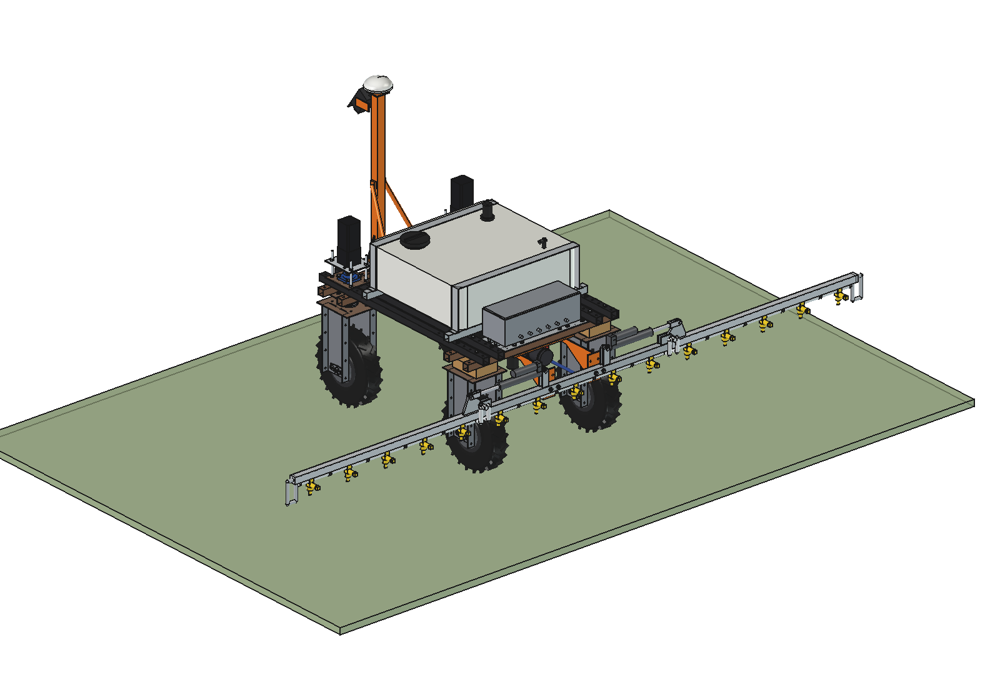

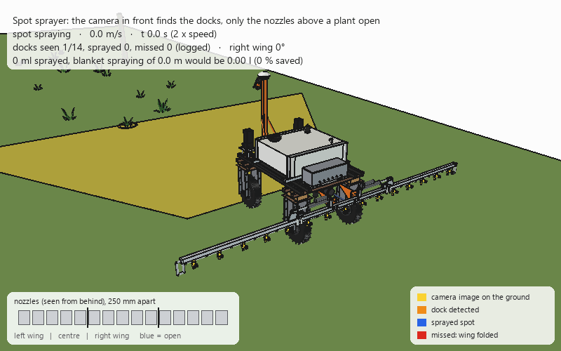

*The robot drives at 1 m/s. Yellow: what the camera sees on the ground; orange ring: dock detected; blue: sprayed
spot (only the nozzles above the plant, panel bottom left). Before the fence post the right wing folds up and its
nozzles stay off; the one dock in that strip is missed and logged for a second pass. 14 docks, 139 ml sprayed
instead of 2.4 l for blanket spraying of the same 16 m. Twice real speed.*

| | | |
| --- | --- | --- |
| 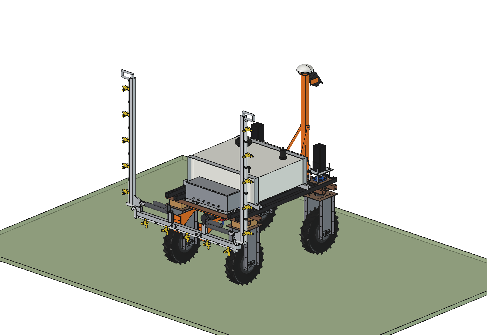 | 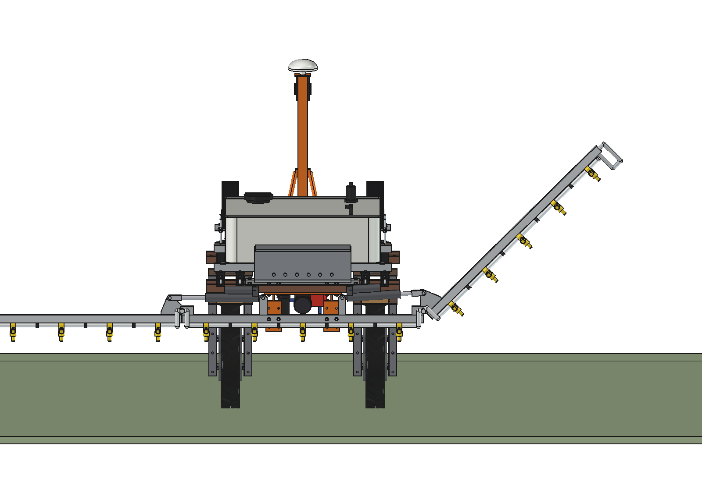 | 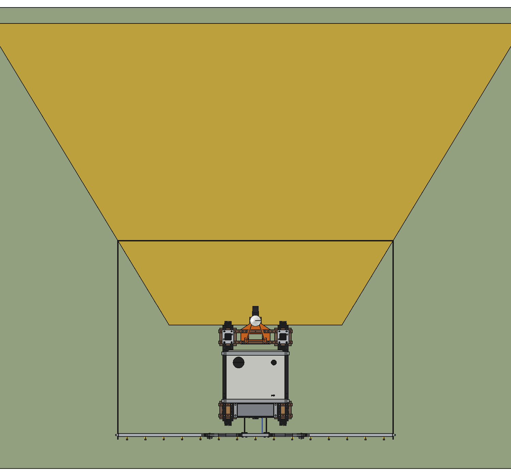 |
| both wings up: 1.61 m wide, 1.85 m high | right wing at 45° (the actuator pulls it up) | from above: camera image on the ground (yellow), boom strip up to the detection line |
| 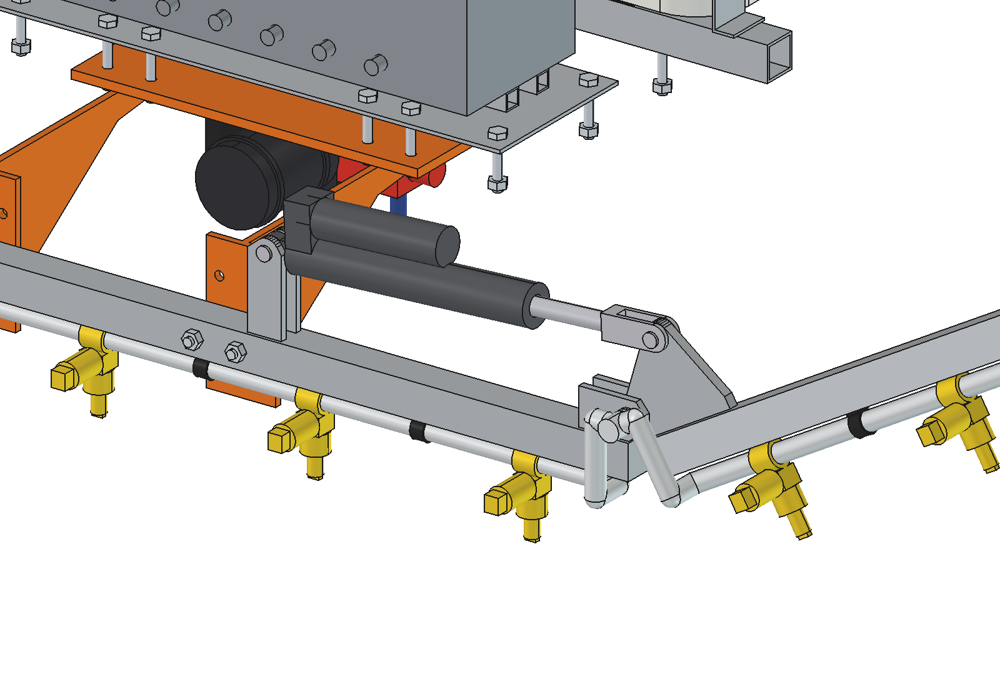 | 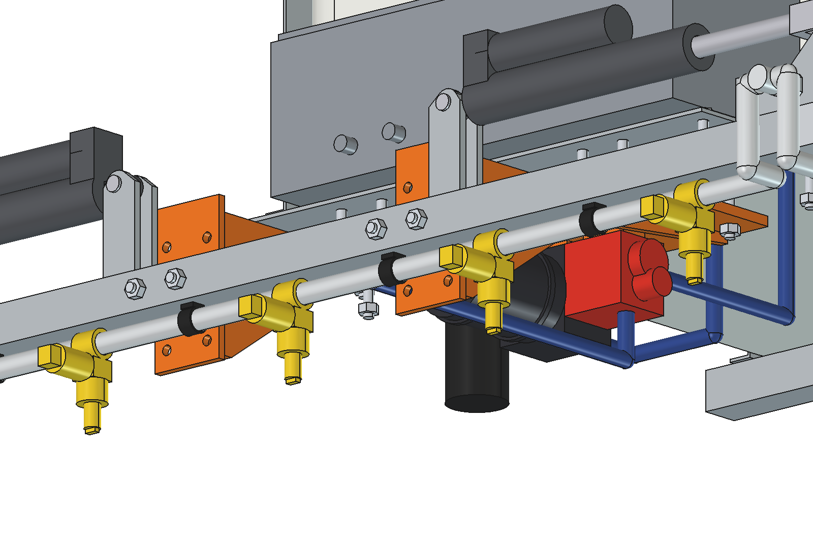 | 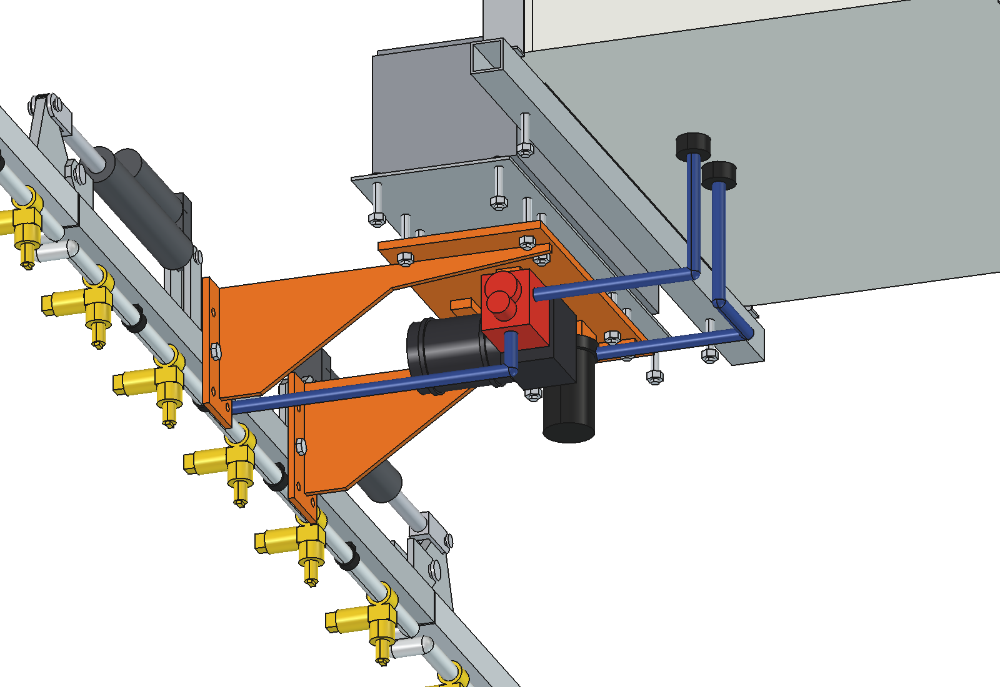 |
| hinge: 2 lugs, pin Ø16, knuckle with the lever, actuator; end plates as the stop | nozzle bodies with the solenoid coil, stainless wet pipe under the carrier tube | pump, suction filter and regulator under the rear beams (robot hidden) |
| 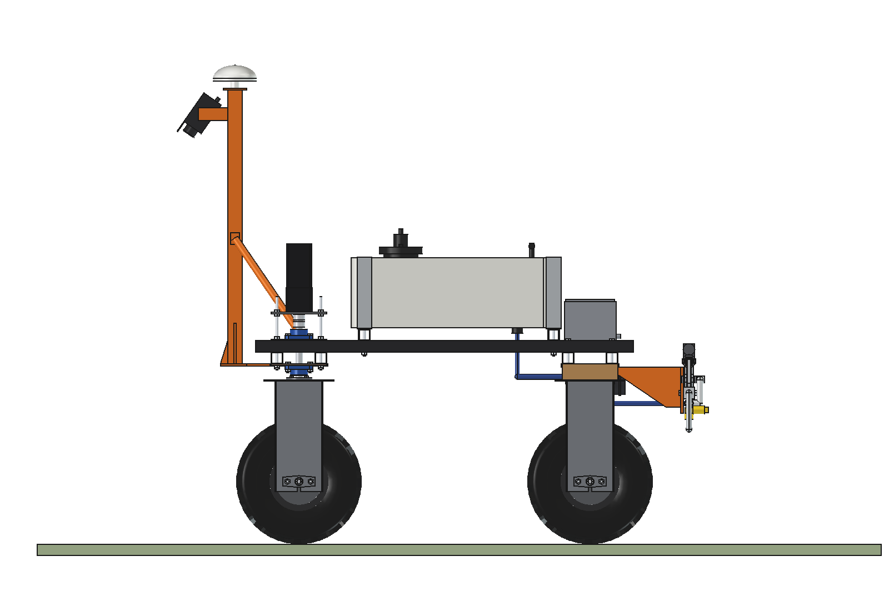 | 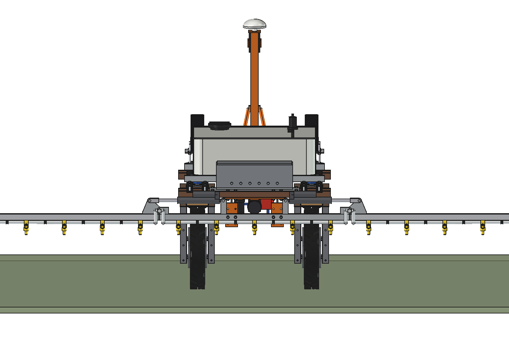 | 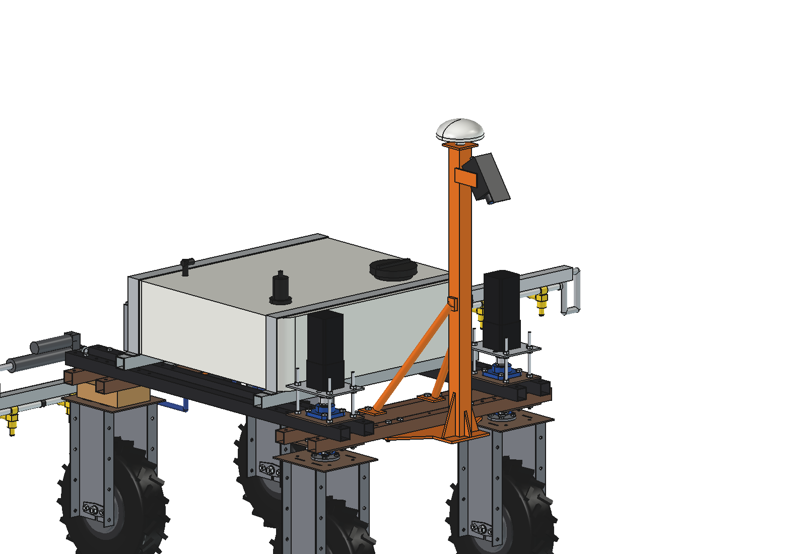 |
| side view: camera at the front, boom behind the rear tyres | from behind | mast with braces, camera on its tilt arms, GNSS antenna on top |

## Key figures

From the model (`build_ssp.mass_properties`, `check_fit`, `clearance`, `size`), `ssp_calc.report()` and
`animate_ssp.summary()`. Robot 161.5 kg (agbot comparison, not weighed).

| | |
| --- | --- |
| Working width | 3.75 m, 15 nozzles at 250 mm, tips 400 mm above the ground (350 / 400 / 450 by moving the tube on the clamp plates) |
| Nozzles | 40° flat fan, size 015: 0.59 l/min at 3 bar, 291 mm wide on the ground (41 mm overlap) |
| Dose where it sprays | 393 l/ha at 1 m/s; with 5 % of the area sprayed ≈ 20 l/ha over the field |
| Tank | 120 l → ≈ 6 ha at 5 % cover; pump 9.5 l/min at 3 bar is enough for all 15 nozzles at once (8.8 l/min) |
| Capacity | 1.35 ha/h gross, ≈ 1.1 ha/h net at 1 m/s |
| Camera | 93° × 83° field of view, 1.48 m high, 55° down; image ≥ 3.75 m wide from y 1.81 m, ≤ 3 mm/px up to y 4.78 m: ≈ 60 frames per plant at 1 m/s |
| Latency | last look → nozzle 2.65 m = 2.65 s at 1 m/s; needed ≈ 135 ms (frame, detection, valve) |
| Spot | a Ø300 dock gets a spot 400 mm long (50 mm margin), 2–3 nozzles wide, ≤ 12 ml |
| Fold | 0 → 90° in 3.2 s (actuator 1000 N, 40 mm/s, uses 127 of its 150 mm); max 449 N at 0° (× 2.2 reserve) |
| Obstacle | fold starts 2.3 m (to 60°) to 3.4 m (to 90°) before the post; 4.7–6.7 m of that wing strip is not sprayed (logged) |
| Mass | 91 kg empty (tank + cradle 21, rear subframe + control box 23, pump etc. 8, boom 24, mast 15); wing 5.3 kg |
| Size | working 3820 × 1825 mm, 1646 mm high (antenna); folded 1610 mm wide, 1850 mm high |
| Axle loads (robot + sprayer) | full 372 kg: rear 203 / front 169 kg (45 % front), max 102 kg per wheel of 500; empty rear 138 / front 114 kg |
| Stability, full, wings up | cg 700 mm high: tips sideways at 28°, uphill wheels half unloaded at 15°; fore-aft 33° |
| Boom strength (× 2.5 for bumps) | wing at the hinge 14 MPa (aluminium), centre tube at the clamps 40 MPa (steel), tip sags 1.8 mm |
| Clearances | boom ≥ 183 mm from the rear tyres; mast plate 48 mm from the front wheel units at 30° steering; tank 85 mm from the stepper plates; rear mount 20 mm from the wooden blocks |
| Power | ≈ 160 W for the sprayer, ≈ 600 W with driving: ≈ 4 h, 4.3 ha on a 2.4 kWh battery |

## How it sprays

1. The camera takes 20 frames per second. The vision computer finds the plants and gives each one a position on the
   ground in robot coordinates (camera calibration, pitch and roll from the IMU).
2. Wheel odometry (and the GNSS heading) carries every plant from the image to the boom: 2.6–5.6 m further on.
3. When the nozzle line reaches the plant minus a margin of 50 mm (minus the valve time of 25 ms), the nozzles whose
   250 mm strip touches the plant open; they close 50 mm after it. Every spot is logged with its position.
4. Before a post or a tree (from the field map, or seen by the camera up to 4.8 m ahead) the wing on that side folds
   up, its nozzles are off; the strip it misses is logged and sprayed on the next pass or from the other direction.

## Parts list

Quantities for one sprayer. Prices are rough estimates (2026) to give an idea of the total, not quotes.

| Qty | Part | Specification | Price (est.) |
| --- | --- | --- | --- |
| 1 | Tank | PE rectangular, 120 l, 800 × 720 × 240, 2 bottom fittings, lid with basket strainer, vent | €180 |
| 1 | Cradle | 2 × tube 40 × 40 × 3 × 920, rubber strip, 2 straps 50 × 3, 4 × M10 | €60 |
| 1 | Laser-cut steel, welded | sub plate 10 mm, 2 hanger webs + clamp plates 8 mm, mast plate 8 mm, gussets, hinge lugs, actuator brackets, 2 knuckles 12 mm, brace feet, camera arms; galvanised | €260 |
| 1 | Tubes | centre 40 × 40 × 2 galvanised 1250, 2 wings aluminium 40 × 40 × 3 × 1250, mast 50 × 50 × 3 × 940, 2 braces Ø25 | €100 |
| 1 | Wet pipe | stainless 1/2" (21.3 × 1.6), 3.8 m, end caps, 2 swivels on the hinge axes, clips | €140 |
| 15 | Nozzle bodies | clamp-on, 12/24 V PWM solenoid valve, cap, 40° flat-fan tip size 015 | €750 |
| 1 | Pump | 24 V diaphragm pump, 11 l/min, 4 bar | €120 |
| 1 | Filter, regulator | suction filter 50 mesh, pressure regulator with bypass, pressure sensor | €120 |
| 1 | Hoses | 1/2" spray hose ≈ 3 m, clamps | €40 |
| 2 | Fold actuators | 24 V linear actuator, 1000 N, stroke 150, 40 mm/s, IP66, with end switches | €260 |
| 1 | Pins | 2 hinge pins Ø16, 4 pins Ø10, circlips | €30 |
| 1 | Camera | 2/3" 5 MP global shutter (2448 × 2048), 4 mm lens, IP67 housing with window and hood | €650 |
| 1 | Vision computer | Jetson Orin class, 8–16 GB | €550 |
| 1 | Control box | IP66 box, 16-channel valve driver, pump and actuator drivers, DC-DC 48 → 24/12 V, glands, wiring | €300 |
| | Bolts | M10 (8 + 8 + 4 + 4), M8 | €20 |
| | **Total** | | **≈ €3,580** |

The robot's own GNSS antenna moves to the top of the mast (no extra antenna).

## Files

| File | Contents |
| --- | --- |
| `Spot_Sprayer_Boom.FCStd`, `.step` | the model (generated; robot hidden in the FCStd, not in the STEP) |
| `ssp_params.py` | all dimensions, including the robot interface |
| `ssp_parts.py` | one function per part (right wing and actuator; the left ones are mirrored) |
| `build_ssp.py` | model tree, colours, fold pose, interference and fold check, clearances, mass, renders, STEP |
| `ssp_calc.py` | fold kinematics and actuator force, camera footprint and detection band, latency, dose, tank, capacity, power, axle loads, stability, strength |
| `ssp_field.py` | process model for the animation: docks, post, drive, detection, nozzle timing, spots, litres |
| `animate_ssp.py` | animation on the robot: `build()`, `play()`, `stop()`, `summary()`, `render_all(folder)` |
| `make_gif_ssp.py` | frames to GIF with caption and nozzle panel |
| `run_in_freecad.py` | macro: reload, build, print the key figures |
| `previews/` | images and the GIF |

## Usage

In FreeCAD 1.1, run `run_in_freecad.py` (or in the Python console):

```python
import build_ssp
build_ssp.build()                       # FCStd + STEP
build_ssp.set_fold(left=0, right=90)    # fold the wings (degrees)
build_ssp.check_interference()          # []
build_ssp.check_fit()                   # {} over 0 .. 92 degrees
build_ssp.clearance()
build_ssp.mass_properties()
build_ssp.render_all()                  # previews/
```

Animation:

```python
import animate_ssp
animate_ssp.build(); animate_ssp.play()
animate_ssp.render_all(r"C:\temp\ssp_frames")
import make_gif_ssp; make_gif_ssp.main(r"C:\temp\ssp_frames", r"previews\animation_spot_spraying.gif")
```

## Estimated, not measured

- Robot mass 161.5 kg and its centre of gravity (agbot comparison); drive power 450 W at 1 m/s on grass.
- Camera: lens 4 mm on a 2/3" sensor (93° × 83°); detection needs ≤ 3 mm/px; 60 ms per frame for detection.
  The detector itself (training data for dock, thistle, nettle) is not part of this model.
- Valve opening time 25 ms; nozzle flow from typical catalogue values (size 015, 0.59 l/min at 3 bar); pump 9.5 l/min
  at 3 bar, 110 W.
- Weed cover 5 % of the area, field efficiency 80 %.
- Fold actuator 1000 N at 40 mm/s, 2.6 kg (generic 24 V IP66 actuator); nozzle body 0.25 kg; control box 6 kg incl.
  the electronics; tank wall 6 mm PE.
- Masses of hoses and the wet pipe (with liquid) from an average density; dynamic factor 2.5 for bumps on the boom.
- Not modelled: cables, the hose loops at the swivels, nozzle caps in detail, a breakaway in the wings, lighting for
  the camera.
