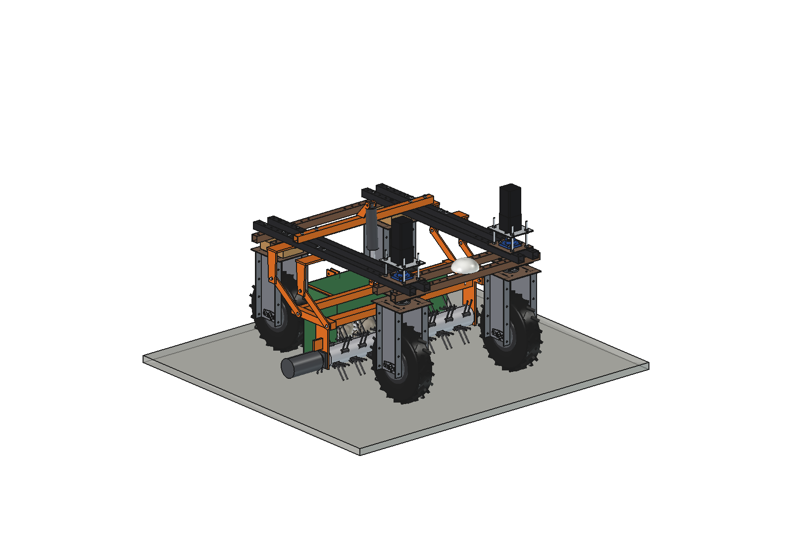
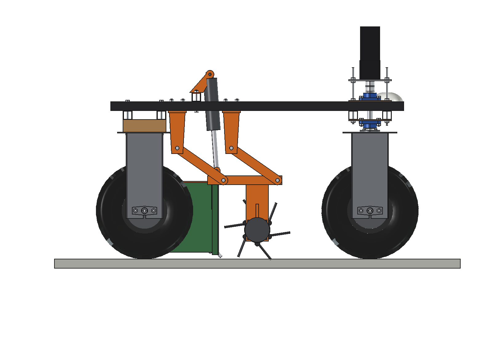
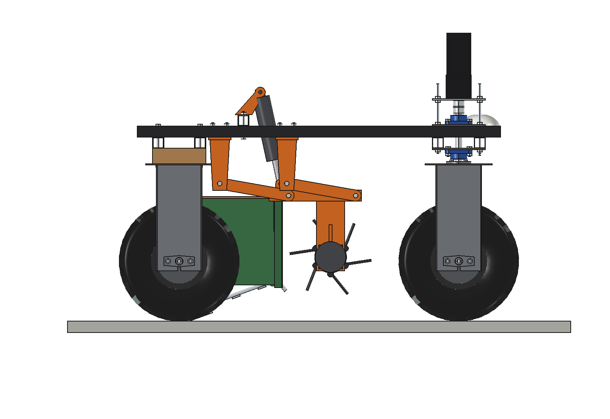
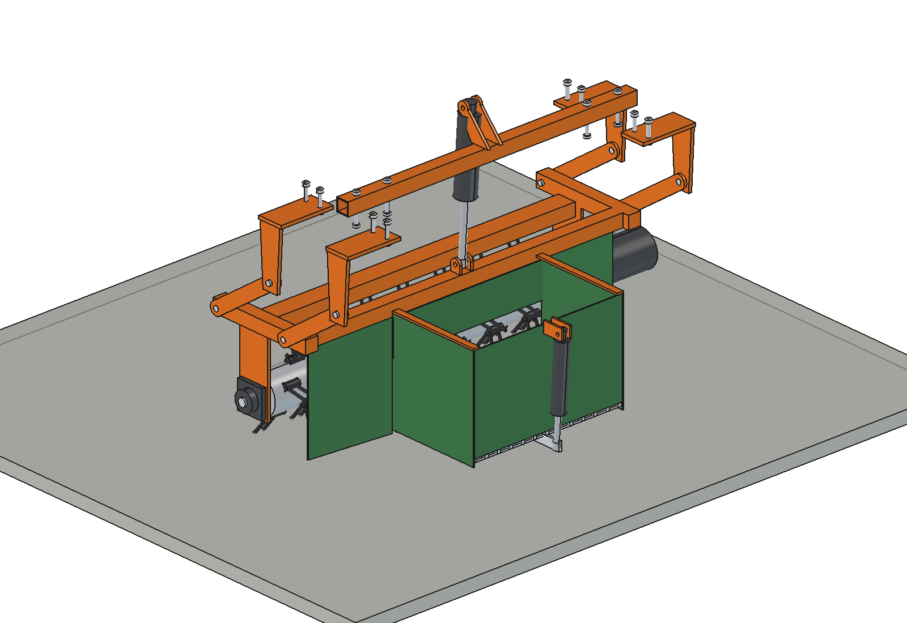
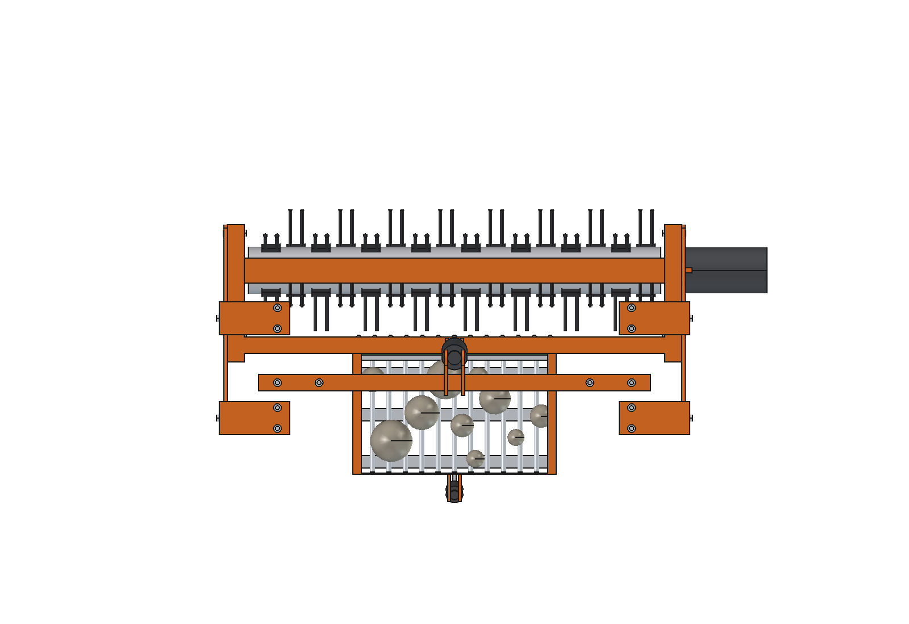
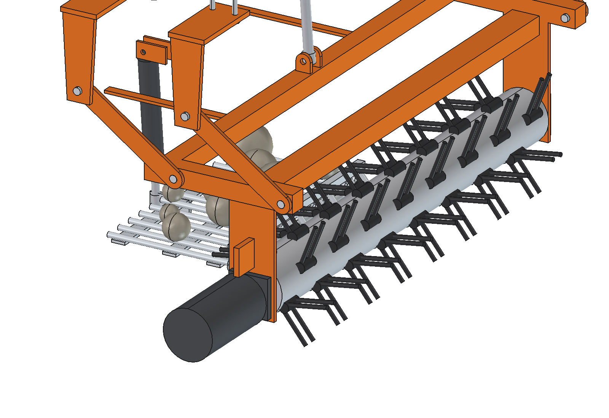

# Stone picker (simple)

Mid-mounted stone picker under the Bruut OpenAgbot (standard robot), between the axles. A tine rotor 1 m wide flicks
stones backwards over a comb into a sieve basket (soil falls through the floor bars). The frame hangs on 4 swing links
(parallelogram, stays level) and one linear actuator lifts it. At the heap the sieve floor drops open and the stones
roll out between the rear wheels.

<p align="center">
  
</p>

| Side, work | Side, lifted and floor open |
| --- | --- |
|  |  |
|  |  |



## Build

- **Mount**: 4 hangers (top plate 10 mm under the outer upper beams, 2 x M10 each, web 10 mm) at y -115 and -355, a
  bearer 40 x 40 x 3 across the upper beams at y -270 with the lug for the lift actuator.
- **Links**: 4 flat bars 40 x 8, 250 between O16 pins, outside the wheel line (x +-546..554). Link angle 55 degrees in
  work, 80 lifted: +100 mm, +41 mm forward, level.
- **Frame**: 2 side beams 40 x 40 x 3 at x +-505..545, front cross tube 60 x 40 over the rotor, rear cross tube
  40 x 40 that carries the basket, bearing plates 8 mm, top stays to the basket rear wall.
- **Rotor**: tube O114 x 4, 990 long, 6 rows of 8 double spring tines O9 (tip radius 150, 20 mm in the soil), shaft
  O25 in 2 x UCFL205, 48 V 750 W planetary gearmotor at 250 rpm on the right end.
- **Basket**: 488 x 290 x 290 (40 l), walls 3 mm, comb of 13 bars O12 at the front, side deflectors from the rotor ends,
  sieve floor of bars O12 with 25 mm gaps, hinged at the front, opened 20 degrees by a 24 V 500 N actuator.
- **Lift**: 24 V 1500 N actuator, stroke 150, from the bearer lug to the rear cross tube.

Mass 92 kg (cg y -134, z 256). Size 1321 x 704 x 843 mm. No interference in any lift / floor pose with the front
wheels steered +-30 degrees; 43 mm from the tyres.

## Key figures (`spk_calc.report()`)

| | Few stones (0.05 kg/m2) | Stony seedbed (0.2 kg/m2) | Very stony (0.5 kg/m2) |
| --- | --- | --- | --- |
| One basket (44 kg) covers | 870 m2 | 218 m2 | 87 m2 |
| Time to fill at 0.5 m/s | 29 min | 7.3 min | 2.9 min |
| Area per hour (40 s dump, 60 m to the heap) | 1711 m2 | 1491 m2 | 1186 m2 |
| Per 8 h day | 1.37 ha | 1.19 ha | 0.95 ha |
| Hours per battery | 2.7 | 3.0 | 3.6 |

- Rotor 525 W (tip 3.9 m/s, 7.9 x the driving speed), 16 Nm.
- Axle loads: front axle 45 % empty, 41 % full; cg 308..335 mm high, side tip angle 48 degrees. No counterweights.
- Lift: 100 mm in 9 s, 1265 N with a full basket (actuator 1500 N). Pull 324 N, grip margin 3.4.

Why and how these come out: see [RATIONALE.md](RATIONALE.md), including the list *Estimated, not measured*.

## Files

| File | Contents |
| --- | --- |
| `spk_params.py` | all dimensions, robot interface, link kinematics (`frame_shift`, `act_length`), stones and work parameters, masses |
| `spk_parts.py` | one function per part, robot coordinates (frame parts in the work pose) |
| `build_spk.py` | model tree, `set_pose(theta, door)`, checks (`check_interference`, `check_poses`, `clearance`), mass, `render_all()`, STEP |
| `spk_calc.py` | basket load, rotor power, lift force and stroke, axle loads, pull, area per hour and energy per basket |
| `run_in_freecad.py` | reload, build, print the key figures |
| `Stone_Picker.FCStd`, `Stone_Picker.step` | generated model (robot hidden in the FCStd) |
| `previews/` | images |

## Use

```python
exec(open(r"F:\veldrobot\aanbouwdelen\stone picker\simple\run_in_freecad.py").read())
import build_spk
build_spk.set_pose(theta=80, door=20)   # lifted, floor open
build_spk.check_poses()                 # must be {}
```

No animation yet: `set_pose()` drives the lift and the floor, the rotor turns in place.
