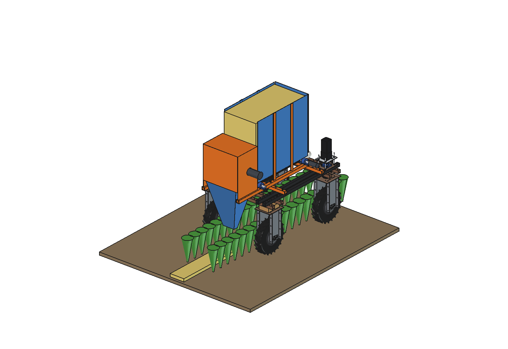
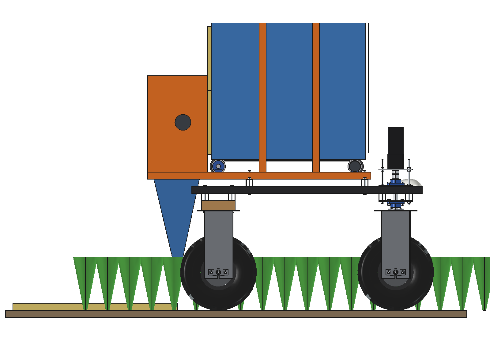
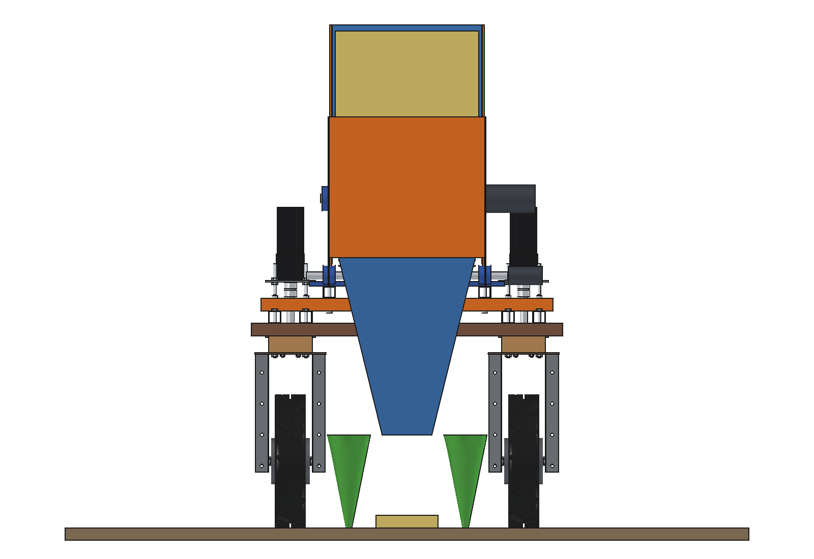
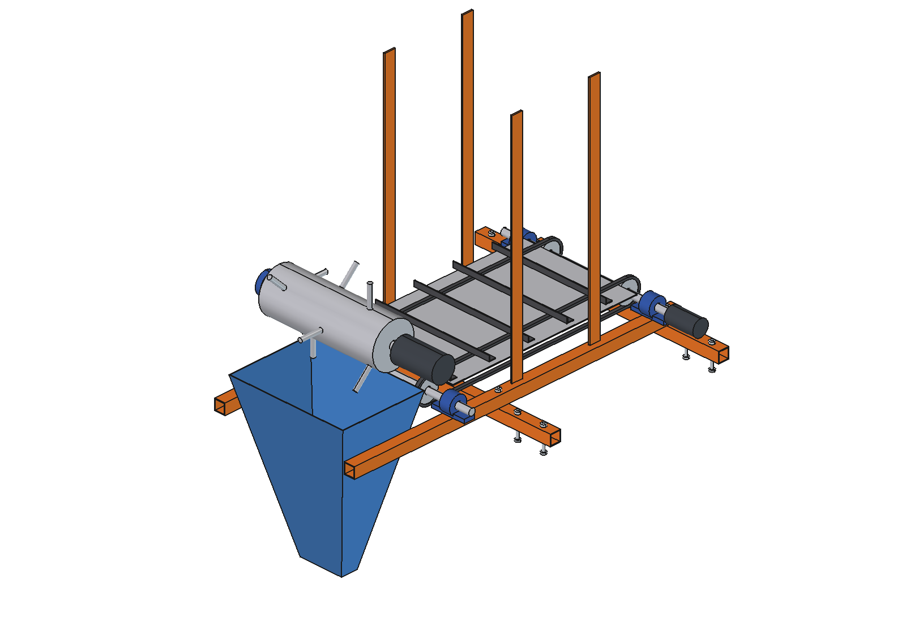
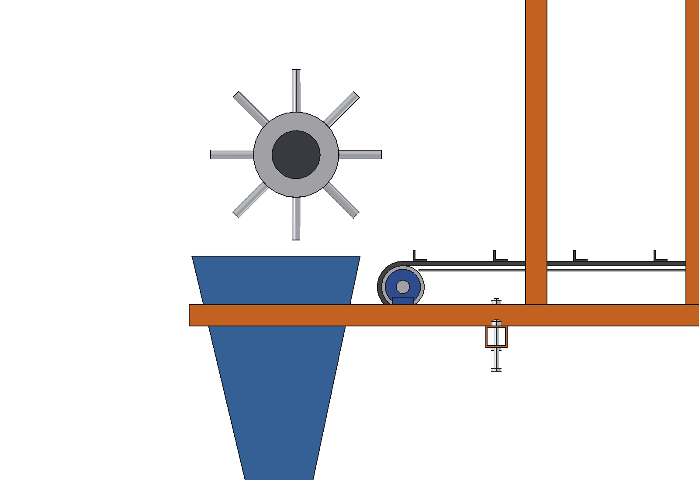

# Straw spreader (simple)

Lays a strip of straw mulch in the free middle inter-row of a 2-row bed (rows 375 apart) under the Bruut OpenAgbot
(standard robot), for weed suppression and moisture. 2 small bales lie in a chamber on the upper beams; a slatted floor
chain moves them slowly back against a spiked shredder drum that tears the straw loose; it falls through a chute to a
160 mm outlet 300 mm above the ground at x 0. The floor speed sets the dose and follows the driving speed.

<p align="center">
  
</p>

| Side | Rear |
| --- | --- |
|  |  |
|  |  |

## Build

- **Mount**: 2 bearers 40 x 40 x 3 across the 4 upper beams at y +-325 (beam holes), 2 rails 40 x 40 x 3 along y at
  x +-250 bolted on top, running back to y -900 to carry the drum housing.
- **Floor chain**: 2 roller chains 08B on sprockets O80 at x +-150, shafts O25 in 4 UCP 204 on the rails, slat angles
  25 x 20 x 3 every 150 mm, 2 mm floor plate under the top strand; 24 V gearmotor on the front shaft.
- **Chamber**: aluminium side walls 2 mm on 4 posts, front wall; 2 small bales (460 x 360 x 880, 13 kg) stacked.
- **Shredder**: drum O160 x 440 with spikes O16 x 80 (tip O320) behind the bales, 250 rpm, 48 V 750 W with a gearbox;
  3 mm housing (side plates, top, rear).
- **Chute**: aluminium funnel 2 mm from under the drum (x +-220) to the outlet 160 x 60 at z 300 (x 0); below z 400
  it stays out of the crop rows (`check_rows()`).

Mass 102 kg empty, 128 kg with 2 bales. Size 940 x 1263 x 1321 mm (top of the walls at z 1620).

## Key figures (`stw_calc.report()`)

| | |
| --- | --- |
| Load | 2 small bales, 26 kg (~89 kg/m3) |
| Strip | 0.20 m wide in the middle inter-row |
| Dose 0.3 / 0.5 / 0.8 kg/m2 at 0.5 m/s | floor 1.0 / 1.7 / 2.7 mm/s; 433 / 260 / 162 m of strip per fill (14 / 9 / 5 min) |
| Drum | 250 rpm, tip 4.2 m/s; 300 / 440 / 640 W (motor 750 W) |
| Energy at 0.5 kg/m2 | ~590 W with driving, ~3.2 h, ~3.5 km of strip per charge (60 % laying, rest refilling) |
| Axle load front / rear, loaded | 104 / 184 kg (rear 64 %) |
| Side slope before tipping, loaded | 28 degrees (static), cg 705 mm |
| Clearance | chute 221 mm from the rear tyres; crop rows untouched |

Why and how these come out: see [RATIONALE.md](RATIONALE.md), including the list *Estimated, not measured*.

## Files

| File | Contents |
| --- | --- |
| `stw_params.py` | all dimensions, robot interface, crop rows, bale and work parameters, masses from the model |
| `stw_parts.py` | one function per part, robot coordinates; bales, strip and crop for the images, row space for the check |
| `build_stw.py` | model tree (Mount, Floor, Chamber, Shredder; Load and Crop apart), checks (`check_interference`, `check_holes`, `check_steering`, `check_rows`, `check_teeth`, `clearance`), mass, `render_all()`, STEP |
| `stw_calc.py` | bale density, floor speed and strip length per dose, drum power, axle loads and tipping, energy |
| `run_in_freecad.py` | reload, build, print the key figures |
| `Straw_Spreader.FCStd`, `Straw_Spreader.step` | generated model (robot hidden in the FCStd) |
| `previews/` | images |

## Use

```python
exec(open(r"F:\veldrobot\aanbouwdelen\straw spreader\simple\run_in_freecad.py").read())
import build_stw
build_stw.check_rows()      # {}: chute out of the crop rows
build_stw.check_teeth()     # > 0: the spikes reach 20 mm into the bale face
```

No animation yet (simple variant).
