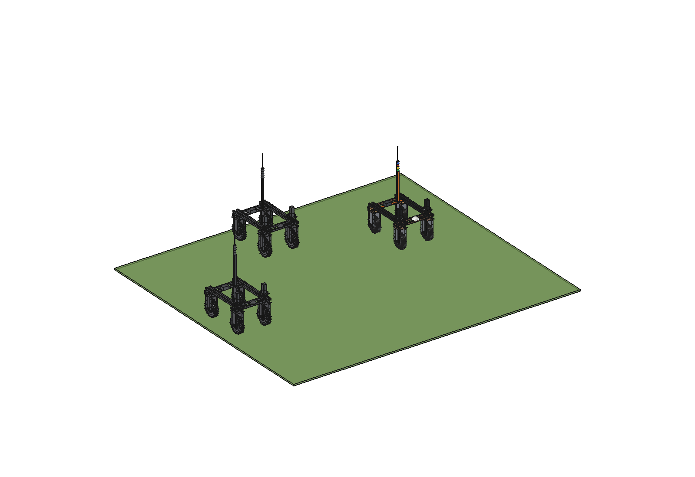
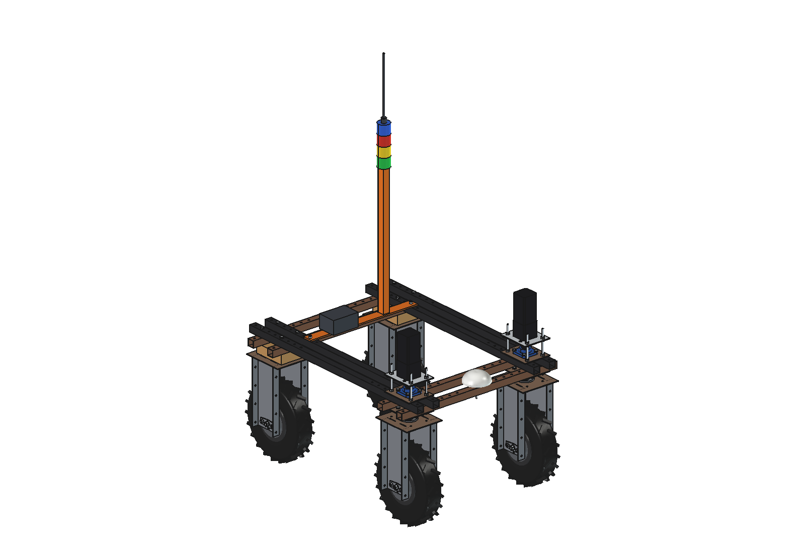
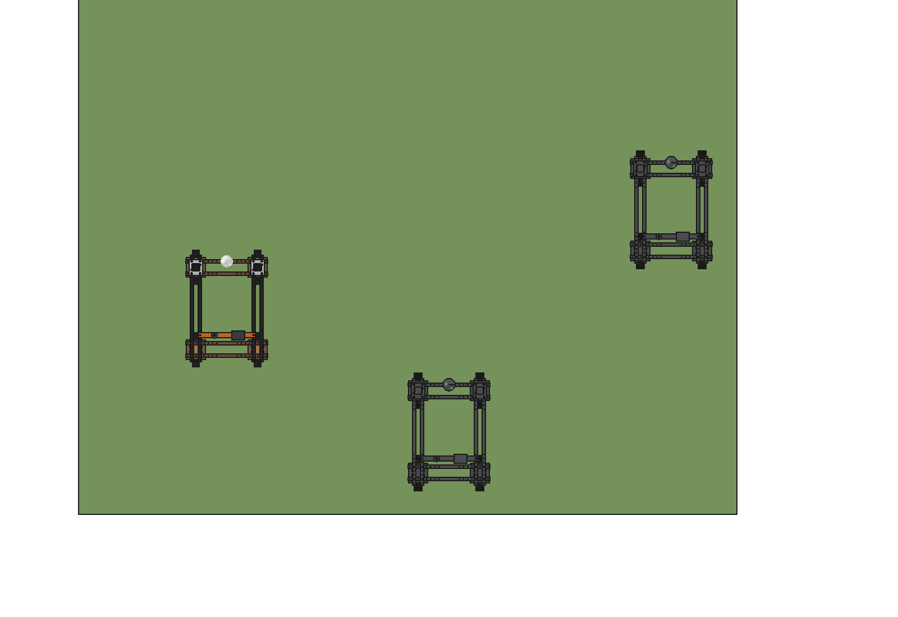
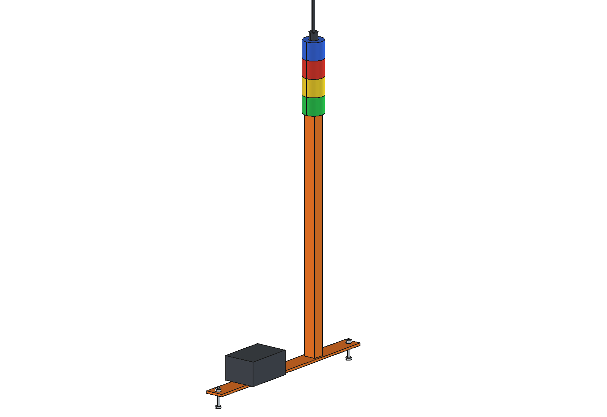

# Swarm operation (simple)

Several Bruut units (standard robot) work one field as a swarm. The job planner splits the field into passes, the
units take passes in turn, share position, progress, battery and intent over a mesh radio, reserve the headland
corridor before they turn, and hand a pass over when one unit drops out. Capacity grows with the number of units
instead of machine size, work goes on when a unit stops, and light units keep soil pressure low.

The hardware per robot is a **swarm kit**: a 1.5 m post on a flat bar across the inner upper beams (y -325 grid holes)
with a 868 MHz mesh radio whip, a status light tower (green working, yellow turning or waiting for the corridor, red
stopped, blue refilling or charging) and a box with the swarm computer. Each unit keeps its own RTK-GNSS; the RTK base
at the field edge relays the mesh to the farm network.

  

| Kit on the robot | Three units on neighbouring passes |
| --- | --- |
|  |  |

## Key figures (`swm_calc.report()`)

10 ha field (400 x 250 m), 1.8 m pass width, 1.2 m/s, 25 s per headland turn, 6 s corridor wait per extra unit:

| Units | 1 | 2 | 3 | 4 | 6 | 8 |
| --- | --- | --- | --- | --- | --- | --- |
| Hours (working time) | 13.8 | 7.1 | 4.8 | 3.7 | 2.6 | 2.0 |
| Speed-up | 1.0 | 1.95 | 2.86 | 3.78 | 5.34 | 6.91 |
| Efficiency per unit | 1.00 | 0.98 | 0.95 | 0.95 | 0.89 | 0.86 |
| Work share with 1 charger (6 h work, 3 h charge) | 0.67 | 0.67 | 0.67 | 0.50 | 0.33 | 0.25 |

- **Radio**: 96 bytes at 5 Hz per unit: 15 kbit/s for 4 units (31 % of a 50 kbit/s mesh), 31 kbit/s for 8 (61 %).
- **Soil pressure**: ~16 kPa per unit against ~42 kPa for a 6 t tractor.
- **Chargers**: from 4 units on, one charger is the bottleneck: one charger per 3 units, or battery swap.

Estimated, not measured: headland turn and corridor wait times, mesh throughput, battery and charge hours, tyre
contact areas. Not modelled: cables and the software itself (job planner, corridor reservation, hand-over).

## Files

`swm_params.py` (kit and swarm parameters), `swm_parts.py` (bar, post, light tower, radio whip, box),
`build_swm.py` (model, checks, `render_all()` with three units, STEP), `swm_calc.py` (scaling, charging, radio,
compaction), `run_in_freecad.py`, `Swarm_Operation.FCStd` / `Swarm_Operation.step`, `previews/`. Mass of the kit
~14 kg; the robot is 2.0 m high at the whip.
