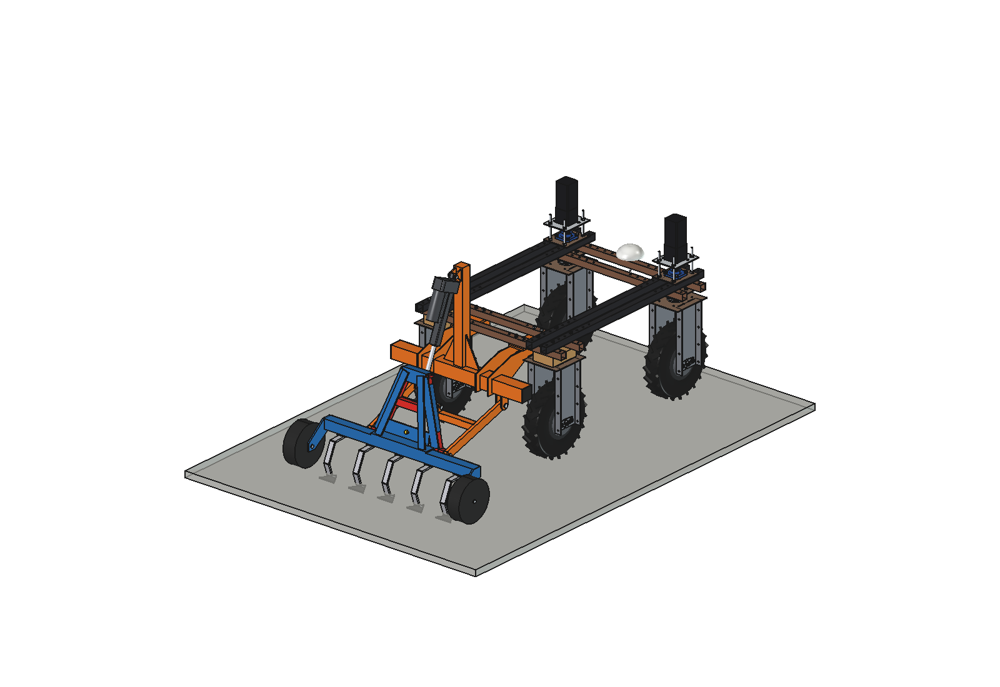
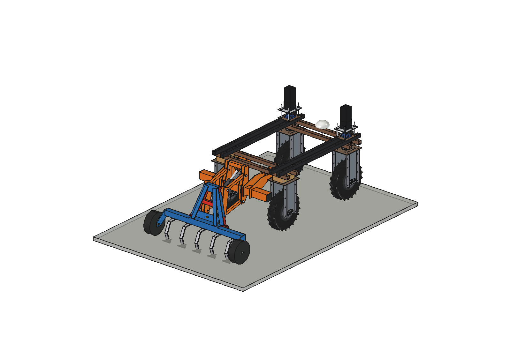
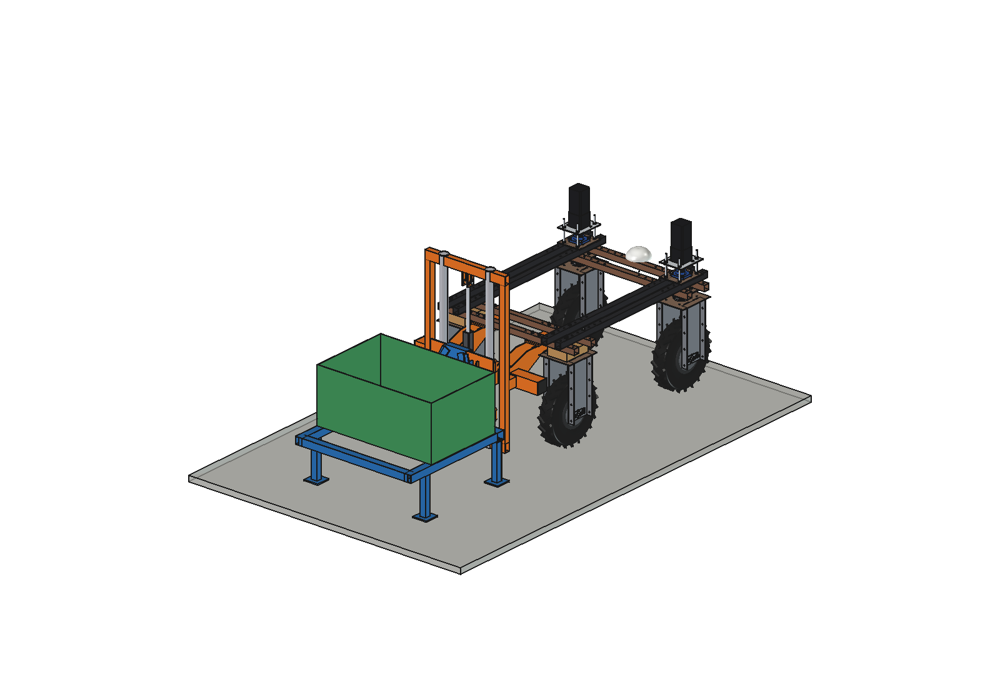
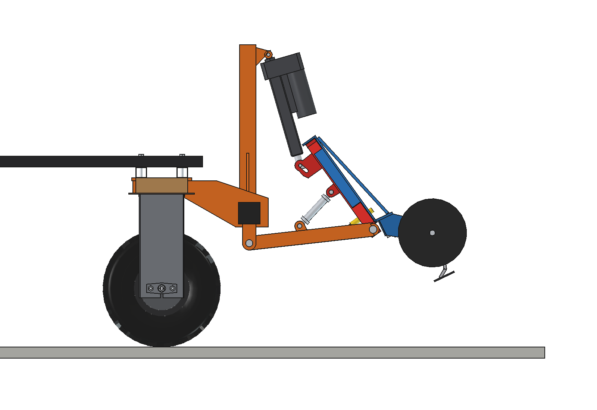
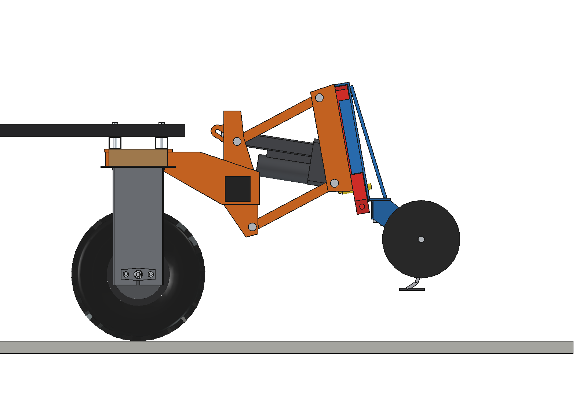
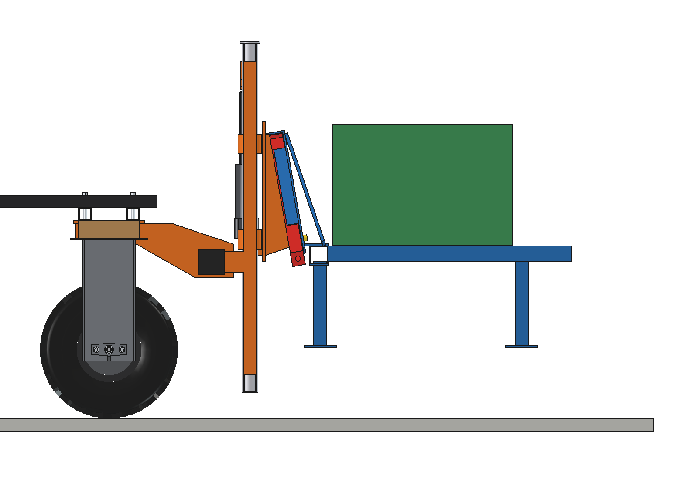

# Three-point hitch

Ways to hang implements and machines at the rear of the Bruut OpenAgbot (standard robot). "Three-point hitch" is used
here for the hitch as a whole, not necessarily three points. All variants hang on the same rear toolbar (80 x 80 x 4
on 2 hangers, from [`simple/`](simple/README.md)); the three newer ones share an **A-frame (triangle) quick coupler**
sized for the robot and lift with a **Linak LA36** electric actuator, so the same implement (with a female triangle)
fits all three.

| Variant | How it lifts | Lift | The implement | LA36 | Good for |
| --- | --- | --- | --- | --- | --- |
| [simple](simple/README.md) | category 0 three-point linkage, 2 x 24 V lift rods | 205 mm | level within 2 degrees, floats (slotted rod eyes) | (generic 3000 N rods) | standard sub-compact category 0 implements with pins |
| [a_frame](a_frame/README.md) | LA36 in the place of the top link turns a rigid lift frame (arms + triangle) about the lower pivots | 201 mm | tilts 25.6 degrees (rear up), floats +-19 mm | 20F, 1700 N, stroke 200 | cultivators, ridgers, rakes: implements that may tilt when lifted; simplest and lightest |
| [parallel](parallel/README.md) | headstock + parallel linkage, LA36 on the diagonal with a slot (as the liquid fertilizer applicator) | 203 mm | stays level, floats +-40 mm | 16F, 2000 N, stroke 150 | seeders, hoes, applicators, boom sprayers: implements that follow the ground and must stay level |
| [lift](lift/README.md) | mast with 2 columns, carriage on plain bushes, LA36 straight up | 280 mm travel | straight up and down, floats 40 mm up | 20F, 1700 N, stroke 300 | picking up, carrying and setting down machines on parking legs |

| a_frame | parallel | lift |
| --- | --- | --- |
|  |  |  |
|  |  |  |

## The A-frame coupler

- Male triangle on the hitch: legs 40 x 40 x 3 from 400 mm apart at the bottom to 120 mm at the apex, 390 mm high,
  leaning 10 degrees forward, a 12 mm apex plate and a spring latch O20 with T-handle.
- Female triangle on the implement: 6 mm plates behind the male legs, 5 mm lips beside them (2 mm play), a hook
  plate over the apex and a lock plate for the latch.
- Coupling: drive under the implement with the triangle low, lift; the sloping legs centre it, the hook takes the
  weight, the latch drops in. Drawn and dimensioned in [`a_frame/tpa_params.py`](a_frame/tpa_params.py) /
  [`a_frame/tpa_parts.py`](a_frame/tpa_parts.py); parallel and lift import it.

## What the robot can carry

In all variants the front axle, not the actuator, is the limit: with the standard 2 x 20 kg front counterweight about
45 .. 50 kg can hang lifted 150 mm behind the triangle (front axle >= 20 %), without counterweight only 10 .. 17 kg.
Heavier machines need more front counterweight (see [counterweights](../counterweights/simple/README.md)): the 50 kg
demo machine of the lift variant needs ~58 kg.

## Animations

| Variant | What the animation shows | File in `animations/` |
| --- | --- | --- |
| a_frame | works a strip floating over mounds, lifts at the headland | `three point hitch a_frame - animation_work_and_lift.gif` |
| parallel | floats level over mounds, lifts straight up | `three point hitch parallel - animation_float_and_lift.gif` |
| lift | picks up a machine from its legs, carries it 2.2 m, sets it down and drives away | `three point hitch lift - animation_pick_up_and_set_down.gif` |
