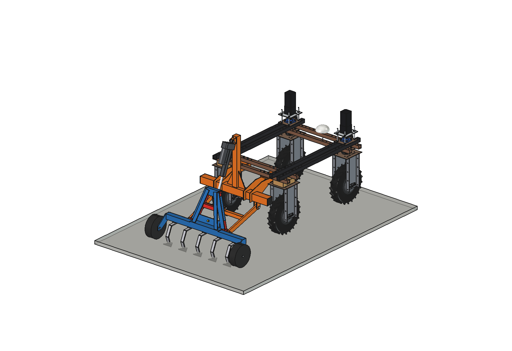
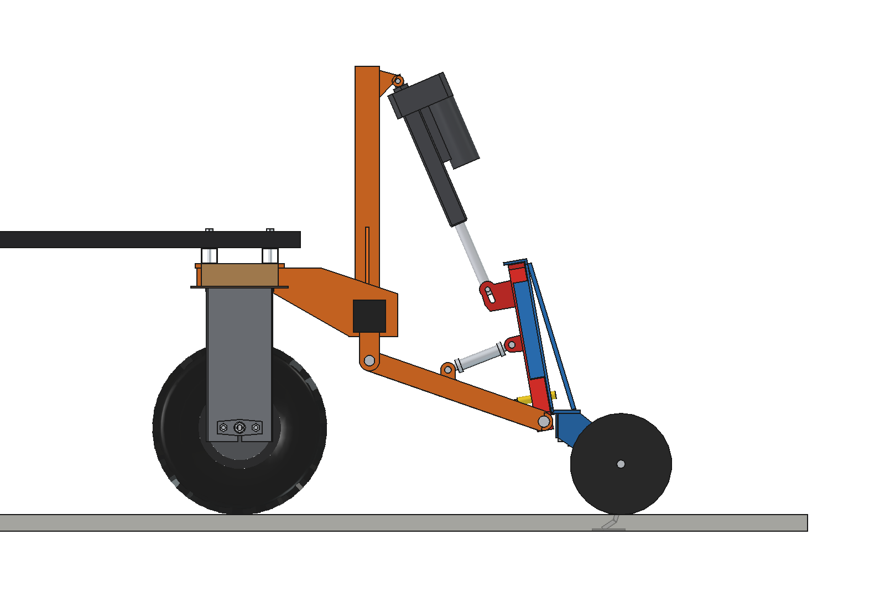
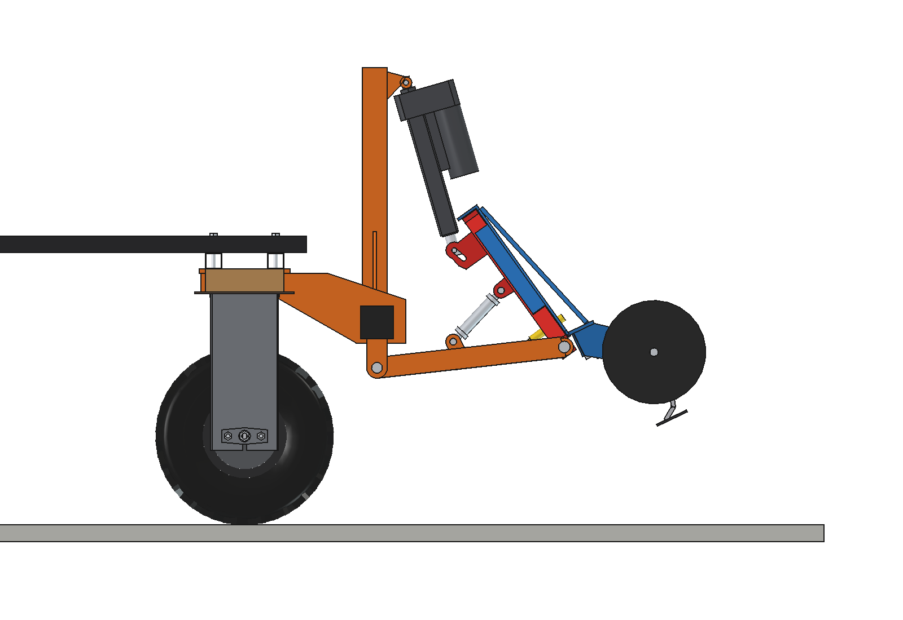
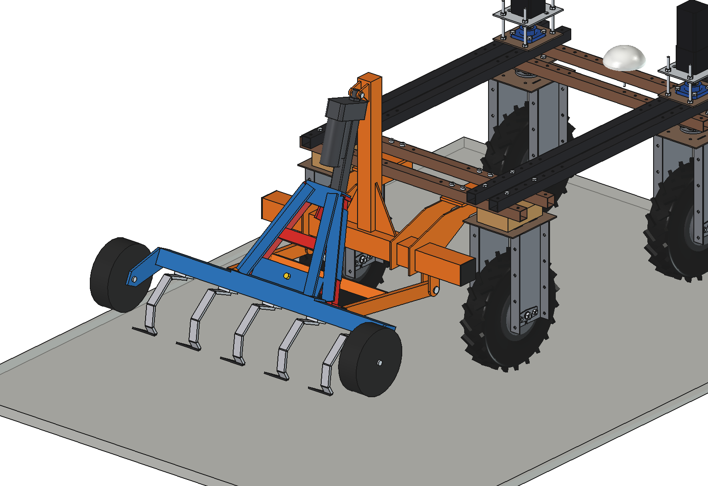
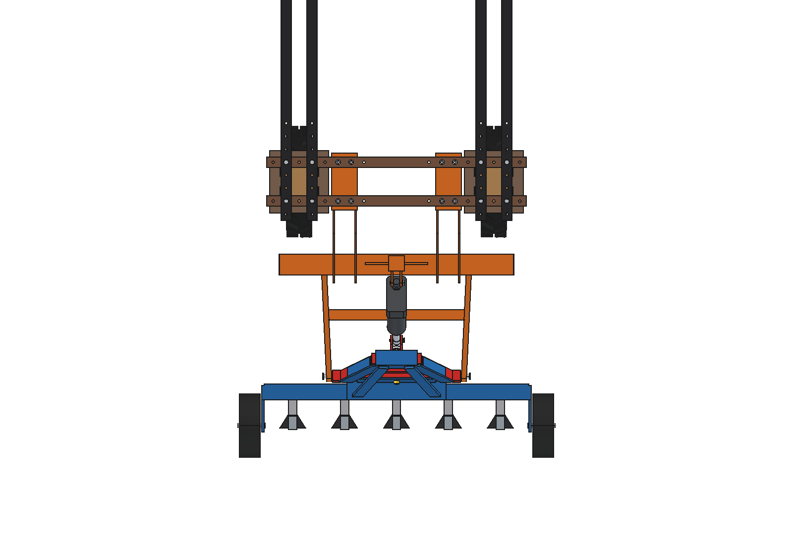
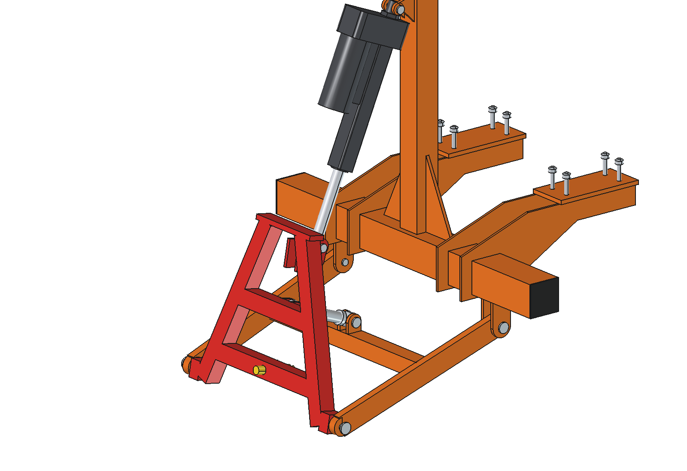
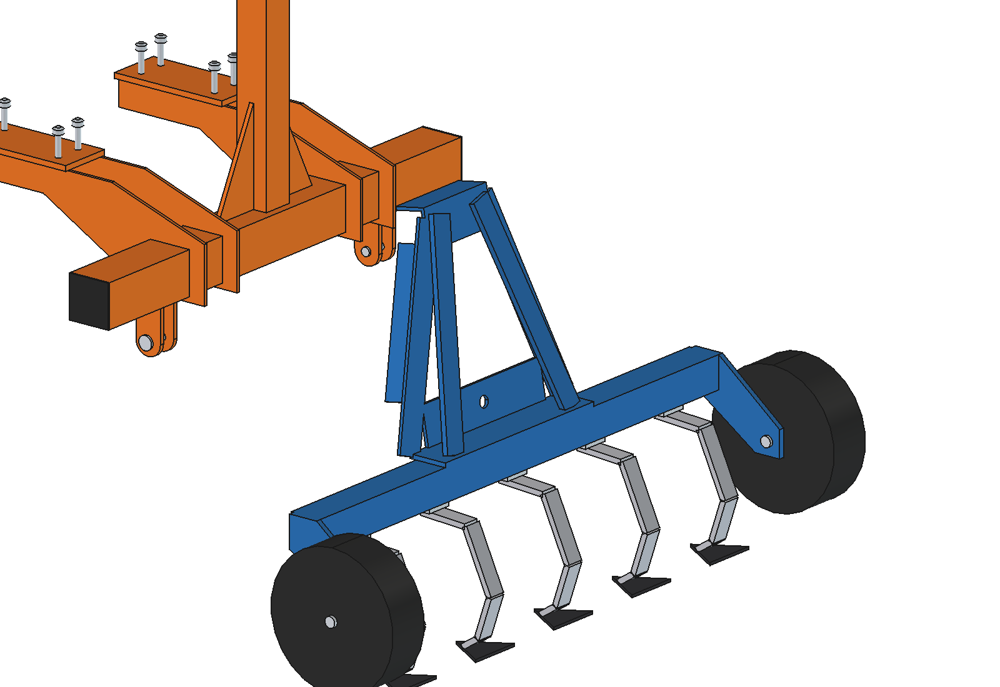
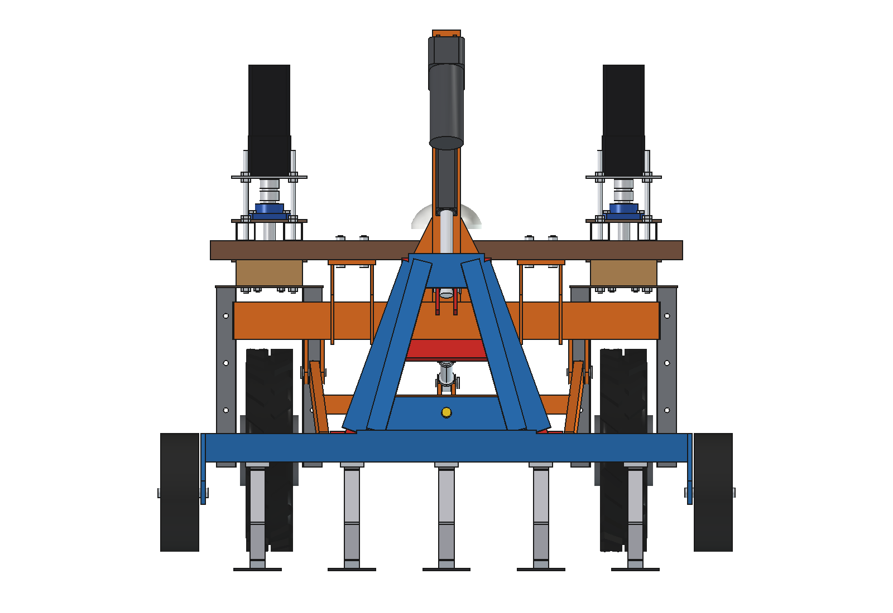
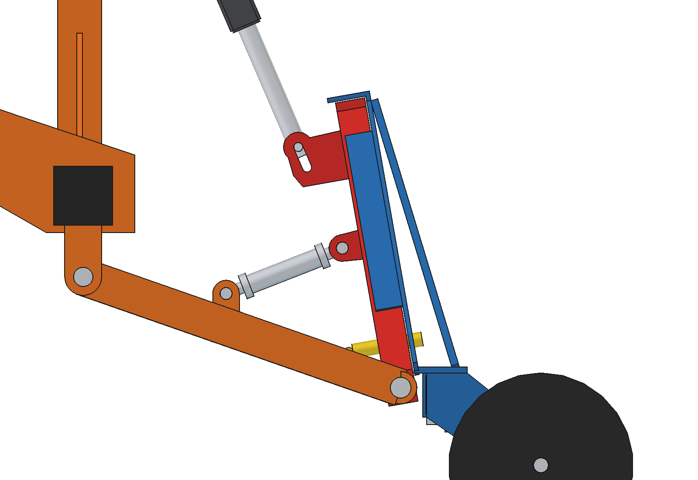

# Three-point hitch, A-frame (LA36 as top link)

A **triangle quick coupler (A-frame)**, as on the front linkage of many tractors, at the rear of the Bruut OpenAgbot
(standard robot), sized for the robot. A **Linak LA36** sits where the top link would be: from a tower on the rear
toolbar to the apex of the male triangle. Retracting it lifts the hitch. Drawn with the small cultivator of
[`../simple/`](../simple/README.md), which now carries a female triangle instead of category 0 pins: drive under it,
lift, the triangle centres itself and the latch drops in.

<p align="center">
  
</p>

| Work (cultivator on its gauge wheels, LA36 floating) | Lifted (LA36 retracted, lower pins +201 mm) |
| --- | --- |
|  |  |
|  |  |
|  |  |
|  |  |

## Build

- **Mount**: the rear toolbar of three point hitch/simple (80 x 80 x 4 on 2 hangers, 8 x M10 through the rear lower
  beams) and its 4 lugs for the lower pivots (O16, y -820, z 380). On top of the toolbar a **tower**: post
  60 x 60 x 4 with 2 gussets, up to z 1106, and a clevis (2 x 8 mm) behind it for the back fixture of the LA36.
- **Lift frame** (one rigid body that turns about the lower pivots): 2 lower arms 50 x 20 (455 mm), a cross tube
  40 x 40 x 3, a **pitch brace** (turnbuckle O26, 169 mm) from the cross tube to the triangle, and the **male
  triangle**: legs 40 x 40 x 3 from 400 mm apart at the lower pins to 120 mm at the apex, 390 high, 10 degrees
  leaning forward, bottom and middle cross tubes, a 12 mm apex plate, foot lugs on O16 pins, 2 lugs with a 30 mm slot
  for the LA36 rod eye and a spring latch O20 with T-handle.
- **LA36** (24 V, 20 mm spindle, gear F: 1700 N, stroke 200, installation 400): housing on the tower, rod eye in the
  slot on the apex. In work the LA36 stands at 575 mm and the rod pin sits in the middle of the slot: the frame floats
  on the gauge wheels. Lifting closes the slot and pulls the apex towards the tower.
- **Female triangle** (on the implement): 6 mm plates behind the male legs, 5 mm lips beside them (2 mm play), a hook
  plate over the apex, a lock plate with the hole for the latch, welded to a base plate on the cultivator toolbar
  and held by 2 stays 40 x 10.
- **Cultivator** (from simple): toolbar 60 x 60 x 4 (1.02 m), 5 S-tines 32 x 10 with 100 mm duckfoot shares at 200 mm,
  2 gauge wheels O250 x 80.

Mass ~84 kg: mount and tower 26.7, lift frame 18.2, LA36 5.0, cultivator with female triangle 33.7 kg.
Size 1222 x 1175 x 1146 mm (x, y, z).

## Key figures (`tpa_calc.report()`)

| | |
| --- | --- |
| Lower pins work / lifted | 230 / 431 mm (201 mm), frame turns 25.6 degrees: the cultivator tilts with it (shares 239 mm, gauge wheels 293 mm off the ground) |
| LA36 length | 422 (lifted) .. 575 mm (work, slot half open): 22 mm from the end stop in, 25 mm from the end stop out |
| LA36 pull | 678 N in work .. 901 N lifted (53 % of 1700 N), lever arm 337 .. 258 mm; empty hitch 154 .. 191 N |
| Lift | ~61 mm/s under the load: 2.5 s from work to lifted, 6.6 A at 24 V |
| Float in work (slot 30 mm) | frame -2.5 .. +2.6 degrees: lower pins -19 / +19 mm, gauge wheels -27 / +28 mm |
| What can hang in it (front axle >= 20 %) | ~48 kg with the 2 x 20 kg front counterweight, ~17 kg without |
| Axle load, cultivator lifted | front 26 % with the counterweight, 13 % without: **use the front counterweight** |
| Cultivator | 823 N draft at 40 mm, grip margin 1.34 (as simple) |
| Clearance to the rear tyres / wheel brackets | 128 mm |

Why and how these come out: see [RATIONALE.md](RATIONALE.md), including the list *Estimated, not measured*.

## Animation

| Animation | File |
| --- | --- |
| The robot works a strip with the cultivator: the LA36 stands at its work length, the frame floats and the gauge wheels ride over 4 mounds in their tracks (the rod pin slides in the slot, the shares go shallower over a mound). At the headland the LA36 retracts (2.4 s), the slot closes, the frame turns up 25.6 degrees and the robot stops with the cultivator lifted | `previews/animation_work_and_lift.gif` (generated, not in git; also copied to `animations/`) |

Run of the GIF (`animate_tpa.summary()`): 12 s, 121 frames at 10 fps (real speed), 6.8 m driven at 1 m/s, frame
floats 0 .. +1.9 degrees over the mounds, share depth 20 .. 40 mm, LA36 pull up to 901 N, lift 2.4 s.

## Files

| File | Contents |
| --- | --- |
| `tpa_params.py` | all dimensions: robot interface, A-frame coupler (male and female, also used by the parallel and lift variants), LA36 datasheet, lift frame, tower, cultivator; kinematics (`act_d`, `act_pin`, `act_length`, `lift_for_length`) |
| `tpa_parts.py` | one function per part, robot coordinates, work pose; `male_frame(base)`, `female(base)`, `cultivator_frame(base)` and the LA36 (`la36_body`, `la36_rod`, `la36_placements`) take a coupler origin and are imported by the other variants |
| `build_tpa.py` | model tree, `set_pose(lift, act_len)` (frame, implement and LA36 move together), checks, mass, `render_all()`, STEP |
| `tpa_calc.py` | linkage over the lift, float range, LA36 pull by virtual work, stroke check, speed and current, capacity against the front axle load, cultivator draft |
| `animate_tpa.py`, `make_gif_tpa.py` | animation on the robot, GIF with caption and panel |
| `run_in_freecad.py` | reload, build, print the key figures |
| `Three_Point_Hitch_A_Frame.FCStd`, `.step` | generated model (robot hidden in the FCStd) |
| `previews/` | images (PNG, in git) and the GIF (generated) |

The mount, the lower lugs and the cultivator parts are imported from `../simple/` (`tph_params`, `tph_parts`), not
copied.

## Use

```python
exec(open(r"F:\veldrobot\aanbouwdelen\three point hitch\a_frame\run_in_freecad.py").read())
import build_tpa
build_tpa.set_pose(lift=25.6)                  # lifted
build_tpa.set_pose(0, act_len=575)             # work, LA36 at its work length (rod pin floats in the slot)
build_tpa.check_poses()                        # lift and float poses: must be {}
import animate_tpa; animate_tpa.build(); animate_tpa.play()
```
