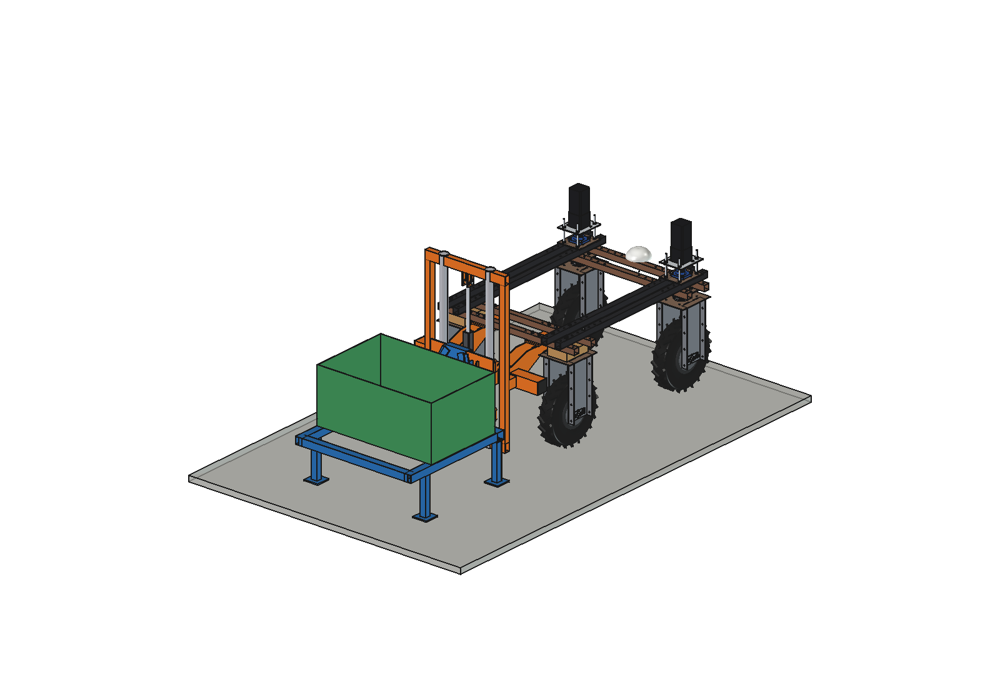
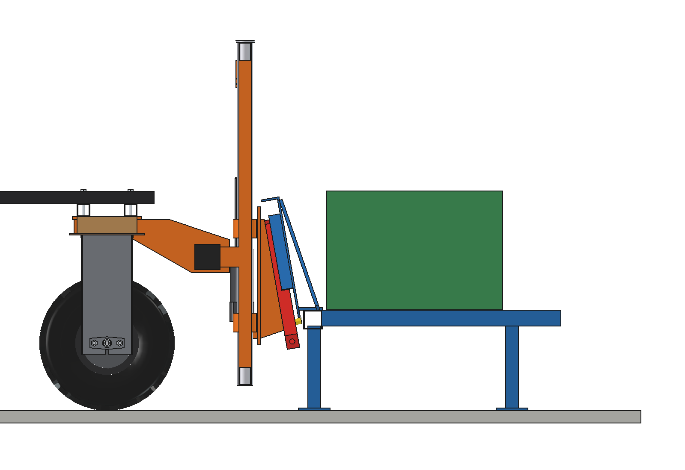
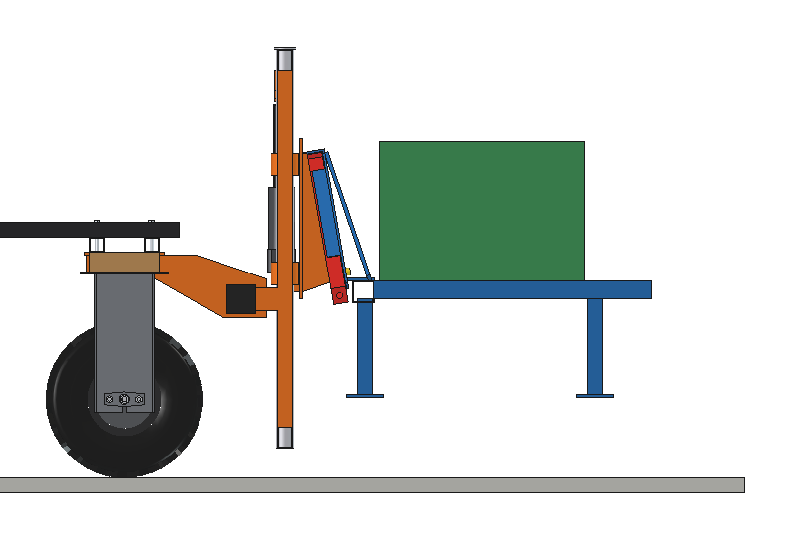
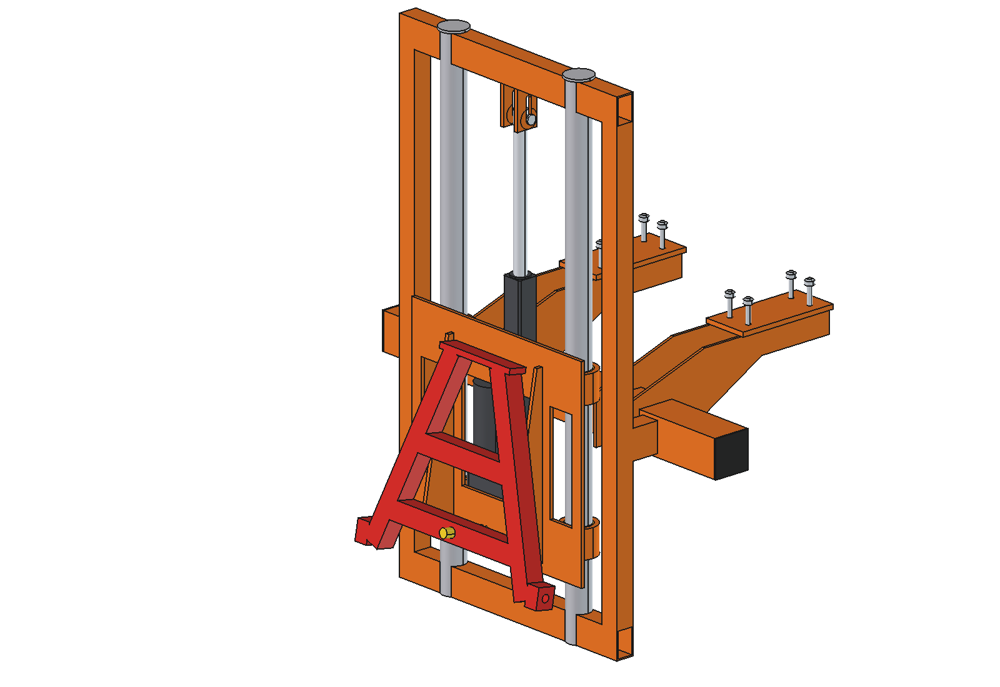
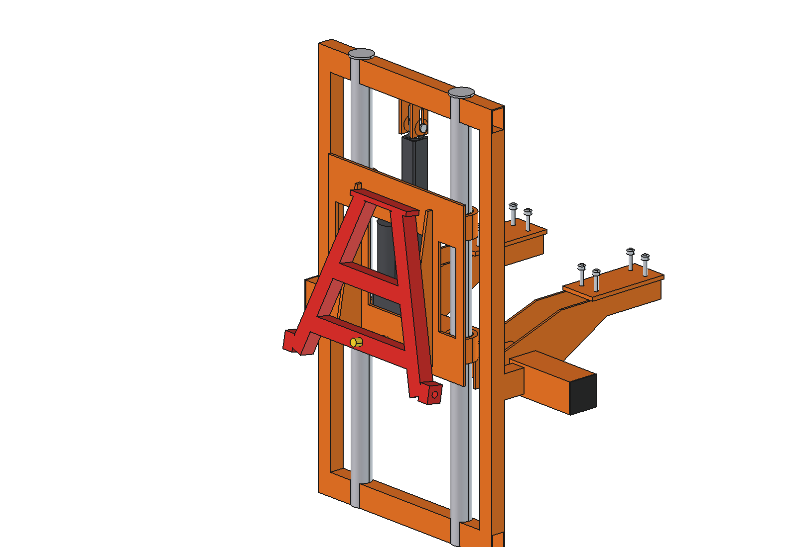
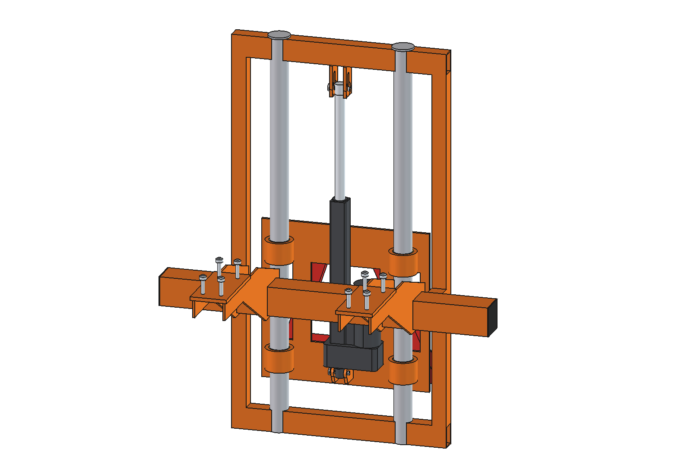
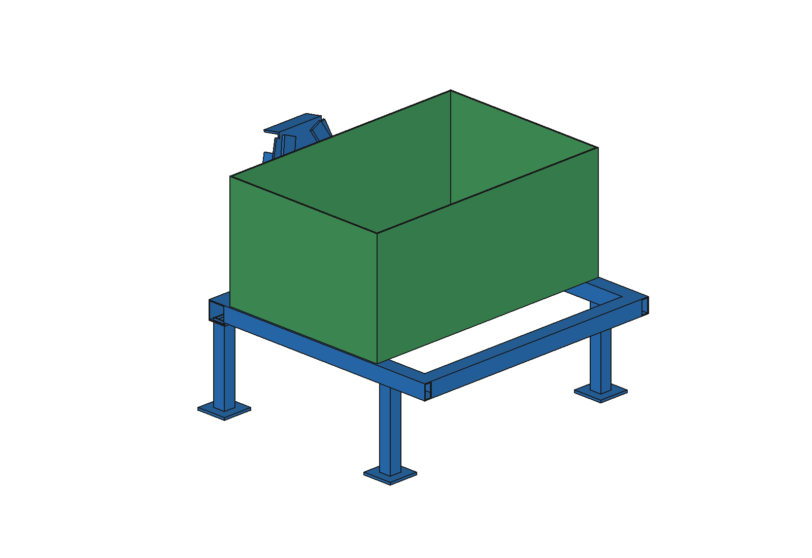
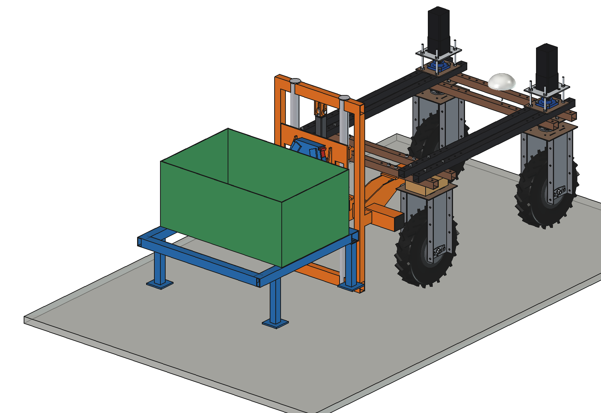
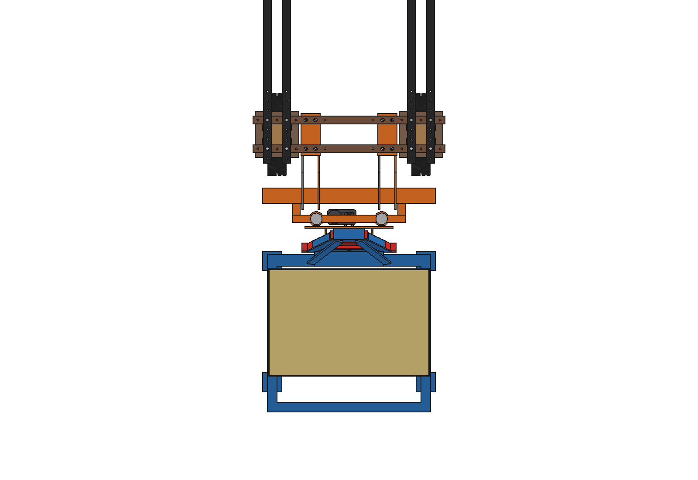

# Three-point hitch, lift mast (raising and lowering machines)

A **lift mast** at the rear of the Bruut OpenAgbot for picking up, carrying and setting down machines: 2 fixed round
columns O50 x 4, a **carriage on 4 plain-bush housings** with the **male A-frame triangle** of
[`../a_frame/`](../a_frame/README.md), and a **Linak LA36** (stroke 300) straight up between the carriage and the top
of the mast. The machine goes straight up and down (it does not tilt). Drawn with a demo machine: a box on a frame
with 4 parking legs and a female triangle. The robot reverses under it with the carriage low, lifts (the triangle
centres the machine, the latch drops in, the legs come off the ground), drives off and sets it down somewhere else.

<p align="center">
  
</p>

| Carriage low, machine on its legs | Machine lifted 220 mm |
| --- | --- |
|  |  |
|  |  |
|  |  |
|  |  |

## Build

- **Mount**: the rear toolbar of three point hitch/simple (80 x 80 x 4 on 2 hangers, 8 x M10).
- **Mast**: bottom and top cross tubes 60 x 40 x 3 (z 80 and 1115), 2 side uprights 40 x 40 x 3 at x +-275 and
  2 brackets to the rear face of the toolbar (clear of the hanger webs); between the cross tubes 2 **columns
  O50 x 4** at x +-170, y -940. Under the top cross tube 2 plates with a 40 mm **slot** for the LA36 rod pin.
- **Carriage**: plate 8 mm with 3 windows, 4 bush housings (tube O76 x 60 with an iglidur bush, 300 mm apart per
  column), 2 wedge brackets to the male triangle (10 degrees lean, as on the other variants), 2 lugs for the LA36
  back fixture. Travel 280 mm: coupler origin z 220 .. 500.
- **LA36** (24 V, 20 mm spindle, gear F: 1700 N, stroke 300, installation 500): housing on the carriage, turned so
  the motor lies along x between the columns (it fits between the toolbar and the carriage plate), rod up to the
  slot under the top cross tube. Retracting lifts. The slot lets the carriage rise 40 mm on its own when an implement
  is carried by its own wheels.
- **Demo machine**: female triangle (a_frame), front cross tube 60 x 60, side rails 50 x 50, 4 parking legs
  40 x 40 with foot plates, a PE box 840 x 560 x 380 with 15 kg of seed.

Mass: mast and mount 44.2, carriage with triangle 21.7, LA36 5.5 kg (hitch ~71 kg); demo machine 50.1 kg with its
load. Size of the hitch 906 x 731 x 1100 mm (x, y, z).

## Key figures (`tpl_calc.report()`)

| | |
| --- | --- |
| Travel | 280 mm: 60 mm to lift the triangle into the female, then the machine 220 mm off its legs |
| LA36 length | 790 (low) .. 510 mm (up): 10 mm from both end stops |
| LA36 pull | 957 N with the demo machine (704 N weight + 253 N friction of the bushes: the load hangs 490 mm behind the columns), 56 % of 1700 N; empty 226 N; the LA36 could lift a ~100 kg machine |
| Speed | ~61 mm/s: 4.6 s to lift, ~4 s to lower, 6.8 A at 24 V |
| Front axle with the machine lifted | 15 % with the 2 x 20 kg counterweight: **~58 kg front counterweight is needed** (6 plates of 11 kg give 22 %); without counterweight 2 % |
| What can hang in it (front axle >= 20 %, 2 x 20 kg counterweight) | ~44 kg with the cg 150 mm behind the triangle, ~36 kg at the cg of the demo machine |
| Clearance to the rear tyres / wheel brackets | 237 mm |

Why: [RATIONALE.md](RATIONALE.md).

## Animation

| Animation | File |
| --- | --- |
| The robot reverses towards the machine on its parking legs with the carriage low (the male triangle passes 60 mm under the female), stops, the LA36 lifts the triangle into the female and the machine 220 mm off its legs, the robot carries it 2.2 m forward, sets it down on its legs, lowers until the triangle is free and drives away | `previews/animation_pick_up_and_set_down.gif` (generated, not in git; also copied to `animations/`) |

Run of the GIF (`animate_tpl.summary()`): 23.6 s, 237 frames at 10 fps (real speed), lifting 4.5 s, lowering 4.5 s,
LA36 up to 957 N, machine moved 2.2 m. `animate_tpl.check_run()` (robot, mast and carriage against the machine every
8 frames) is empty.

## Files

| File | Contents |
| --- | --- |
| `tpl_params.py` | mast, carriage, LA36, demo machine dimensions; `act_length`, `act_pin`, `machine_dz`; coupler and LA36 datasheet from `../a_frame/tpa_params.py` |
| `tpl_parts.py` | mast frame, columns, slot plates, housings, bushes, carriage plate, pins, machine frame, box, load; male triangle, latch, female triangle and LA36 from `../a_frame/tpa_parts.py` |
| `build_tpl.py` | model tree, `set_pose(dz)`, checks (`check_interference`, `check_poses`, `clearance`, `ground_contact`), mass, `render_all()`, STEP |
| `tpl_calc.py` | LA36 pull with the bush friction, speed, current, stroke, capacity and axle loads, front counterweight needed |
| `animate_tpl.py`, `make_gif_tpl.py` | animation on the robot (pick up, carry, set down), `check_run()`, GIF with caption and panel |
| `run_in_freecad.py` | reload, build, print the key figures |
| `Three_Point_Hitch_Lift.FCStd`, `.step` | generated model with the demo machine (robot hidden in the FCStd) |

## Use

```python
exec(open(r"F:\veldrobot\aanbouwdelen\three point hitch\lift\run_in_freecad.py").read())
import build_tpl
build_tpl.set_pose(280)                        # carriage up, machine lifted 220 mm
build_tpl.check_poses()                        # must be {}
import animate_tpl; animate_tpl.build(); animate_tpl.play()
```
