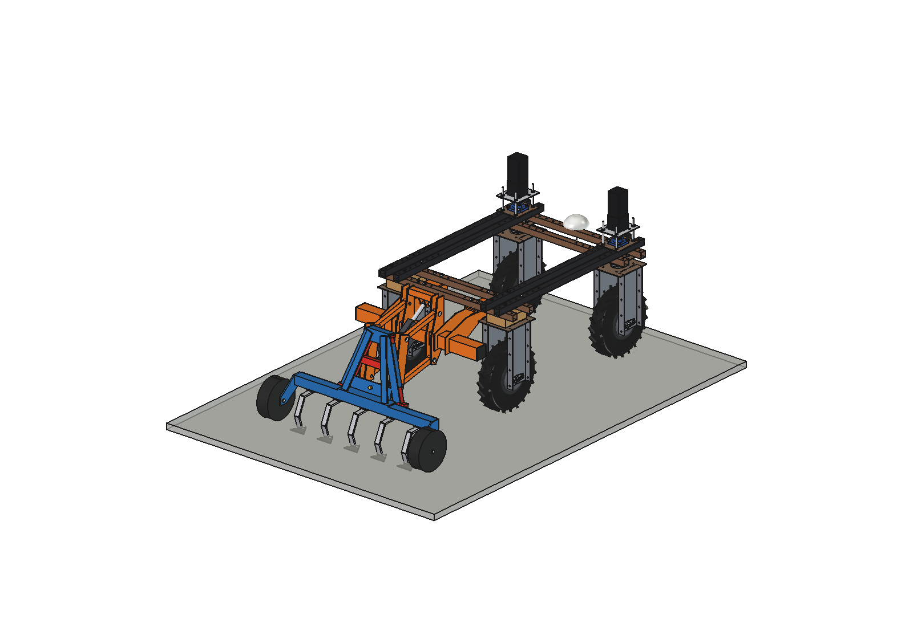
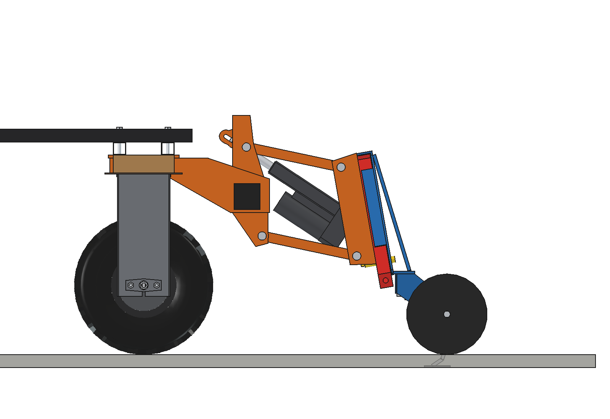
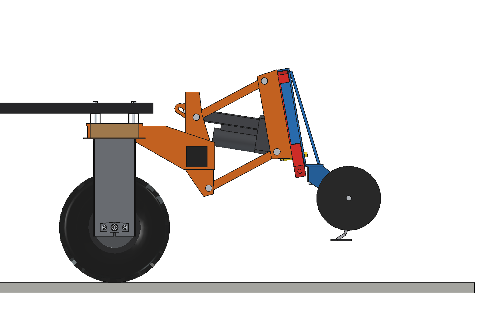
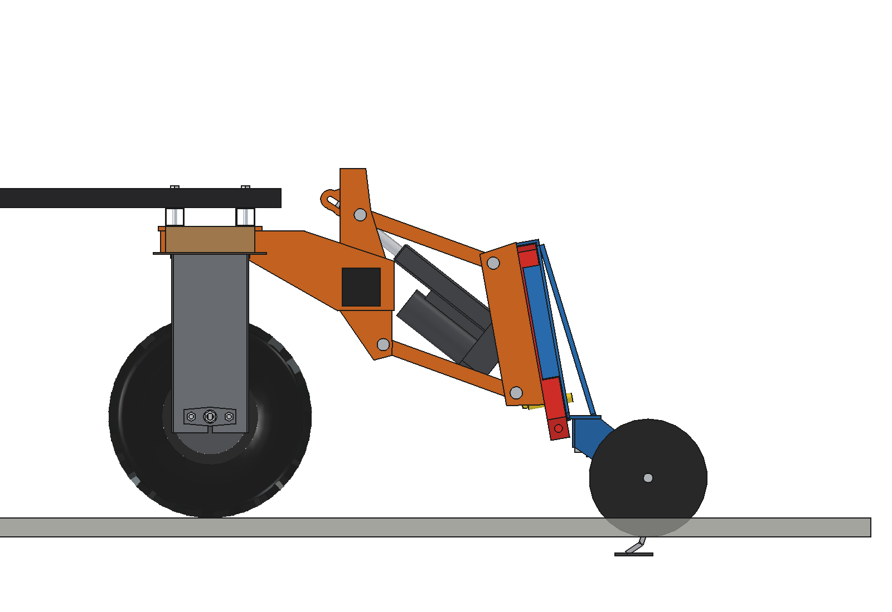
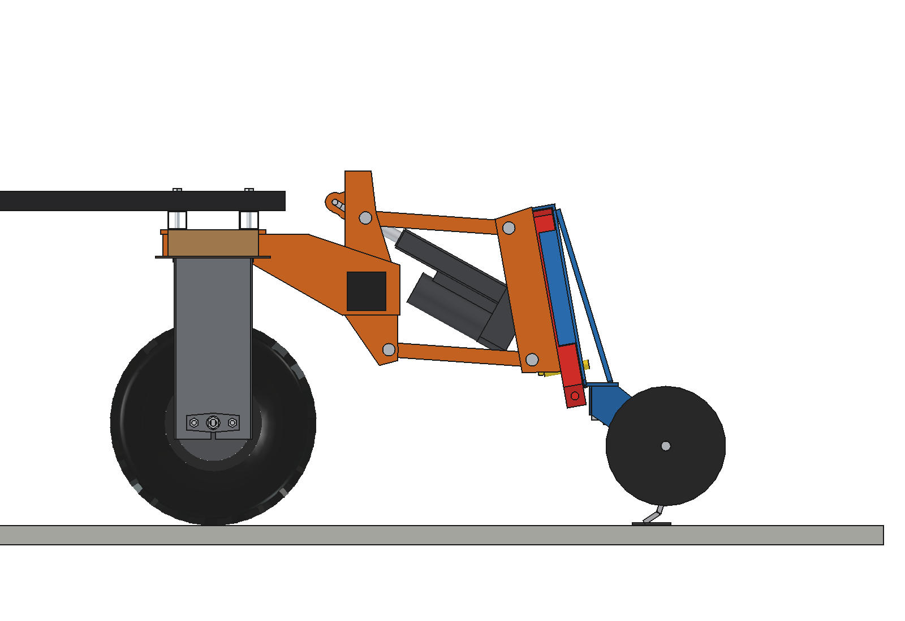
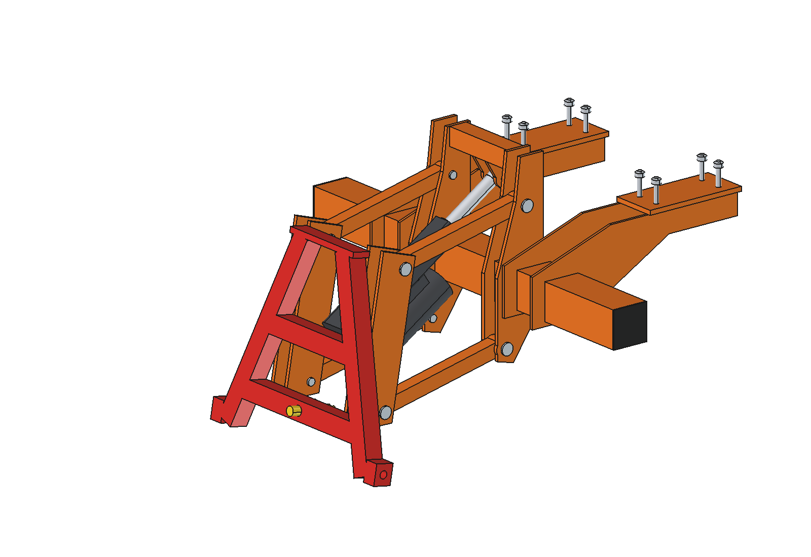
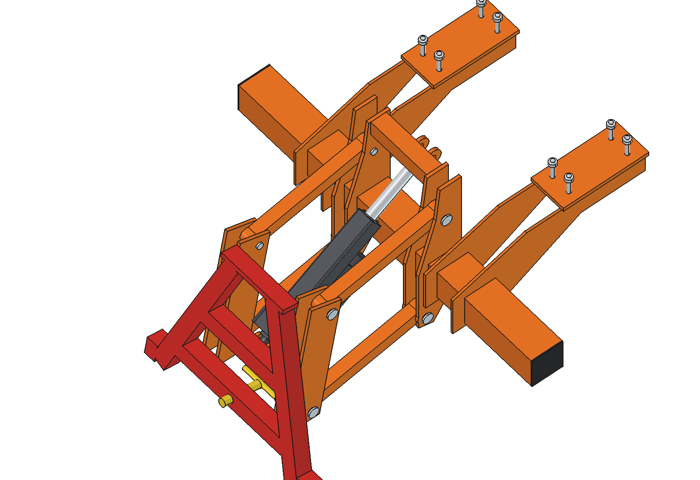
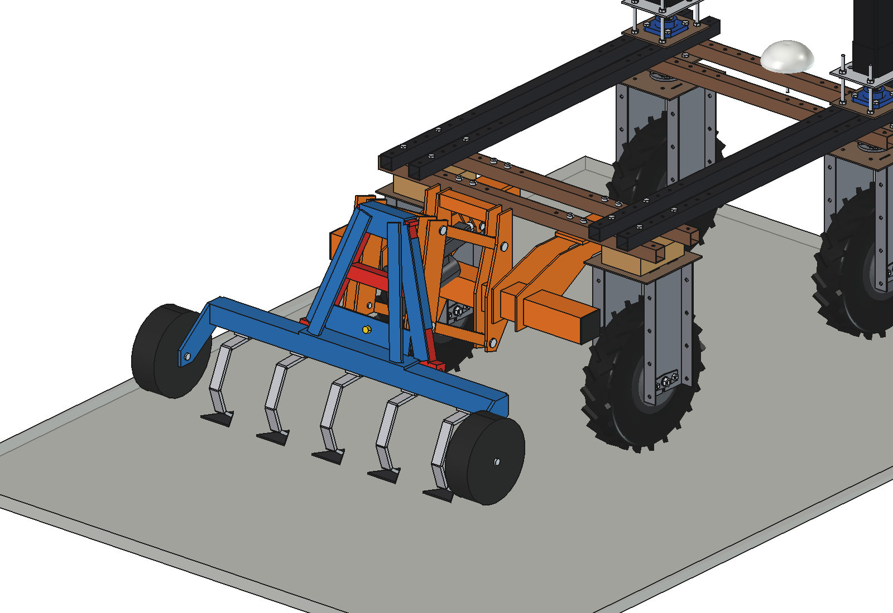
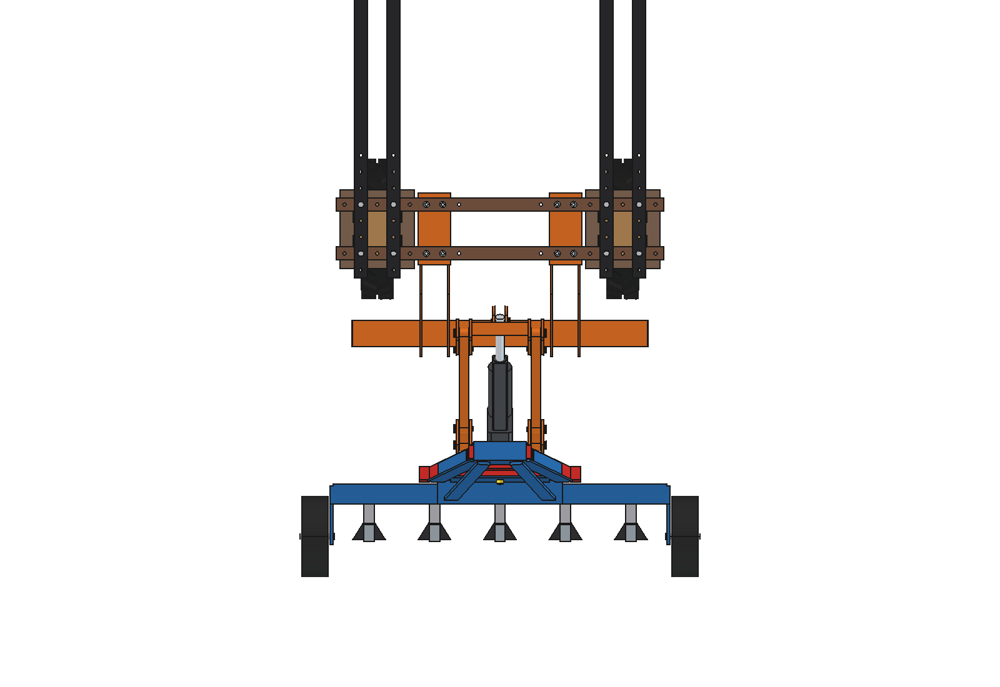

# Three-point hitch, parallel (suspension of the liquid fertilizer applicator)

The suspension of the [liquid fertilizer applicator advanced V2](../../liquid%20fertilizer%20applicator/concept%20versions/advanced_V2/README.md)
made into a general hitch: a **headstock** on the rear toolbar, a **parallel linkage** (2 pairs of links) and a
**Linak LA36** on the diagonal whose rod eye runs in a **slot**, so the implement floats in work and stays **level**
over the whole lift. The rear frame of the linkage is a carrier with the **male A-frame triangle** of
[`../a_frame/`](../a_frame/README.md), so every implement with a female triangle hangs on it; drawn with the same
small cultivator.

<p align="center">
  
</p>

| Work | Lifted 203 mm (level) |
| --- | --- |
|  |  |
|  |  |
| float: lowest (rod pin at the slot end, -40 mm) | float: highest (pin at the far end, +41 mm) |
|  |  |
|  |  |

## Build

- **Mount**: the rear toolbar of three point hitch/simple (80 x 80 x 4 on 2 hangers, 8 x M10). Welded on it the
  **headstock**: 4 cheeks 8 mm (pairs at x +-110, notched around the toolbar) with the front pins O16 at
  (y -867, z 368) and (-818, 644), a top cross tube 40 x 40 x 3 and 2 plates under it with the **31 mm slot** for the
  LA36 rod pin.
- **Parallel linkage**: 4 links 30 x 30 x 3, 300 mm pin to pin, -12 degrees in work, +28 degrees lifted. The rear
  pins sit 280 mm apart along the triangle (10 degrees lean), the front pins the same vector apart, so the carrier
  translates without turning.
- **Carrier**: 4 plates 8 mm bolted to the bottom and middle cross tubes of the male triangle (a_frame, without its
  LA36 and brace lugs), the rear pins, 2 lugs for the LA36 back fixture.
- **LA36** (24 V, 16 mm spindle, gear F: 2000 N, stroke 150, installation 350): housing on the carrier, motor below,
  rod up and forward to the slot in the headstock. In work it stands at 487 mm: the rod pin rests at the slot end
  with the carrier at the bottom of its float, so the cultivator floats -40 .. +41 mm around the work pose on its gauge
  wheels. Lifting closes the slot and pulls the carrier up.
- **Implement**: the cultivator with female triangle of a_frame (5 S-tines, duckfoot shares, 2 gauge wheels).

Mass ~85 kg: mount and headstock 27.9, links 4.1, carrier with triangle 14.0, LA36 4.8, cultivator 33.7 kg.
Size 1222 x 1175 x 782 mm (x, y, z): 360 mm lower than the a_frame variant, no tower.

## Key figures (`tpp_calc.report()`)

| | |
| --- | --- |
| Lift | carrier straight up 203 mm (and 29 mm forward), the implement stays level: shares 163 mm, gauge wheels 203 mm off the ground |
| LA36 length | 370 (lifted) .. 487 mm (work): 20 mm from the end stop in, 13 mm from the end stop out |
| LA36 pull | 1306 N at the start of the lift .. 718 N lifted (65 % of 2000 N); empty hitch 421 N |
| Lift time | ~49 mm/s under the load: 2.4 s, 7.6 A at 24 V |
| Float in work (slot 31 mm) | links -20 .. -4 degrees: carrier -40 / +41 mm, level |
| What can hang in it (front axle >= 20 %) | ~49 kg with the 2 x 20 kg front counterweight, ~17 kg without; the LA36 lifts ~60 kg |
| Axle load, cultivator lifted | front 26 % with the counterweight, 13 % without: use the front counterweight |
| Cultivator | 823 N draft at 40 mm, grip margin 1.27 |
| Clearance to the rear tyres / wheel brackets | 239 mm |

Why and how these come out, and the differences with the applicator: [RATIONALE.md](RATIONALE.md).

## Animation

| Animation | File |
| --- | --- |
| The robot works a strip with the cultivator: the LA36 stands at its work length, the parallel linkage floats and the cultivator rides level over 5 mounds (up to 38 mm) in the gauge wheel tracks. At the headland the LA36 retracts (2.3 s), the slot closes and the carrier goes straight up 203 mm; the robot stops | `previews/animation_float_and_lift.gif` (generated, not in git; also copied to `animations/`) |

Run of the GIF (`animate_tpp.summary()`): 11.9 s, 120 frames at 10 fps (real speed), 6.8 m driven at 1 m/s, carrier
floats 0 .. +33 mm, share depth 7 .. 40 mm (the whole cultivator rises over a mound), LA36 pull up to 1289 N, lift
2.3 s.

## Files

| File | Contents |
| --- | --- |
| `tpp_params.py` | linkage, headstock, carrier, LA36 dimensions; kinematics (`front_pins`, `shift`, `act_length`, `float_slot`, `act_pin`, `float_limits`); coupler, LA36 datasheet and cultivator from `../a_frame/tpa_params.py` |
| `tpp_parts.py` | headstock cheeks, cross tube, slot plates, pins, links, carrier plates and pins; male triangle, latch, LA36 and cultivator from `../a_frame/tpa_parts.py` |
| `build_tpp.py` | model tree, `set_pose(theta, act_len)`, checks (`check_interference`, `check_poses`, `clearance`, `ground_contact`), mass, `render_all()`, STEP |
| `tpp_calc.py` | lift table, float range, LA36 pull by virtual work, stroke, speed, current, capacity, axle loads, draft |
| `animate_tpp.py`, `make_gif_tpp.py` | animation on the robot, GIF with caption and panel |
| `run_in_freecad.py` | reload, build, print the key figures |
| `Three_Point_Hitch_Parallel.FCStd`, `.step` | generated model (robot hidden in the FCStd) |

## Use

```python
exec(open(r"F:\veldrobot\aanbouwdelen\three point hitch\parallel\run_in_freecad.py").read())
import build_tpp
build_tpp.set_pose(28)                         # lifted
build_tpp.set_pose(-12, act_len=487)           # work, rod pin floats in the slot
build_tpp.check_poses()                        # must be {}
import animate_tpp; animate_tpp.build(); animate_tpp.play()
```
