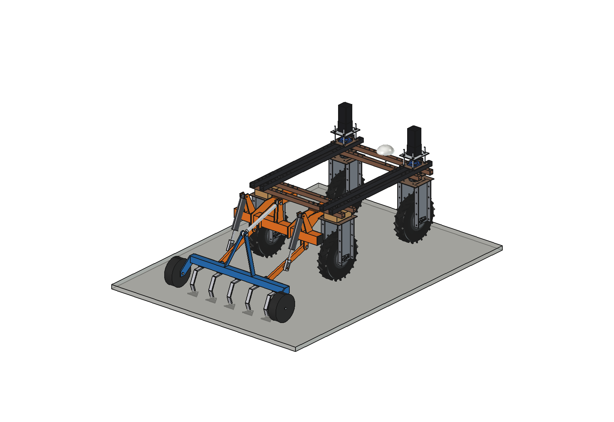
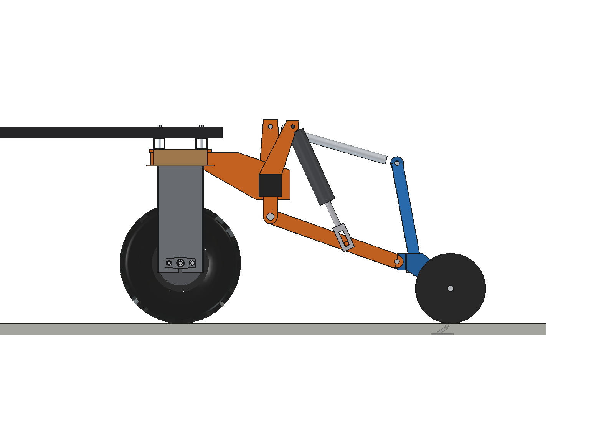
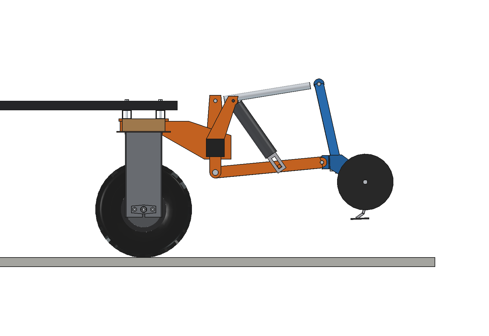
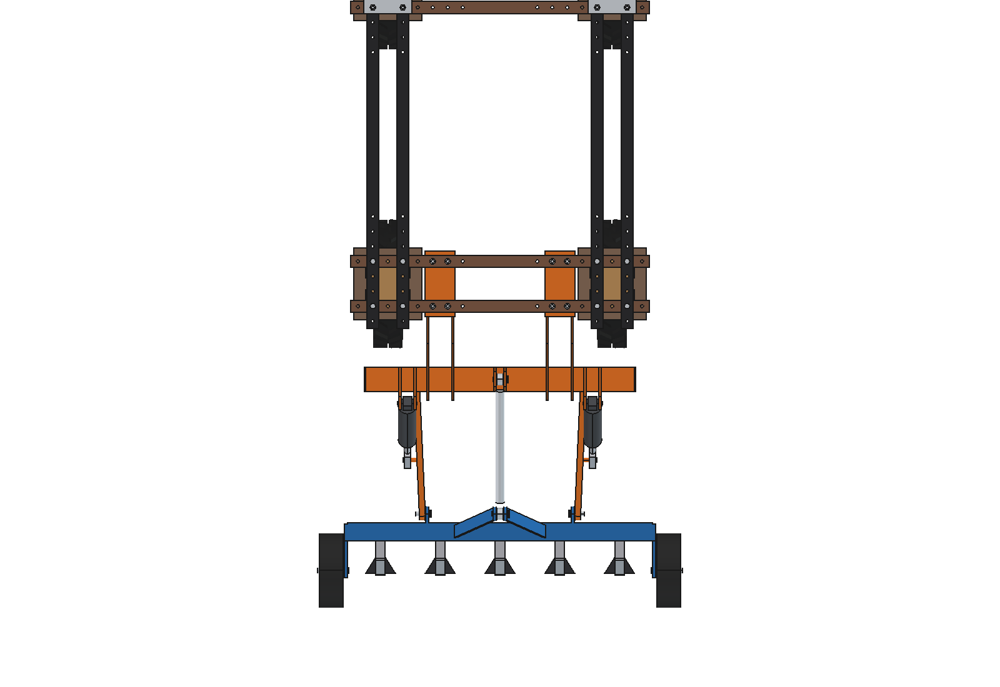
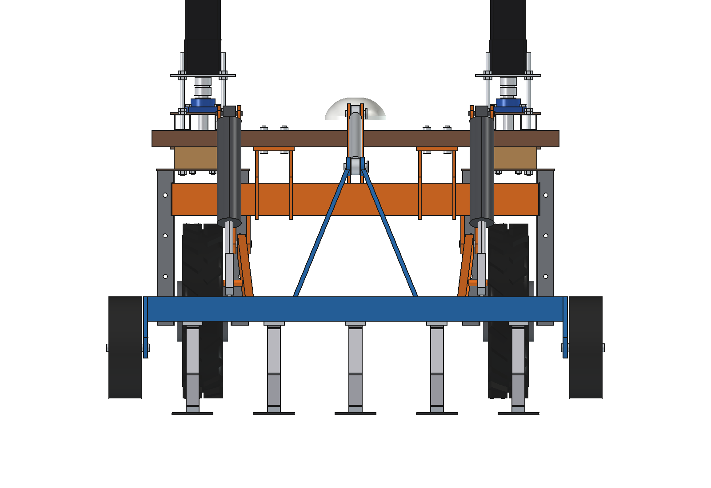
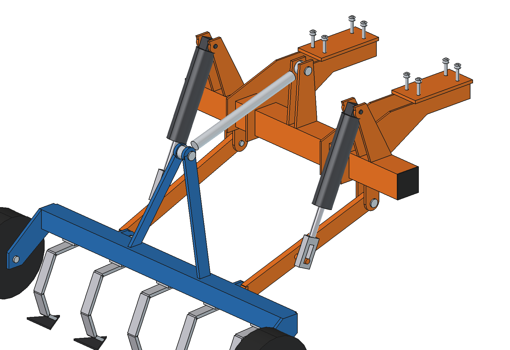
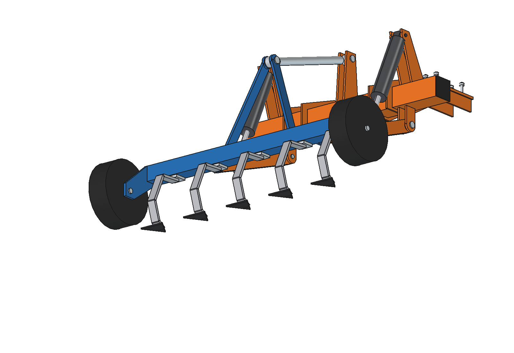

# Three-point hitch (simple)

Category 0 three-point linkage at the rear of the Bruut OpenAgbot (standard robot), with two 24 V actuators as lift rods,
so standard sub-compact implements can hang on the robot. Drawn with a small 1.0 m cultivator (5 S-tines with duckfoot
shares, gauge wheels) as the implement, which also covers the *small cultivator* idea.

<p align="center">
  
</p>

| Work (cultivator on its gauge wheels) | Transport (lower links up 25 degrees) |
| --- | --- |
|  |  |
|  |  |
|  |  |

## Build

- **Mount**: the rear toolbar of the grassland harrow / inter-row hoe (80 x 80 x 4 on 2 hangers, 8 x M10), 4 lugs for
  the lower links under it, a top link bracket and 4 lugs for the lift rods on top.
- **Linkage, category 0**: lower links 50 x 20 with O16 pins, lower hitch spacing 500, mast height 350, top link
  turnbuckle O30 (453 mm).
- **Lift rods**: 2 x 24 V actuator 3000 N, stroke 150, rod eye with a 40 mm slot (the implement floats in work).
- **Cultivator**: toolbar 60 x 60 x 4 (1.02 m), A-frame mast, 5 S-tines 32 x 10 at 200 mm with 100 mm duckfoot shares
  (40 mm deep), 2 gauge wheels O250 x 80.

Mass ~71 kg (hitch 36 kg, cultivator 28 kg, lift rods 7 kg). Size 1222 x 1195 x 765 mm (x, y, z).

## Key figures (`tph_calc.report()`)

| | |
| --- | --- |
| Lower pins work / transport | 220 / 425 mm (205 mm lift), implement level within 2 degrees |
| Lift rods | 358 .. 475 mm, ~310 N each with the cultivator, capacity ~270 kg at the hitch, ~20 s full lift |
| What can hang in the hitch (front axle >= 20 %) | ~56 kg with the 2 x 20 kg front counterweight, ~25 kg without |
| Axle load front / rear, cultivator lifted | 85 / 179 kg with counterweight (32 %), 42 / 182 kg without (19 %) |
| Cultivator | 1.0 m, draft 600 + 208 N, grip margin 1.29, ~1.1 kW, ~0.29 ha/h at 1 m/s |
| Clearance to the rear tyres / wheel brackets | 128 mm |

Why and how these come out: see [RATIONALE.md](RATIONALE.md), including the list *Estimated, not measured*.

## Files

| File | Contents |
| --- | --- |
| `tph_params.py` | all dimensions, robot interface, category 0 linkage, cultivator, work parameters, masses; `linkage()` solves the four-bar |
| `tph_parts.py` | one function per part, robot coordinates, work pose |
| `build_tph.py` | model tree, `set_pose(lift)` (links, top link, rods and implement move together), checks, mass, `render_all()`, STEP |
| `tph_calc.py` | linkage over the lift, lift rod force by virtual work, hitch capacity against the front axle load, cultivator draft |
| `run_in_freecad.py` | reload, build, print the key figures |
| `Three_Point_Hitch.FCStd`, `Three_Point_Hitch.step` | generated model (robot hidden in the FCStd) |
| `previews/` | images |

## Use

```python
exec(open(r"F:\veldrobot\aanbouwdelen\three point hitch\simple\run_in_freecad.py").read())
import build_tph
build_tph.set_pose(lift=25)
build_tph.check_poses()        # lower links -5..25 degrees: must be {}
```

No animation yet (simple variant): the poses are checked statically with `check_poses()`.
