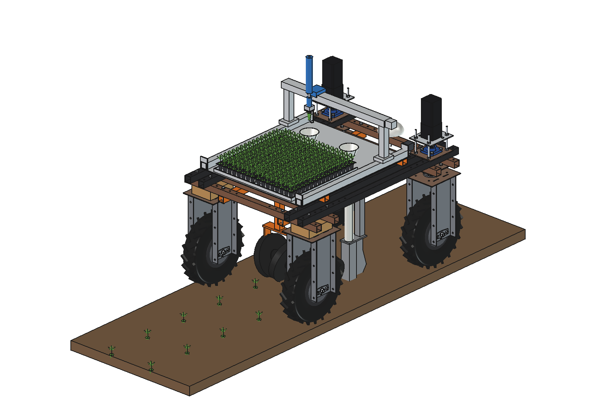
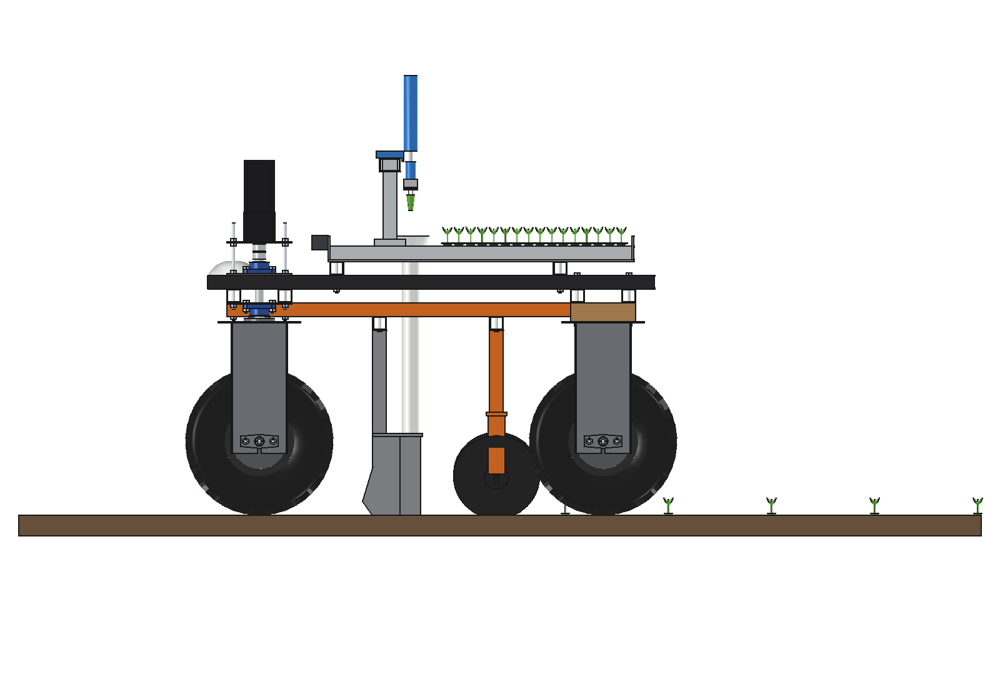
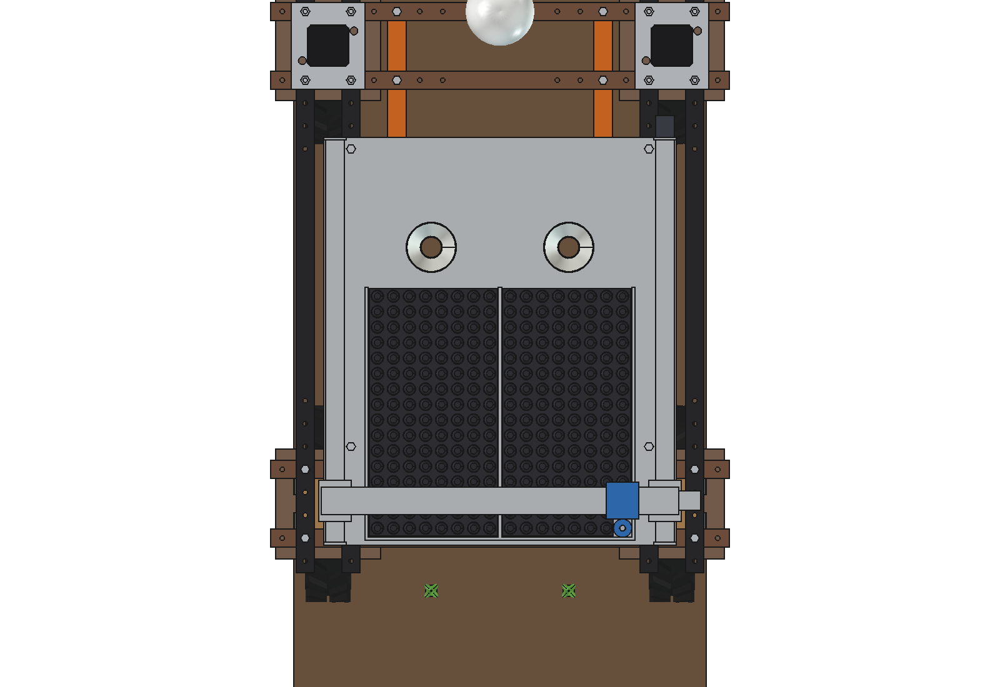
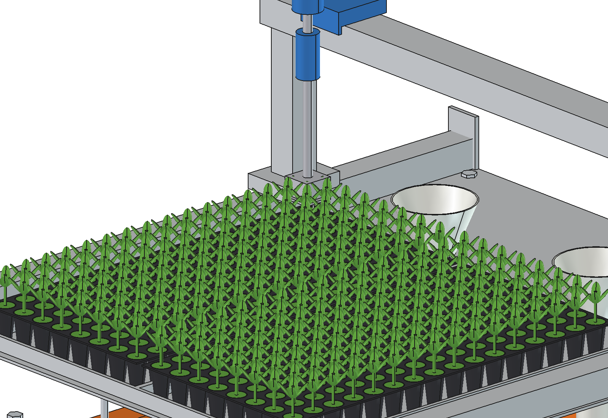
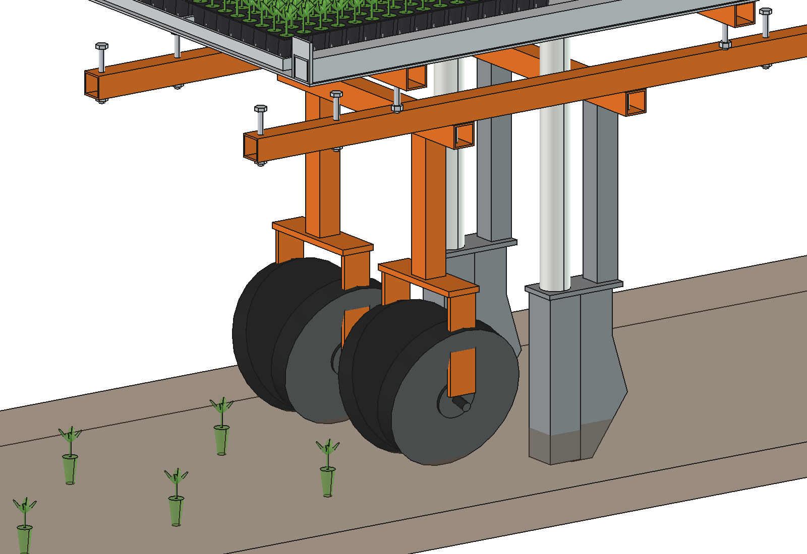

# Tray setter (simple)

Transplanter for the Bruut OpenAgbot (standard robot): takes plug seedlings out of 2 plug trays on top of the robot
and sets them out in 2 rows (x +-150, e.g. lettuce on a bed) at 300 mm in the row.

- **Tray table**: aluminium plate 770 x 890 on 2 cross tubes on the inner upper beams; 2 plug trays of 128 cells
  (8 x 16, 280 x 540) side by side, angle stops round them.
- **Gantry**: 2 Y rails along the table edges (x +-360), an X beam on 2 Y carriages, a picker carriage with a Z axis and
  a 4-needle gripper (needles 30 mm into the plug, a stripper plate pushes it off). GT2 belts and NEMA17 motors.
- **Funnels and drop tubes**: one per row in front of the trays; the plug falls through a O50 tube straight down.
- **Planting units under the belly**: on 2 rails under the lower beams (x +-225, as on the
  [drop-on-demand boom](../../drop%20on%20demand%20boom/simple/README.md)) 2 cross beams; per row a runner shoe
  (opens a slot 60 mm deep, the plug drops through its boot) and 2 press wheels O250 tilted 15 degrees that close
  the slot round the plug.

The robot drives slowly at a constant speed; the controller drops a plant when the shoe is at the next planting point
(odometry / RTK), alternating left and right row.

<p align="center">
  
</p>

| Side | Trays and gantry from above |
| --- | --- |
|  |  |
|  |  |

## Key figures (`tst_calc.report()`)

| | |
| --- | --- |
| Pick cycle | 1.6 s (front cell to its funnel) to 3.0 s (far rear cell of the other tray to the far funnel) |
| Speed | 2 rows at 300 mm need one plant per 3.1 s at **0.048 m/s**: the gantry sets the pace (max ~0.05 m/s) |
| Per set of trays | 256 plants = 38 m of bed, ~13 min; ~780 plants/h (~117 m of bed per hour) with tray changes |
| Draft | ~240 N for the 2 shoes |
| Battery | ~260 W: ~9 h, ~7000 plants per charge |
| Mass, axle loads | ~68 kg with full trays; 124 / 105 kg front / rear with the robot |
| Clearance | press wheels 77 mm from the rear tyres |

Why and how these come out: see [RATIONALE.md](RATIONALE.md), including the list *Estimated, not measured*.

No animation: the gantry poses (`build_tst.POSES`) are checked with `check_poses()`.

## Files

| File | Contents |
| --- | --- |
| `tst_params.py` | all dimensions: table, trays, gantry, funnels, belly rails, shoes, press wheels; cycle and work figures |
| `tst_parts.py` | one function per part, robot coordinates; seedling, bed for the renders |
| `build_tst.py` | model tree (table, fixed gantry, moving Y / X / Z groups, belly), `set_pose(name)`, checks (`check_interference`, `check_poses`, `clearance`), mass, `render_all()`, STEP |
| `tst_calc.py` | pick cycle, highest speed, plants and bed per hour and per set of trays, draft, battery, axle loads |
| `run_in_freecad.py` | reload, build, print the key figures |
| `Tray_Setter.FCStd`, `Tray_Setter.step` | generated model (robot hidden in the FCStd) |
| `previews/` | images |

## Use

```python
exec(open(r"F:\veldrobot\aanbouwdelen\tray setter\simple\run_in_freecad.py").read())
import build_tst
build_tst.set_pose("pick_rear_right")
build_tst.check_poses()        # all gantry poses and steering +-30: {}
build_tst.clearance()          # 77.3 mm, press wheel to a rear tyre
```
