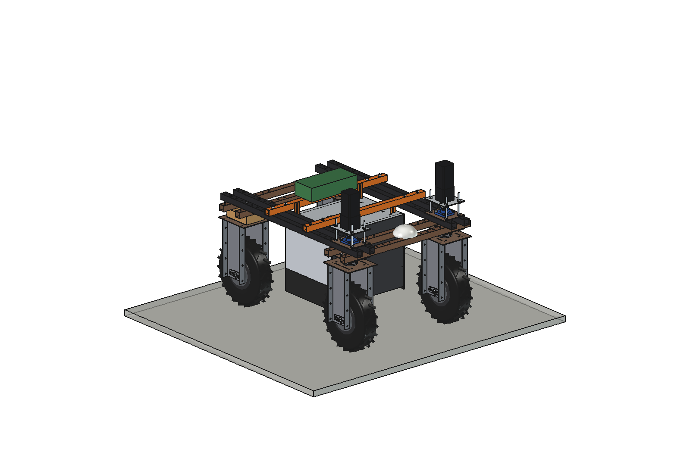
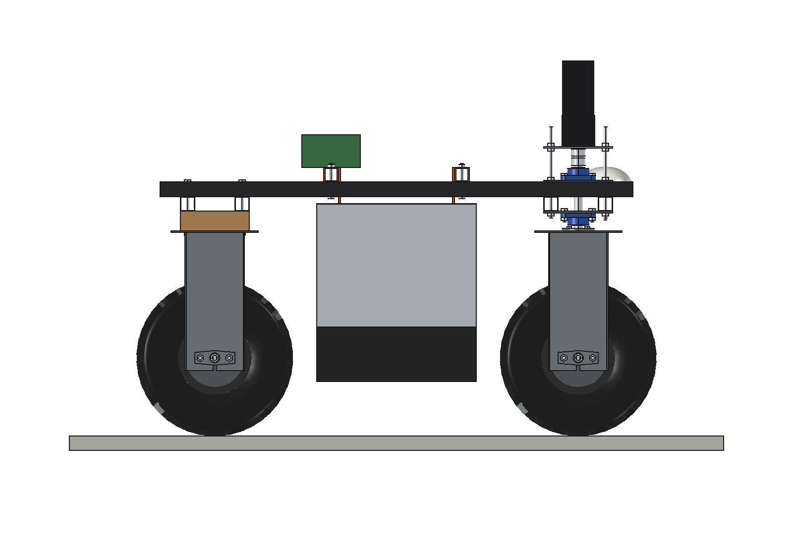
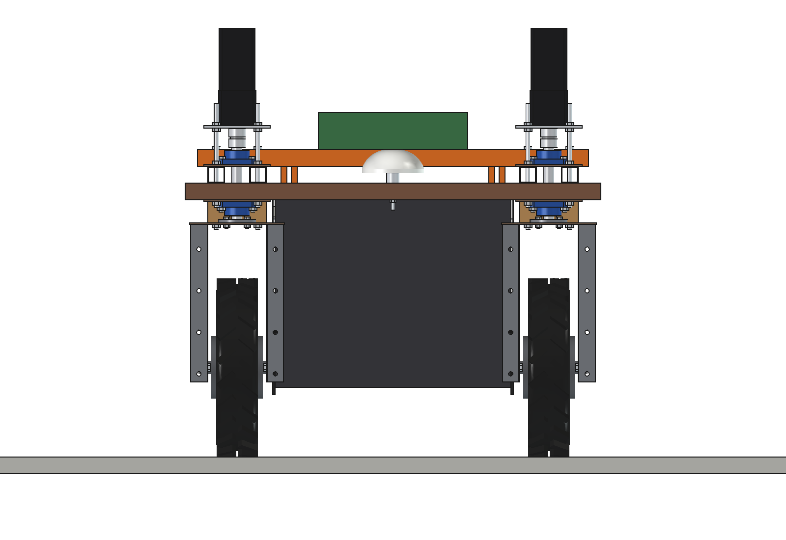
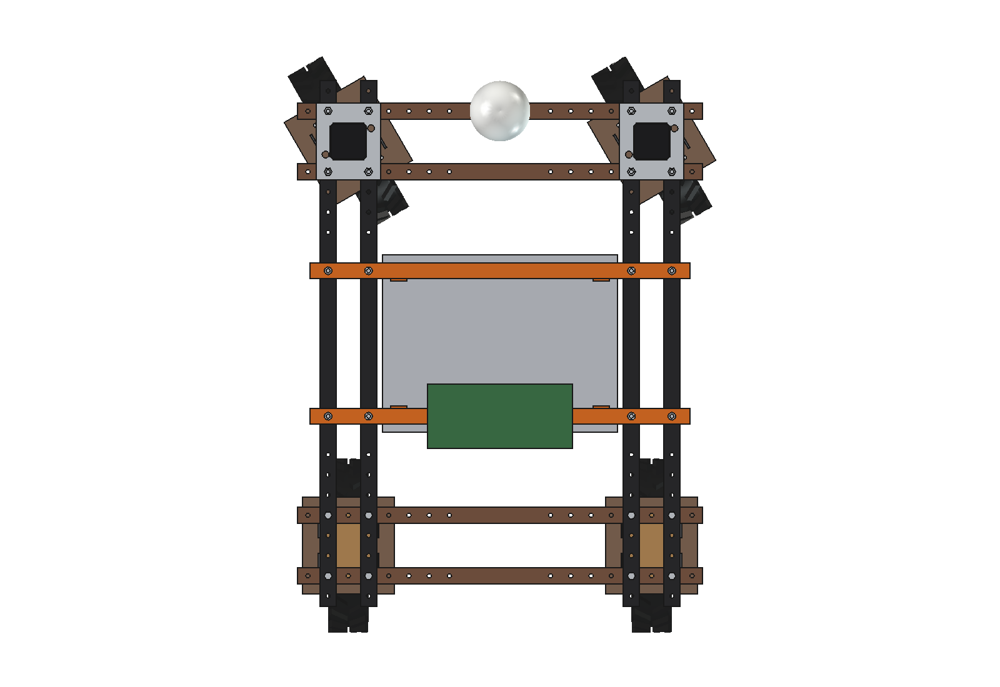
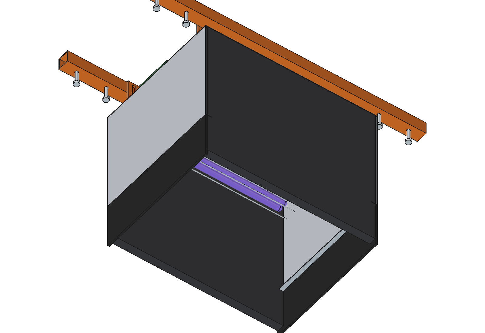
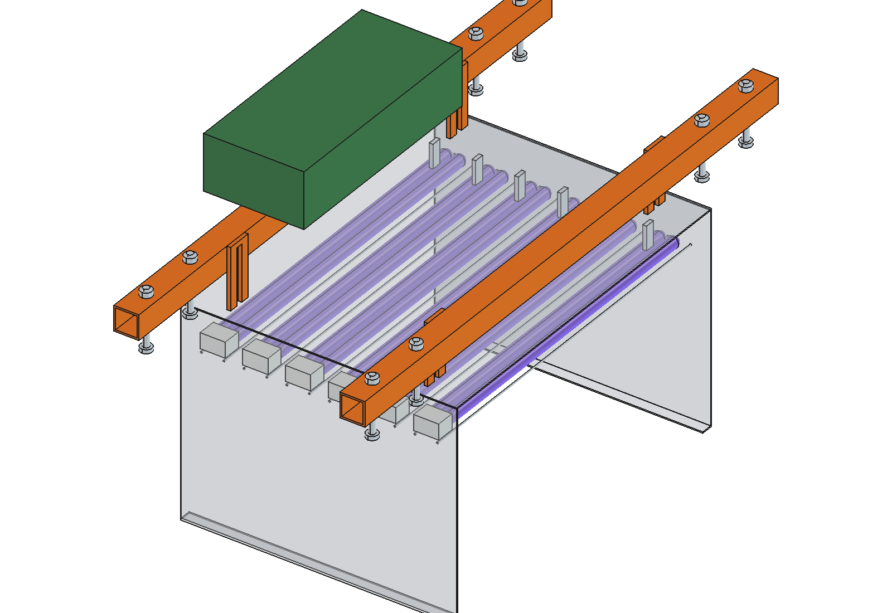

# UV-C mildew light (simple)

A reflecting hood with 6 UV-C lamps under the Bruut OpenAgbot (standard robot), between the axles, over the bed the
robot straddles. It drives at night and gives the crop a low UV-C dose against powdery mildew, without chemicals. Brush
curtains and rubber skirts keep the light inside; the lamps only burn while the hood is down and the robot moves.

  

| Side | Front |
| --- | --- |
|  |  |
|  |  |

## Build

- **Mount**: 2 bearers 40 x 40 x 3 across the upper beams at y +-180 (8 x M10), 4 slotted hangers 40 x 6 (hood height
  +-75 mm), driver box with 6 electronic ballasts and the interlock on the rear bearer.
- **Hood**: aluminium 2 mm, 580 x 440, roof at z 640, side walls to z 300 with rubber skirts to z 150, brush curtains
  front and rear. 6 compact UV-C tubes (PL-L 55 W class) across the hood at z 590, sockets on the right wall, clips,
  2 guard wires under each lamp.

Mass 21 kg. Size 940 x 480 x 679 mm. No interference; 25 mm from the tyres with the front wheels steered +-30 degrees.

## Key figures (`uvc_calc.report()`)

| Dose per pass | 100 J/m2 | 200 J/m2 (strawberry mildew) | 400 J/m2 |
| --- | --- | --- | --- |
| Speed | 1.15 m/s | 0.58 m/s | 0.29 m/s |
| Area per hour | 1778 m2 | 1020 m2 | 551 m2 |
| Power | 571 W | 489 W | 448 W |
| Per battery charge | 3.3 h, 5900 m2 | 3.9 h, 4000 m2 | 4.2 h, 2300 m2 |

UV-C 102 W from 6 x 55 W, ~300 W/m2 on the canopy (290 mm under the lamps), 0.39 m of exposure per plant.

Why and how these come out: see [RATIONALE.md](RATIONALE.md), including the list *Estimated, not measured*.

## Files

| File | Contents |
| --- | --- |
| `uvc_params.py` | all dimensions, robot interface, lamps, work parameters |
| `uvc_parts.py` | one function per part, robot coordinates |
| `build_uvc.py` | model tree, checks (`check_interference`, `check_poses`, `clearance`), mass, `render_all()`, STEP |
| `uvc_calc.py` | irradiance, speed per dose, area per hour, power and battery time |
| `run_in_freecad.py` | reload, build, print the key figures |
| `UV_Mildew_Light.FCStd`, `UV_Mildew_Light.step` | generated model (robot hidden in the FCStd) |
| `previews/` | images |
