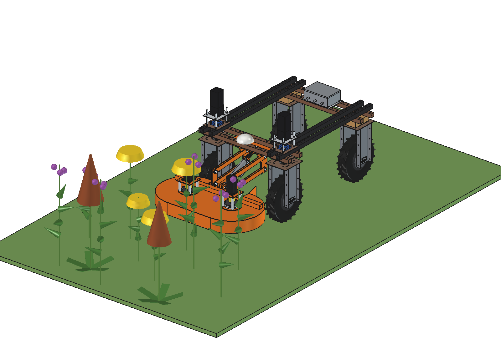
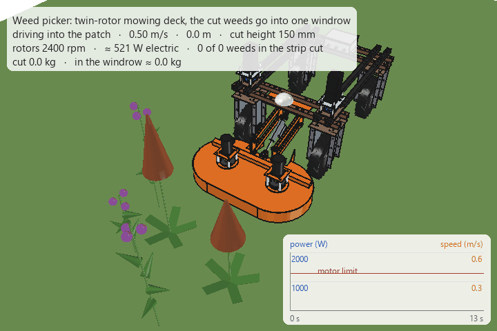

# Weed picker for the Bruut: mowing deck

Cuts **thistles, ragwort and broad-leaved dock** above the grass and gathers the cut weed **into one windrow**, so it
does not stay spread over the field. The robot keeps driving through the field; the grass under the cut height is
left alone. Ragwort in particular has to leave the field: wilted it is still toxic and cattle and horses eat it more
easily than when it stands.

| | Variant | Contents |
| --- | --- | --- |
| [Mowing deck](mowing_deck/README.md) | `mowing_deck/` | FreeCAD model: traditional twin-rotor mowing deck with swinging blades in front of the robot, centre discharge into a windrow, cut height 100–400 mm with an electric actuator on a parallel linkage; calculations, animation in a weed patch, parts list (≈ €1,040); why: [RATIONALE](mowing_deck/RATIONALE.md) |

## Concept

1. **Two rotors with free-swinging blades** under one hood, in front of the robot (the weeds are cut before the
   robot drives over them).
2. **The rotors turn towards each other at the front.** In the middle both sweep backwards: the chopped weed leaves
   through an opening at the rear of the hood, between the rotors, and lands as one windrow between the front
   wheels. No auger, no belt, no bin.
3. **Cut height from an actuator** on a parallel linkage: 100–400 mm, set from the robot (per field, per weed, or
   lifted for transport). A slotted link lets the deck ride up over a hump by itself.
4. **One 48 V motor per rotor**, straight on a lawn-tractor deck spindle: no belts and no timing between the rotors
   (the left rotor sits 24 mm higher, so the blade circles may overlap).

## Requirements

| | |
| --- | --- |
| Weeds | thistles (creeping and spear thistle), ragwort, dock; 0.5–1.2 m high, stems up to ≈ 20 mm |
| Cut height | adjustable, at least 100–250 mm ("10 or 20 cm"), above the grass |
| Gathering | cut material together in one strip, not spread over the field; no collecting bin needed |
| Working | keeps driving through the field; lower efficiency is acceptable as long as it works |
| Robot | 48 V battery, mounted on the 50 mm hole grid, no changes to the robot, clear of the steering |
| Cost / making | cheap, robust, easy to make: laser-cut plates, bought drive parts |

## Options considered

| Principle | For | Against | Choice |
| --- | --- | --- | --- |
| **Twin rotor, swinging blades, centre discharge** (modelled) | one simple machine cuts, chops and gathers; swinging blades fold back on stones and molehills; cheap bought spindles | blade windage costs power (≈ 400 W); material is chopped, not left whole | **simple variant** |
| Sickle bar (double knife) + cross auger to the middle | clean cut, low cutting power, whole plants | needs a reel or auger to gather, tall weeds fall forward, knife and drive cost more, clogs in thick thistle | possible advanced variant |
| Single big rotor (Ø 900) | one motor | throws to one side: the windrow ends up under a wheel | no |
| Flail mulcher | robust, chops finely | spreads the material over the full width: nothing is gathered | no |
| String trimmer heads | safe on posts and wire | too weak for dock and thistle stems | no (see the fence mower) |
| Weed wiper (rope wick with herbicide) | very low power | chemical; nothing is removed | out of scope |

## Variants (ideas)

| Variant | Difference | Why |
| --- | --- | --- |
| Mowing deck (modelled) | windrow on the ground, between the wheels | cheapest; collect the windrows later by hand, fork or loader |
| With catcher | mesh basket under the robot between the axles, behind the discharge (like a lawn-tractor grass catcher), emptied at the headland | ragwort straight off the field in one pass |
| Spot topping | camera finds the weeds; the deck stays lifted (or the rotors idle) where there are none | saves most of the windage power, longer run time |
| Windrow pick-up | a second implement with a pick-up drum or rake into a box drives along the windrows | collects all windrows of a field in one go |
| Sickle bar | double knife and an auger to the middle | less power, whole plants |

## Design decisions

- **In front of the robot:** the robot body is 619 mm above the ground; behind it the weeds would already be pushed
  over by the beams and the wheels. In front they stand when they are cut.
- **Rotary with swinging blades, not a sickle bar:** the same rotors cut, chop and move the material to the middle;
  no reel, no auger, no knife drive.
- **Windrow, not a bin:** no volume or weight limit and nothing to empty; a catcher can be added later behind the
  same discharge.
