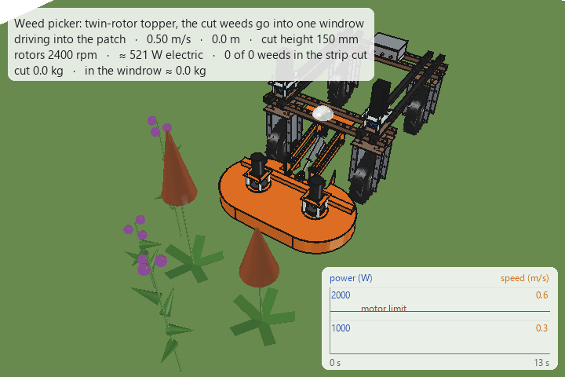
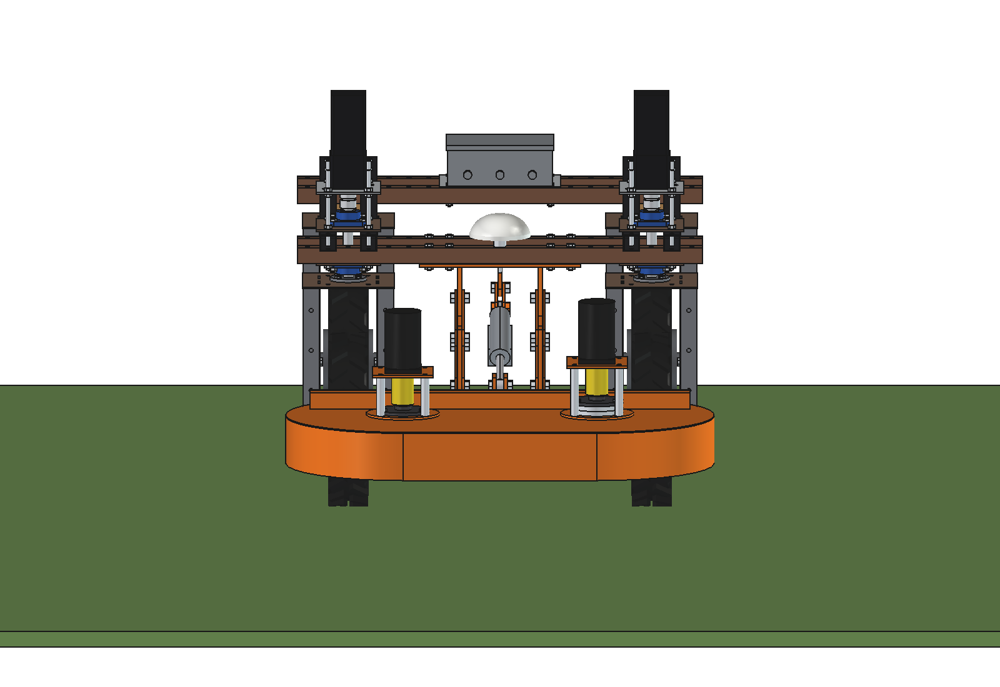
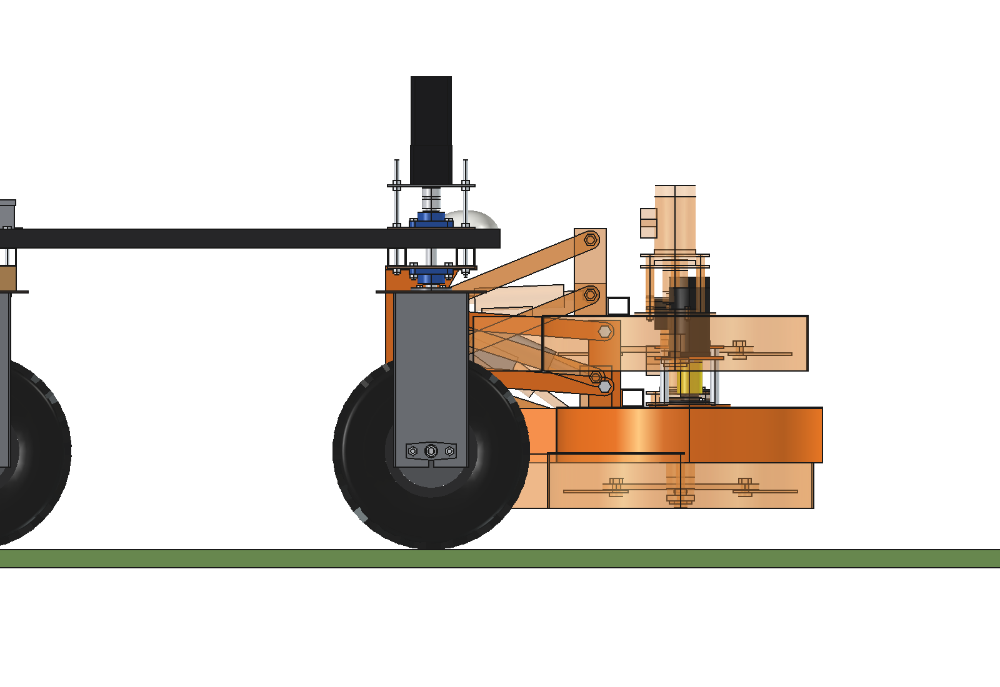
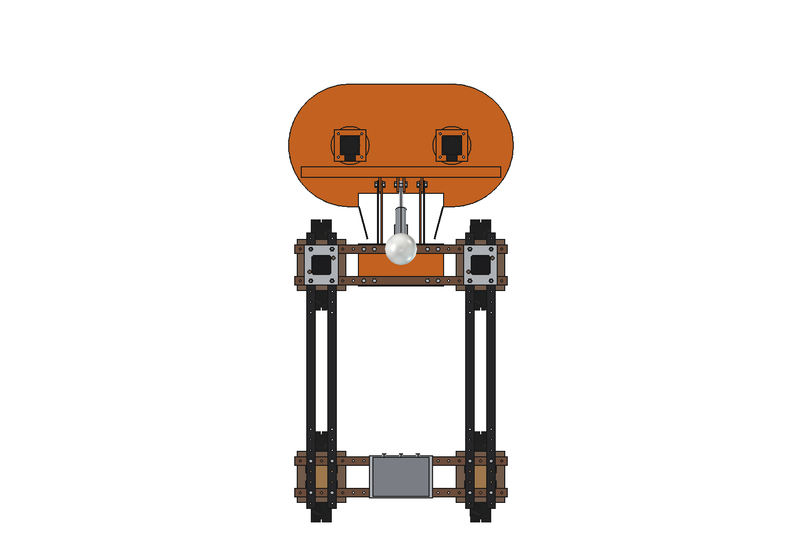
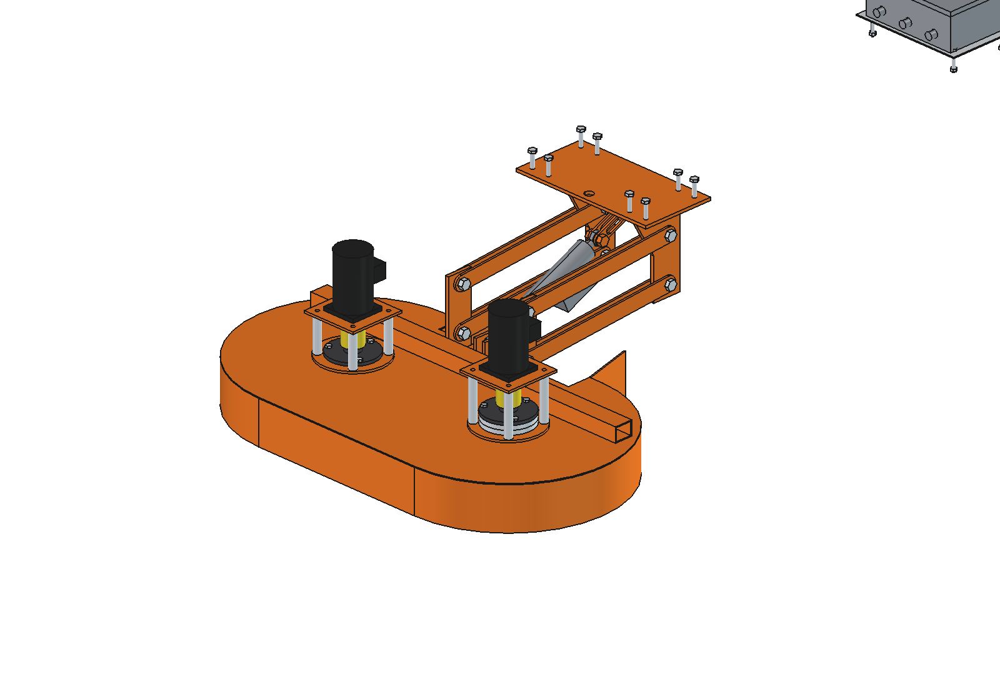
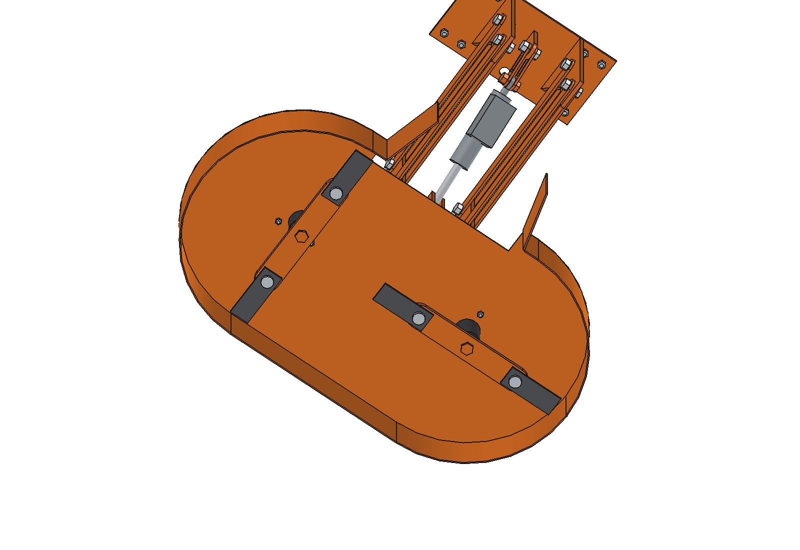
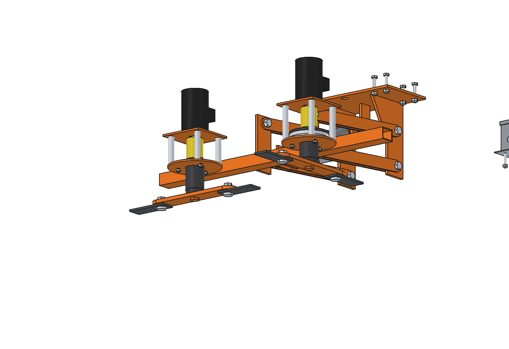
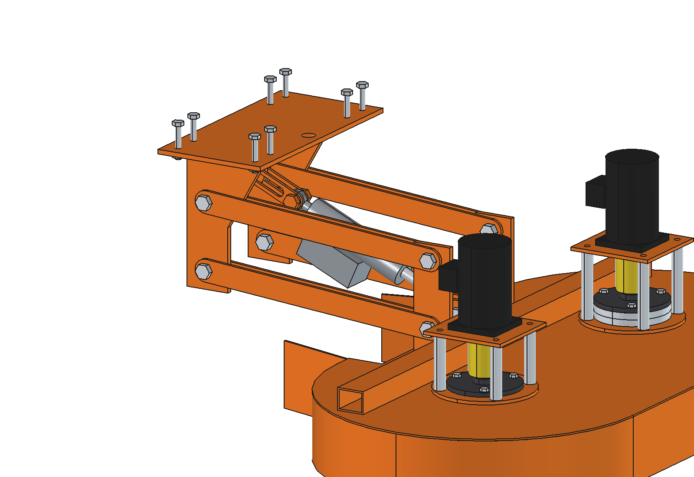

# Weed picker (simple): FreeCAD model

A **twin-rotor weed topper** in front of the standard Bruut OpenAgbot. It cuts thistles, ragwort and dock above the
grass and puts all the cut weed **in one windrow** in the middle, between the front wheels. The robot keeps driving
through the field. There is no collecting bin.

- **Cut and gather in one go:** two rotors with free-swinging blades turn towards each other at the front. In the
  middle both sweep backwards, so the chopped weed leaves through an opening at the rear of the hood and lands as a
  windrow ≈ 320 mm wide. Two short swath boards keep it narrow.
- **Cut height 100–400 mm** (model: 200), set by an electric actuator on a parallel linkage. The robot can change it
  while driving, or lift the deck for transport. A slotted float link lets the deck ride up over a hump by itself.
- **Simple to make:** laser-cut plates (deck, skirt, lugs, links, blade bars), one RHS, M16 bolts as pins. Bought:
  2 × 48 V BLDC motors, 2 lawn-tractor deck spindles, 2 jaw couplings, 1 linear actuator. About **€1,040** in parts.
- **Robust:** swinging blades fold back when they hit a stone or a molehill; no belts; same blade left and right
  (both edges ground).

Why it is designed this way is explained in [RATIONALE.md](RATIONALE.md); other principles and variants in the
[concept README](../README.md).




*A dense patch (≈ 0.5 kg/m² of weed above the cut). The robot slows down when the motors reach 90 % of their power;
halfway the actuator raises the cut height from 150 to 250 mm. Panel: electric power of both rotors against the motor
limit, and the driving speed. The chopped weed (yellow) lies in one strip between the wheels.*

| | | |
| --- | --- | --- |
|  |  |  |
| from the front: 2 motors on standoffs, linkage and actuator in the middle | side: cut height 200, with 100 and 400 transparent | from above: the rear opening between the rotors and the 2 swath boards |
|  |  |  |
| the weed picker without the robot | from below: 2 blade bars with swinging blades, skirt open at the rear | deck hidden: spindles, couplings, blade bars, blades |
|  | | |
| mount plate, parallel linkage, actuator with the float link | | |

## Key figures

From the model (`build_wpk.mass_properties`, `check_heights`, `clearance`, `size`), `wpk_calc.report()` and
`animate_wpk.summary()`. Robot 161.5 kg (agbot comparison, not weighed).

| | |
| --- | --- |
| Cut | 990 mm wide (2 × Ø510, 30 mm overlap; the left rotor runs 24 mm higher), 2400 rpm, blade tip 64 m/s, 6 mm of travel per blade pass at 0.5 m/s |
| Cut height | 100–400 mm (bottom of the right blades); full range in ≈ 10 s; the deck can float up 30–175 mm (more at low settings) |
| Windrow | rear opening x −200 … 200, swath boards to ± 160: windrow ≈ 320 mm wide in the middle, 165 mm from each front tyre |
| Power | at 0.5 m/s in 0.2 kg/m² of weed: 392 W blade windage + 50 W idle + 396 W chopping = 838 W shaft, 986 W electric (20.5 A at 48 V), each motor at 70 % |
| Speed | the robot drives slower in thick weed (motor current): 1.0 m/s at 0.05 kg/m², 0.8 at 0.2, 0.32 at 0.5, 0.16 at 1.0 kg/m² |
| Capacity | 0.18 ha/h at 0.5 m/s; ≈ 1.6 h per charge (with driving) → ≈ 0.3 ha per charge |
| Windrow size | 0.17 kg per metre at 0.2 kg/m² (≈ 11 mm high, loose); 0.84 kg/m at 1 kg/m² (≈ 56 mm) |
| Mass | 82 kg (deck with rotors 57, mount 10.5, links 6.9, actuator 3.3, controller box 4.6), centre of gravity y 840 |
| Overall size | 1060 × 954 × 475 mm (x × y × z), from the front beams (y 400) to y 1354 |
| Interference | none, at cut heights 100–400 and with the deck floated up |
| Clearance | ≥ 47 mm from the front wheels, steered ± 30°, over the whole height range |
| Actuator | holds 1.7–1.8 kN (short lever on the diagonal); 4000 N actuator, 33–137 mm out of 150 |
| Axle loads | 244 kg in total, 85 % on the front axle (206 kg, spec 500 kg); with 45 kg on the rear beams 30 % rear |

## How it works

1. **Driving into the weeds:** the front skirt (10 mm below the blades) pushes a tall plant over; it slides under the
   deck and is cut by the blades at the set height, again and again as the deck moves over it: the whole top
   is chopped into short pieces.
2. **To the middle:** seen from above the right rotor turns anti-clockwise and the left clockwise. At the front the
   blades move inwards, in the middle both move backwards. The pieces are thrown back through the rear opening; the
   skirt closes the hood at the front and the sides.
3. **Windrow:** the swath boards narrow the stream to ≈ 320 mm. It lands between the front wheels and passes under
   the robot (619 mm free). About 85 % ends up in the windrow (estimated), the rest lies scattered in the cut strip.
4. **Height:** the actuator sets the length of the diagonal of the parallelogram: shorter = higher. The deck rests on
   it through a float link with a 60 mm slot, so a hump lifts the deck instead of breaking something.

The animation and the report use the same numbers: windage and idle from `wpk_calc`, 4 kJ per kg of cut weed, and the
cut weed comes from `wpk_weeds` (a plant is cut when a blade circle passes its stem above the cut height).

### Collecting the windrows

The windrows lie every 0.99 m (one per pass). Pick them up with a fork or a loader, or drive the passes so that two
windrows lie close together. A catcher behind the discharge and a pick-up implement are listed as variants in the
[concept README](../README.md). Ragwort has to be removed: wilted it stays toxic.

## Parts list

Quantities for one weed picker. Prices are rough estimates (2026) to give an idea of the total, not quotes.

| Qty | Part | Specification | Where to get it | Price (est.) |
| --- | --- | --- | --- | --- |
| 2 | BLDC motor + driver | 48 V, 750 W, 3000 rpm (run at 2400), square flange ≈ 90, shaft Ø19 with key; driver 48 V / 25 A with speed control, brake, current output | e-mobility / automation shops ("48V 750W BLDC motor") | €350 |
| 2 | Deck spindle | lawn-tractor mower deck spindle, 2 ball bearings, 3-bolt flange on Ø110, shaft 3/4" / Ø19, blade boss below | garden machinery parts shops | €70 |
| 2 | Jaw coupling | L-type (e.g. L-075), bores 19 / 19 with keyway, rubber spider | bearing / transmission shops | €30 |
| 1 | Linear actuator | 24 V, 4000 N, 150 mm stroke, ≈ 255 mm pin to pin closed, eyes for M16 (bush if needed), IP65+; DC-DC 48/24 V, reversing relay | automation shops | €110 |
| 4 | Swinging blades | flat 50 × 6 × 140, hole Ø17 at 25 mm from the end, both long edges bevelled (C45 or Hardox; or bought topper blades of the same size) | steel merchant / agricultural parts | €40 |
| | Laser-cut steel S235 | deck 3 (stadium 1060 × 580 with the rear notch), skirt 3 (2 half rings r 290, front 480, 4 short pieces, 118 high, rolled), 2 swath boards 4, mount plate 8 (400 × 200), 2 link lugs 10, actuator lug 10, 2 deck lugs 10, actuator deck lug 2 × 8, 8 link bars 40 × 6 (R20 ends), 2 float bars 30 × 6 with a 60 mm slot, 2 doublers 6 Ø180, 2 spacer rings 12, 2 motor plates 6, 2 blade bars 12 (340 × 60) | laser cutter (rolling the skirt: same shop), weld yourself | €260 |
| 1 | RHS 50 × 40 × 3 | 940 mm (crossbeam) | steel merchant | €10 |
| 8 | Standoffs | tube Ø20 × 103 (127 left), M10 threaded rod, nuts | steel merchant / hardware store | €10 |
| | Bolts | 8 × M10 × 70 (mount), 7 × M16 pins with lock nuts (4 robot side, 2 + 1 deck side... see model), 4 × M16 button head (blades), 6 × M8 (spindles), 8 × M8 (motors), 2 × M16 (actuator) | hardware store | €40 |
| 1 | Controller box | IP66 ≈ 260 × 180 × 90, 2 drivers inside, fuses, relay, cable glands, cable | electronics shops | €60 |
| | Paint or galvanizing | welded parts | | €60 |
| | | | **total, roughly** | **≈ €1,040** |

## Making it

- **Deck:** weld the rolled skirt under the edge of the deck plate, leaving the rear between the rotors open; the 2
  swath boards on the ends of the short rear skirt pieces. Weld the crossbeam on top, then the 2 deck lugs and the
  actuator lug against its rear face. The doublers are welded on top of the deck, concentric with the
  spindle holes (drill the 3 spindle holes through deck and doubler together).
- **Rotors:** the deck spindle goes in from below; its flange bolts (3 × M8) clamp it on the doubler, on the left
  side with the 2 spacer rings in between. Bolt the blade bar to the blade boss like a mower blade, then the swinging
  blades with M16 button-head bolts and lock nuts (blades must swing freely).
- **Motor stand:** 4 standoffs (tube + M10 rod) per motor, motor plate on top, motor flange down; align the jaw
  coupling, then tighten. Add a sheet guard around the coupling (not modelled).
- **Mount:** weld the 2 link lugs and the actuator lug under the 8 mm plate; bolt it under the two front lower beams
  with 8 × M10 through the grid holes (x ± 125, ± 175). The hole in the middle is for the GNSS stud.
- **Linkage:** 8 flat bars 40 × 6, two per link, on both sides of the lugs, with a washer on each side; M16 bolts
  with lock nuts as pins (grease them).
- **Actuator:** rod eye on the deck (pin B), rear eye between the float bars; the float bars hang on pin A with their
  slot.
- **Robot:** nothing to drill. Controller box on the rear lower beams (M8 at x ± 125), cables along the frame.

## Settings

| What | How |
| --- | --- |
| Cut height | actuator (robot software): 100–400 mm; ≈ 10 s for the full range. Model: 200 |
| Rotor speed | BLDC drivers: 2400 rpm (tip 64 m/s). Lower = less windage and noise, higher = cleaner cut |
| Driving speed | up to 0.5–1.0 m/s; slow down on motor current (≈ 90 % of the rated current) |
| Transport | actuator fully in: cut height 400; rotors off |
| Windrow width | bend the swath boards in or out |

## Files

| File | Contents |
| --- | --- |
| `Weed_Picker.FCStd` | the model at cut height 200, with the robot model hidden next to it. Generated, so do not edit by hand |
| `Weed_Picker.step` | the weed picker only, in robot coordinates, cut height 200 |
| `wpk_params.py` | all dimensions, the robot interface, rotors, deck, linkage, actuator and the operating values; deck position for a cut height |
| `wpk_parts.py` | one function per part; each returns a `Part` shape in robot coordinates (cut height 200); weeds and chips for the renders |
| `build_wpk.py` | model tree with the moving sub-Parts, colours, `set_height`, interference over the height range, clearance to the steered wheels, mass, images, STEP |
| `wpk_kin.py` | linkage and actuator: table per cut height, actuator force, float range, forces in the links (pure Python) |
| `wpk_calc.py` | rotors, blades, windage, power, speed limit per weed density, capacity, windrow, strength, axle loads, cost (pure Python) |
| `wpk_weeds.py` | weed model: thistles, ragwort and dock; cutting and the chips in the windrow |
| `animate_wpk.py` | animation: robot + weed picker through a weed patch, speed follows the motor load, cut height changed while driving |
| `make_gif_wpk.py` | frames to GIF with a caption and the power / speed panel |
| `run_in_freecad.py` | macro: open in FreeCAD and run (F6) to rebuild and print the key figures |
| `previews/` | images and the GIF |

## Axes

Robot coordinates: x = right, y = driving direction (front = +y), z = up, ground = z 0, mm, origin = centre of the
robot. Cut height = bottom of the right-hand blades above the ground. The left rotor runs 24 mm higher.

## Rebuilding and using

```python
import sys; sys.path.insert(0, r"F:\veldrobot\aanbouwdelen\weed picker\simple")
import build_wpk, wpk_calc
build_wpk.build()                    # FCStd + STEP
build_wpk.check_interference()       # []
build_wpk.check_heights()            # all lists empty
build_wpk.clearance(); build_wpk.mass_properties(); build_wpk.size()
wpk_calc.report()
build_wpk.render_all()               # previews/
```

Or run `run_in_freecad.py` as a macro. Change a dimension in `wpk_params.py`, rebuild, and run the checks again. After
a change, copy the masses from `mass_properties()` into `wpk_kin.MODEL`.

## Animation

```python
import animate_wpk, make_gif_wpk
animate_wpk.build(); animate_wpk.play()          # live; animate_wpk.stop()
animate_wpk.summary(); animate_wpk.check_fit()
animate_wpk.render_all(r"C:\temp\wpk_frames")
make_gif_wpk.main(r"C:\temp\wpk_frames", r"previews\animation_topping_windrow.gif")
```

`summary()`: 131 frames, 13 s, 14 weeds of which 10 in the strip, all 10 cut; 1.9 kg cut, ≈ 1.6 kg of it in the
windrow; cut height 150 → 250 mm. In this dense patch the robot averages 0.29 m/s and the power stays near the motor
limit (≈ 1.27 kW electric). The rotors turn 37° per frame in the pictures (the real 2400 rpm would alias).

## Model tree

```
Weed_picker (weed_picker_simple)
  Mount         mount plate 8 under the front lower beams (8 x M10), 2 link lugs, actuator lug, pins
  Controller    control box on the rear lower beams (2 BLDC drivers, DC-DC, relay)
  Top_links     turn about the robot pivot: 4 flat bars 40 x 6
  Bottom_links  turn about the robot pivot: 4 flat bars 40 x 6
  Actuator      redrawn per height: actuator body, rod and eye, float link with slot
  Deck          moves with the linkage: deck plate, skirt, swath boards, crossbeam, deck lugs, pins, doublers,
                spacer rings, spindle housings + bolts, standoffs, motor plates, 2 BLDC motors
    Rotor_R     turns anti-clockwise: shaft, boss, blade bar, 2 swinging blades + bolts, coupling, motor shaft
    Rotor_L     turns clockwise, 24 mm higher
Robot (hidden in the FCStd; for checking only)
```

## Safety

- **Thrown stones:** the skirt reaches 10 mm below the blades at the front and the sides; the only opening is the
  rear discharge, which points under the robot. Still: nobody within a few metres while the rotors turn.
- **Stop the rotors** (driver enable) when the robot stops, when it is lifted, and when the deck is fully up.
- **Guard the couplings** with a sheet around the standoffs.
- **Front-heavy:** with the deck 850 mm in front of the front axle the rear axle keeps only 15 % of the weight. Put
  ≈ 45 kg on the rear beams (or the battery at the rear) for traction and braking on slopes.

## Maintenance

- **Blades:** turn them over (both edges are ground) or regrind; replace them as a pair to keep the rotor balanced.
  Check the blade bolts: the blades must swing freely.
- **Spindles:** grease nipple on most deck spindles; a few strokes per season.
- **Pins:** grease the M16 pins of the linkage; check the lock nuts.
- **Actuator:** keep it out of the mud (it sits high, above the windrow); check the float link slides on pin A.

## Estimated, not measured

- Robot: 161.5 kg, centre of gravity y +95, z 543 (agbots/agbot comparison, not weighed).
- Motors: 48 V BLDC 750 W, 3000 rpm, 4.5 kg each, Ø90 × 140, flange 90 (check with the supplier and adjust
  `motor_*`). Motor + driver efficiency 0.85. At 2400 rpm the available power is taken as rated torque × speed (600 W).
- Deck spindle: housing Ø62, 83 mm below the flange, flange Ø130, 3 bolts on Ø110, 2.6 kg (differs per make: adjust
  `spindle_*`).
- Actuator: 255 mm pin to pin closed, 150 mm stroke, 4000 N, 10 mm/s, 2.6 kg (check the chosen model and adjust
  `act_*`).
- Weeds: plant mass (thistle 0.12–0.25 kg, ragwort 0.15–0.30, dock 0.20–0.40 above ground), 4 kJ per kg to cut,
  chop and throw out, 85 % into the windrow, windrow bulk density 60 kg/m³, a plant is chopped over 600 mm of travel.
- Blade windage with Cd 1.2 (blade edgewise, 6 mm with a bevel); idle 25 W per rotor; driving 200 W.
- 80 % of the 2.4 kWh battery usable.
- Loads: deck weight × 2 for bumps, 300 N backwards on the deck (× 2) for dense weed and a molehill.

See RATIONALE § 10.
