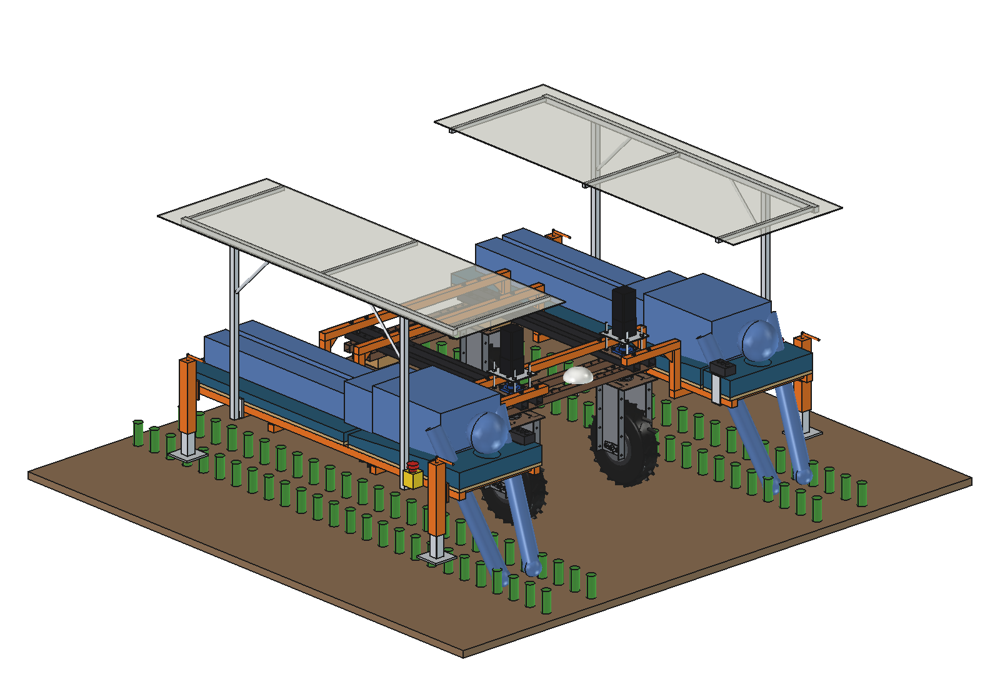
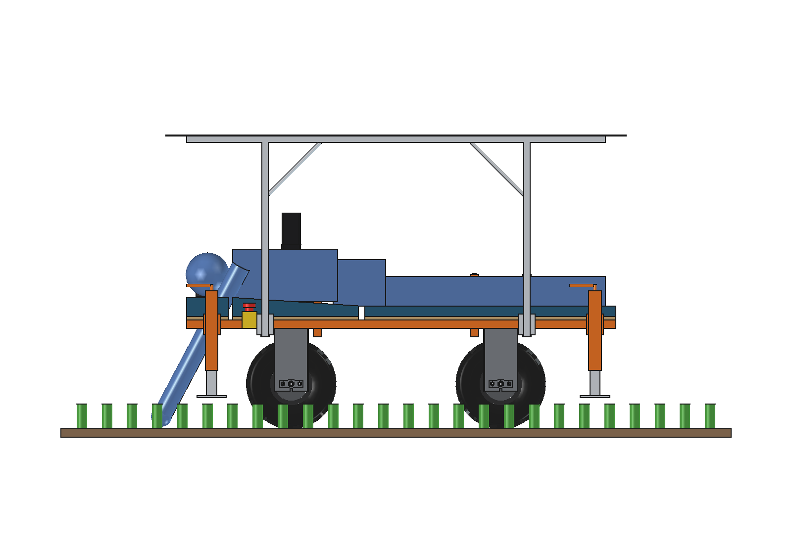
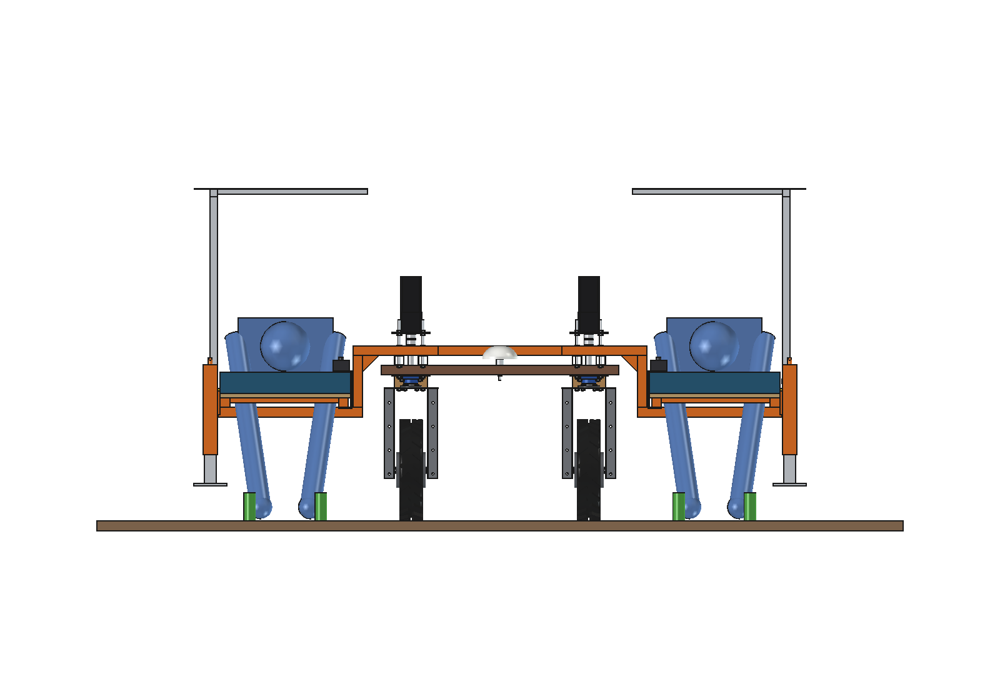
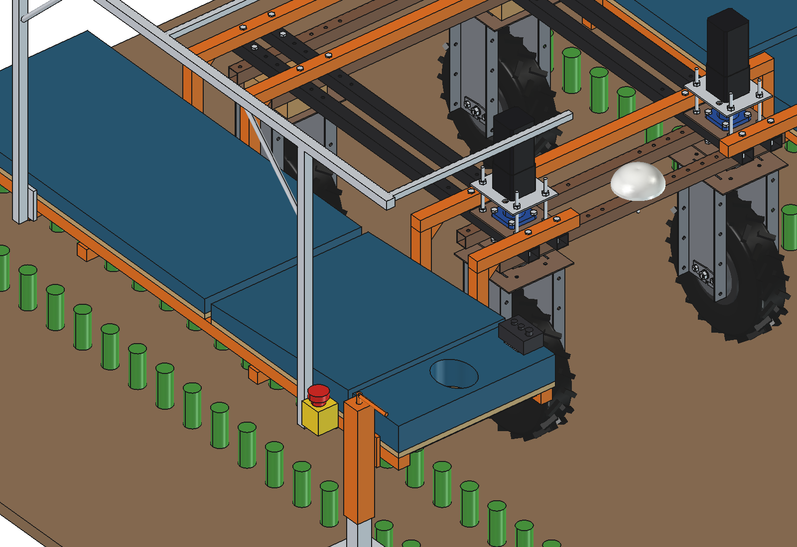
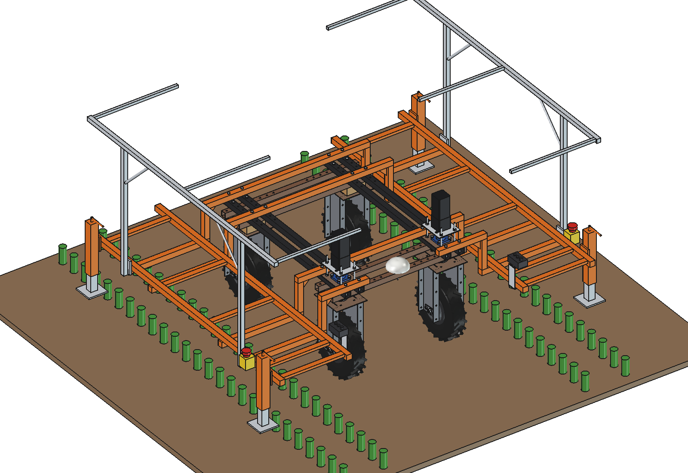

# Weeding bed (simple)

A lying platform for hand weeding or harvesting: two workers lie face down on padded boards beside the Bruut OpenAgbot
(standard robot), one on each side, each over the row under them, while the robot creeps along the bed at walking-pace
fractions. Low power, slow and straight: a job that suits the robot well.

- **Frame**: 4 cross tubes 40 x 40 x 3 on the upper beams (2 x M10 per beam, in the real grid holes at y -625, -375,
  375 and 625). At y 625 the GNSS dome sits in the middle, so there are 2 stubs there. Each tube ends in a **hanger**
  40 x 40 x 4 at x +-600 (61 mm outside the front steering sweep) with a gusset, down to a **cross arm** under the bed:
  4 C-frames per side. Nothing crosses over the worker's back; the bed hangs from the inner hangers only.
- **Bed per side**: 2 side rails 40 x 40 x 3 (x 660 and 1160, y -1050..1000) on the arms, cross slats, 18 mm plywood
  with 50 mm foam: a leg board, a **chest wedge** (40 mm higher at the head end) and a **face rest** with an oval
  opening, the worker looks straight down at the crop. Board 550 mm wide, top at z 588 (chest 628); 440 mm crop
  clearance under the arms.
- **Controls per side**: a **hold-to-run pendant** at the inner front corner of the face rest (run button, stop
  button, speed knob: the robot only creeps while both workers hold run, or the one worker on board) and an
  **emergency stop** on the outer rail.
- **Parking stands**: 2 drop-leg stands per side on the outer rail, cranked down for getting on and off (the empty
  bed tips with one worker stepping on the outer edge, factor 1.44), up (pad at 150 mm) while driving.
- **Sun canopy** per side on 2 posts clamped to the outer rail, top at 1.4 m, separate canopies so the GNSS antenna in
  the middle keeps a clear sky.

<p align="center">
  
</p>

| Side | Front |
| --- | --- |
|  |  |
|  |  |

## Key figures (`wdb_calc.report()`)

| | |
| --- | --- |
| Mass | ~178 kg (frame 86, boards and foam 36, stands 26, canopies 27, controls 3) |
| With 2 workers (85 kg) | 509 kg, front share 57 %, 144 kg per front wheel, 111 kg per rear wheel |
| One worker on board | lightest wheel 48 kg, sideways tip at 18 degrees side slope (cg 194 mm inside the wheel line) |
| Getting on, stands up | 110 kg on the outer edge of the empty bed: factor 1.44 against tipping: **stands down** |
| Cross tube at the beam | 766 N per tube (factor 2), 352 Nm, 69 MPa; stub bolts 3.5 kN (M10 8.8 proof 33.7 kN) |
| Speed and output | 100-400 m/h; 2 workers x 0.5 m: 100-400 m2/h (0.08-0.32 ha per 8 h day) |
| Power | ~160 W (drive at creep speed + electronics): ~10 h per 1.9 kWh charge |

Rules: drive only with the stands up (limit switch), only straight along the bed at creep speed with hold-to-run, no
turning or headland with workers on board, both e-stops and both pendants in the robot's safety circuit.

Checks: `check_interference()` [] (stands up and down), `check_steering()` {} (front wheels at +-30 degrees),
`check_holes()` [] (all 16 M10 in grid holes), `clearance()` 61 mm to the steering units, 111 mm to the tyre
envelopes. See [RATIONALE.md](RATIONALE.md), including the list *Estimated, not measured*.

## Usage

```python
exec(open(r"F:\veldrobot\aanbouwdelen\weeding bed\simple\run_in_freecad.py").read())
import build_wdb
build_wdb.check_interference(); build_wdb.check_steering(); build_wdb.check_holes(); build_wdb.clearance()
build_wdb.render_all()
```

```bash
"C:/Program Files/FreeCAD 1.1/bin/python.exe" -B wdb_calc.py
```

## Files

| File | Contents |
| --- | --- |
| `wdb_params.py` | cross tubes, C-frames, rails, boards, controls, stands, canopy, workers, operation |
| `wdb_parts.py` | one function per part, robot coordinates, both sides; worker dummy for the renders (helpers from `sfe_parts`) |
| `build_wdb.py` | model tree, checks (`check_interference`, `check_steering`, `check_holes`, `clearance`), mass, `render_all()`, STEP |
| `wdb_calc.py` | wheel loads with 0/1/2 workers, side tip, boarding, cross tube bending and bolts, output and battery time |
| `run_in_freecad.py` | reload, build, print the key figures |
| `Weeding_Bed.FCStd`, `Weeding_Bed.step` | generated model (robot hidden in the FCStd) |
| `previews/` | images |
