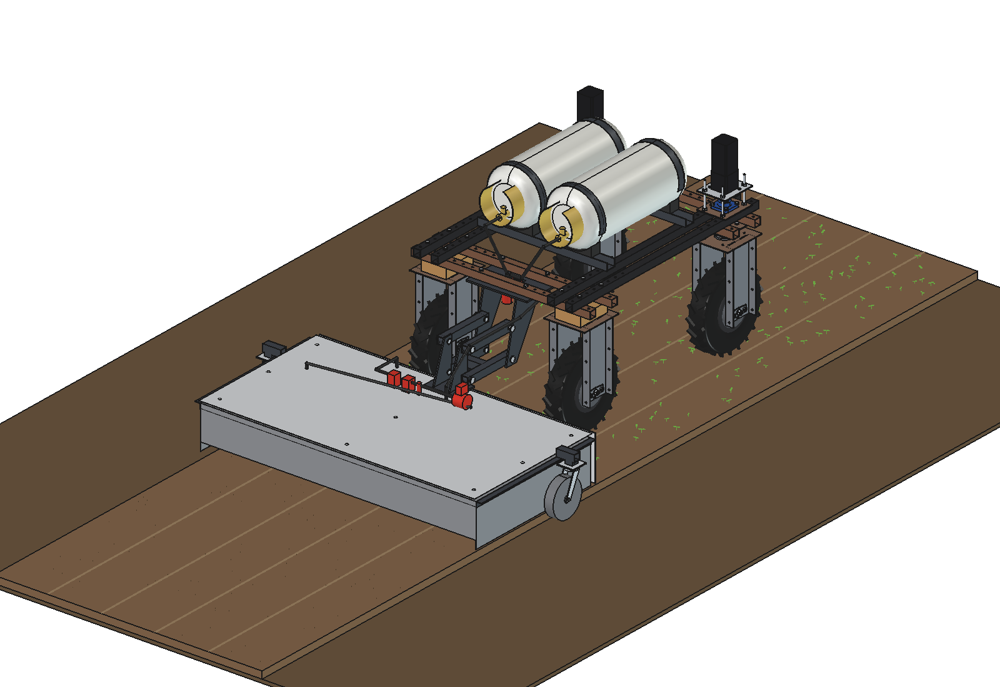

# Propane flame weeder with a hood: design rationale

15 October 2026. Model: `Flame_Weeder_Hood.FCStd` (FreeCAD 1.1, generated with `build_flw.py`). The figures come from
the model, from `flw_calc.py` and from the process model (`flw_field.py`, `animate_flw.summary()`). Where something is
assumed or estimated, this is stated.

---

## 1. Assignment

- A gas burner on the robot that burns the top of **freshly sown beds**, against weeds (the inspiration: a hand-pushed
  flamer with a hood and a propane bottle).
- Pre-emergence: the crop is not up yet, so everything green on the bed is a weed.

## 2. The design in brief

1. **Hood** 1.5 × 0.8 m behind the robot, insulated top, 6 flat-flame burners at the front aimed back and down.
2. **Gas:** two 18 kg forklift cylinders (liquid withdrawal) on a cradle on the upper beams; a vaporiser coil in the
   hood; main valves on the robot, regulator and burner valve on the hood; pilots with igniters and flame sensors.
3. **Hood on two steel swivel castors**, pulled by a free parallelogram from a plate under the rear beams.

| Characteristic | Value |
| --- | --- |
| Width | 1.5 m (one bed) |
| Power | 167 kW (13 kg/h propane) |
| Dose at 0.7 m/s | 34 kg/ha |
| Gas per filling | 0.84 ha |
| Mass (model, empty) | 131 kg |
| Parts, roughly | ≈ €3,400 |

## 3. Behind the robot

| Option | For | Against |
| --- | --- | --- |
| **Behind** (chosen) | The robot drives over the bed before it is flamed (no wheel prints in burnt soil); the heat stays away from the steering, the electronics and the cylinders; the hood follows straight | The rear tyres are 215 mm from the hood: a heat shield is needed |
| In front | The robot sees what it flames | Hot gas and radiation towards the steering stacks and the GNSS antenna; the robot drives over hot soil and stops right behind the flames |
| Under the belly | Compact | 167 kW under the electronics, the battery and the cylinders: no |

## 4. A hood, and how big

Without a hood the wind blows the flames away and much of the heat goes up. Under a hood the hot gas stays on the soil
for the whole length: here 0.8 m = 1.14 s at 0.7 m/s. The hood is as wide as one bed (1.5 m, the usual track in
vegetable growing) and long enough for six burners at 250 mm with their flames landing 190 mm behind the mouths and the
hot gas running out under the rear wall. Longer means more exposure per kg of gas but more mass behind the robot.

The top is insulated (ceramic-fibre blanket inside, aluminium cover outside on spacers) so that heat goes down, not
up; the side and front walls are a single skin. The front wall faces the robot: an aluminium shield 30 mm in front of
it brings the radiation on the rear tyres from ≈ 975 W/m² (bare wall at 350 °C) to ≈ 14 W/m², far below the sun.

## 5. Dose and speed

The dose decides whether the seedlings die. Flame-weeding trials give 20–60 kg/ha propane for seedlings up to 2–4
leaves (more for bigger ones; hooded flamers need less than open ones). The design point is **35 kg/ha**:

| Speed (2 bar) | Dose | On the soil (65 %) | Net capacity |
| --- | --- | --- | --- |
| 0.5 m/s | 48 kg/ha | 145 kJ/m² | 0.23 ha/h |
| **0.7 m/s** | 34 kg/ha | 104 kJ/m² | 0.32 ha/h |
| 0.9 m/s | 27 kg/ha | 81 kJ/m² | 0.41 ha/h |

With 104 kJ/m² every seedling up to 2 leaves dies, the 4-leaf ones mostly survive (lethal 60–120 kJ/m², estimated):
in the animation 73 % of all seedlings, all small ones, 17 % of the biggest. The answer is timing (flame when the weeds
are small, a few days before the crop emerges) or a slower pass (0.5 m/s, or a higher pressure via the regulator).

## 6. Gas: forklift cylinders with liquid withdrawal

13 kg/h is far more than a normal propane bottle can evaporate from its liquid surface (≈ 1 kg/h for an 11 kg bottle
at 15 °C; it freezes and the pressure drops). Two ways out:

| Option | For | Against |
| --- | --- | --- |
| Many bottles in parallel, vapour withdrawal | Simple valves | 10+ bottles for 13 kg/h; heavy |
| **Liquid withdrawal + vaporiser in the hood** (chosen) | Forklift cylinders are made for it (dip tube, locating pin); the liquid boils in a coil heated by the flames: 2.4 kW, 1.4 % of the burner heat; the cylinder stays warm and the pressure stays up | The coil must be warm before full flow: pilots first; liquid LPG valves and hoses |

Two 18 kg cylinders last 2.6 h (0.84 ha). They lie along the robot on the upper beams, 72 mm from the steering
stacks and above the battery bay, ≈ 1 m away from the flames. The vapour pressure must stay above the burner pressure
plus a margin: down to about −7 °C cylinder temperature at 2 bar.

## 7. Valves and safety logic

- **On the robot:** liquid filter, two main solenoid valves in series (normally closed): closed when the robot stops,
  on any fault, and without power.
- **On the hood:** vaporiser outlet → motorised regulator (sets the dose with the speed) → pressure sensor → burner
  solenoid valve → manifold. Pilot line with its own small regulator and valve; a spark igniter and a thermocouple per
  burner.
- **Speed interlock:** half a second standing still with full flames already gives the strip under the flames 1.2 ×
  the dose; the valves close at once below 0.2 m/s.

## 8. Hood on castors, free parallelogram

The hood (69 kg) rides on two steel swivel castors (rubber would not like the hot side walls) right under its centre
of gravity, so the robot carries none of its weight and no pitch moment. The parallelogram (arms 270 mm, short pins
one per side) pulls the hood, keeps it in line and level, and lets it float −60 … +80 mm. In the headland the hood
stays on the ground and follows the robot round on its castors; no lift actuator is needed. The robot itself carries
the cylinders (up to 36 kg of gas) and the mount: 259 kg, 50 % on the front axle.

## 9. Checks

- `check_interference()` and `check_fit()` (float −60 and +80): no overlap between the parts or with the robot.
- `clearance()`: heat shield ≥ 168 mm from the rear tyres, cylinders 72 mm from the front steering stacks, cradle
  112 mm from the rear frame bolts, mount 102 mm from the rear wheel units.

## 10. Open points

- The dose / kill relation depends on the weed species, the size and the soil moisture: test with the regulator
  before relying on the numbers.
- Wet soil absorbs heat: flame on a dry surface (late morning).
- Unattended flaming: local rules and insurance (see the safety list in the README).
- The pilots, igniters and flame sensors need a proper burner controller (flame safeguard); the model shows the parts,
  not the wiring.
