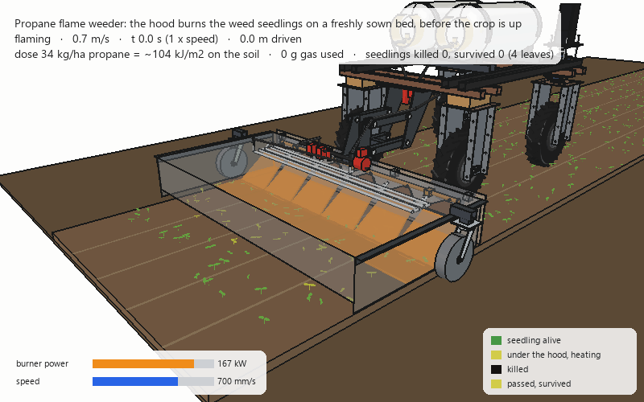
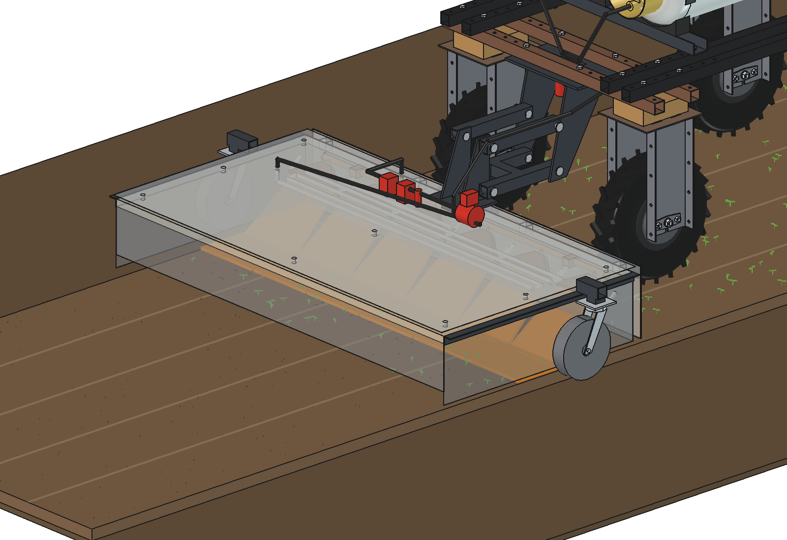
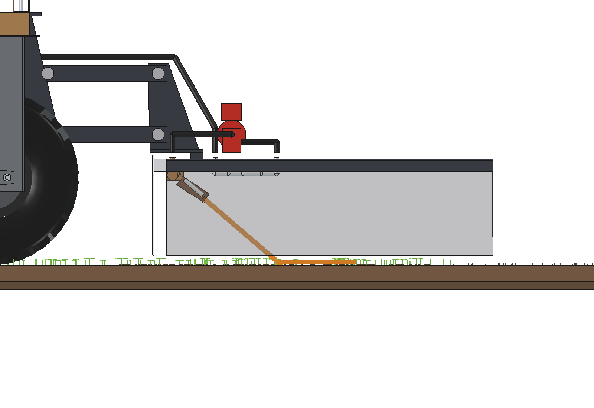
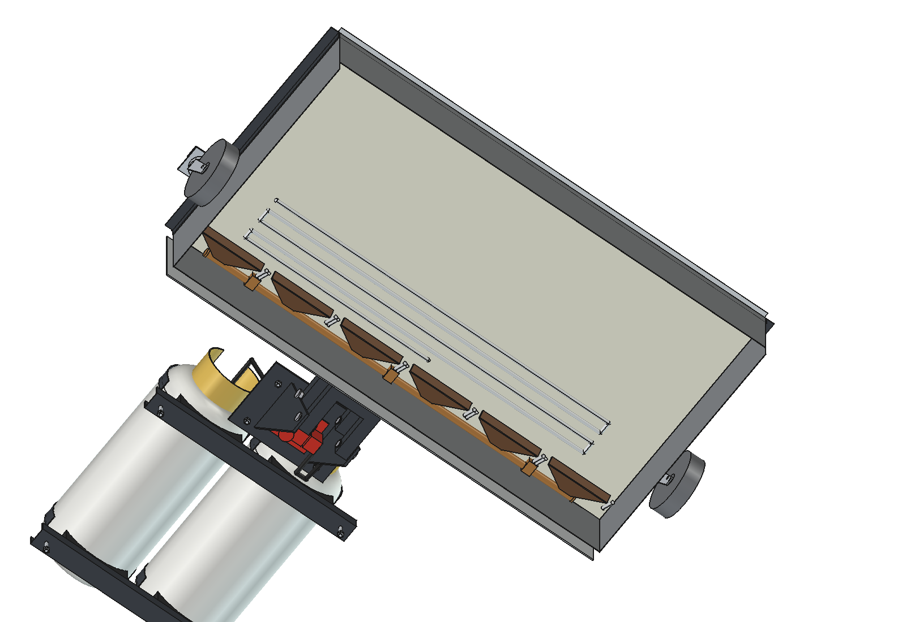
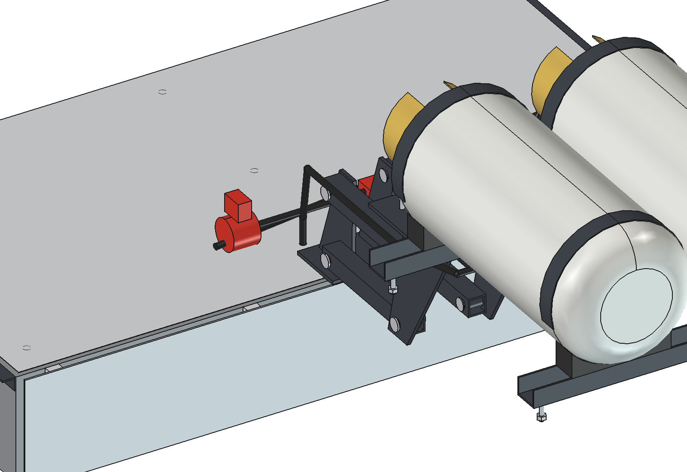
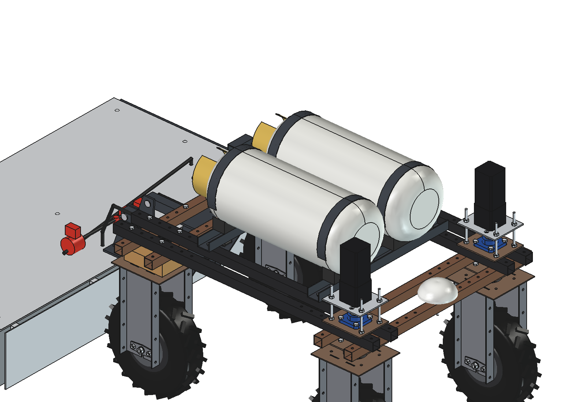
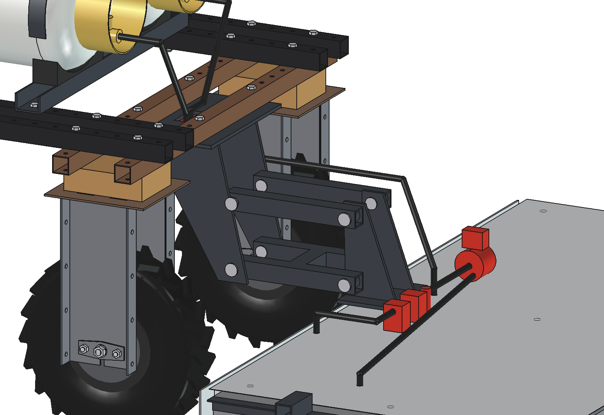

# Propane flame weeder with a hood: FreeCAD model

Burns the weed seedlings on a **freshly sown bed, just before the crop comes up** (pre-emergence flaming: carrot,
onion, beetroot, parsnip, ...). A 1.5 m hood behind the standard Bruut OpenAgbot holds **six flat-flame burners**; the
flames and the hot gas under the hood kill every seedling that has already emerged. The crop seed lies 10–20 mm deep
and is not touched, and the soil is not moved, so no new weed seeds come up.

- **Hood:** 1.5 m wide (one bed), 0.8 m long, steel skin 1.5 mm with a 25 mm ceramic-fibre blanket under the top and an
  aluminium top cover; the hot gas leaves through a slot under the rear wall. An aluminium heat shield in front of the
  front wall protects the robot.
- **Burners:** 6 flat-flame burners of 250 mm, 40° down to the rear: 13 kg/h propane, **167 kW**, at 2 bar.
- **Gas:** two **18 kg forklift cylinders** on the robot, liquid withdrawal (the dip tube takes liquid). The liquid
  evaporates in a stainless coil inside the hood, so the cylinders do not freeze and the flow does not drop.
- **Safety train:** excess-flow valves, two main solenoid valves in series (on the robot), a motorised regulator, a
  pressure sensor and a burner solenoid valve (on the hood), pilot flames with spark igniters and a flame sensor per
  burner.
- **Hood on castors:** two steel swivel castors under the hood's centre of gravity carry it; a free parallelogram on
  the rear of the robot pulls it and keeps it in line. In the headland the main valves close, the pilots stay on and
  the hood follows the robot round on its castors.

Why it is designed this way: [RATIONALE.md](RATIONALE.md); the concept and the alternatives: the
[weeds burner README](../README.md).




*The robot drives at 0.7 m/s (the hood is drawn see-through, the seedlings 1.6 × larger). Under the hood the
seedlings collect heat (yellow); black = killed, light yellow = passed but survived (the biggest, 4-leaf ones). At the
end of the bed the robot stops: the main valve closes at once, only the pilot flames stay on. Real speed.*

| | | |
| --- | --- | --- |
|  |  |  |
| hood see-through: six flames, the burnt strip behind them | side: burner angle 40°, flame on the soil, castor | from below: burners at the front, vaporiser coil, blanket |
|  |  |  |
| regulator, sensor and valves on the hood front | 2 × 18 kg forklift cylinders on a cradle on the upper beams | mount plate, headstock, parallelogram, liquid hose |

## Key figures

From the model (`build_flw.mass_properties`, `check_fit`, `clearance`), `flw_calc.report()` and
`animate_flw.summary()`. Robot 161.5 kg (agbot comparison, not weighed).

| | |
| --- | --- |
| Hood | 1.50 m wide, 0.80 m long, 260 mm high; edges 25 mm above the soil |
| Burners | 6 × 2.17 kg/h at 2 bar = 13.0 kg/h, 167 kW |
| Dose at 0.7 m/s | 34 kg/ha = 159 kJ/m² from the burners, ≈ 104 kJ/m² on the soil; 1.14 s under the hood |
| Speed / dose (2 bar) | 0.5 m/s: 48 kg/ha · 0.7 m/s: 34 kg/ha · 0.9 m/s: 27 kg/ha |
| Result (animation) | all seedlings up to 2 leaves killed, 73 % of all, 17 % of the 4-leaf ones (lethal 60 … 120 kJ/m², estimated) |
| Gas | 2 × 18 kg: 2.6 h, 0.84 ha per filling; works down to −7 °C cylinder temperature (vapour pressure ≥ burner pressure + 0.8 bar) |
| Vaporiser | 2.4 kW (1.4 % of the burner heat) on a 4.8 m coil: 13 kW/m² needed, the flame gas gives 30–60 |
| Capacity | 0.38 ha/h gross, 0.32 ha/h net at 0.7 m/s; gas ≈ €55/ha |
| Battery | 325 W (driving, valves, igniters): 7.4 h, longer than the gas |
| Standing still | 0.5 s with full flames puts 1.2 × the dose on the strip under the flames: the valves close at once below 0.2 m/s |
| Heat to the robot | 975 W/m² from a bare front wall at 350 °C onto the rear tyres, 14 W/m² behind the shield |
| Mass | 131 kg empty: hood 69 (on its castors), cylinders and cradle 41, mount and gas train 21; full cylinders + 36 kg |
| Axle loads (robot + full cylinders) | 259 kg: front 130 / rear 129 kg, max 65 kg per wheel of 500 |
| Clearances | heat shield ≥ 168 mm from the rear tyres over the float; cylinders 72 mm from the front steering stacks, cradle 112 mm from the rear frame bolts |

## How it flames

1. **Timing.** Sow, then flame a few days before the crop emerges (carrot: 8–12 days; a glass plate on the bed shows
   when the first crop seedlings are close). The weeds that came up first are killed; the crop comes up in a clean bed.
2. **Start.** Pilots lit (spark + flame sensor), then the burner valve opens; the robot drives at 0.7 m/s along the
   bed. The regulator sets the pressure for the dose (2.0 bar for 35 kg/ha at 0.7 m/s).
3. **Speed interlock.** Below 0.2 m/s the main valve closes at once; a flame sensor without a flame closes it too.
4. **Headland.** Main valves closed, pilots on, the robot turns, the hood follows on its castors.

## Safety

Unattended open flames of 167 kW need more care than any other implement:

- only on bare, moist soil (a freshly sown bed); never near dry grass, straw, hedges or buildings;
- two main solenoid valves in series (normally closed), excess-flow valves on the cylinders, a flame sensor per burner,
  a tilt sensor, a gas sensor near the cylinders; the controller closes everything on a fault, a stop, a lost GNSS fix
  or a lost link;
- a powder extinguisher on the robot; a person within sight of the field while it flames;
- check the local rules for unattended flaming and for transporting LPG cylinders before use.

## Parts list

Quantities for one flame weeder. Prices are rough estimates (2026) to give an idea of the total, not quotes.

| Qty | Part | Specification | Price (est.) |
| --- | --- | --- | --- |
| 1 | Hood | steel 1.5 mm, laser-cut and folded, edge angles 30 × 30 × 3, ceramic-fibre blanket 25 mm, aluminium top cover 0.8 mm and front heat shield 4 mm | €450 |
| 6 | Burners | flat-flame weeding burner 250 mm, ≈ 28 kW at 2 bar | €420 |
| 1 | Manifold and vaporiser | 1/2" manifold, feed tubes, stainless coil 12 × 1 (5 m), fittings | €180 |
| 6 | Pilots | pilot burner, spark igniter and thermocouple per burner, ignition module | €350 |
| 1 | Gas train | liquid filter, 2 excess-flow valves, 2 main solenoid valves (liquid LPG, 24 V), motorised regulator 0.5–4 bar, pressure sensor, burner and pilot valves | €830 |
| 1 | Hoses | LPG high-pressure hose and fittings | €150 |
| 2 | Gas cylinders | 18 kg forklift cylinder, liquid withdrawal (deposit) | €160 |
| 1 | Cradle | 2 channels 40 × 60 × 4, saddles, straps | €90 |
| 1 | Mount | sub plate 8 mm, headstock, parallelogram (4 arms, 8 pins), hood bracket; painted | €220 |
| 2 | Castors | steel wheel Ø200 × 50, swivel | €120 |
| 1 | Burner controller | flame safeguard, speed interlock, tilt and gas sensor, relays | €350 |
| 1 | Extinguisher | 6 kg powder, bracket | €60 |
| | Bolts | M10, M8 | €20 |
| | **Total** | | **≈ €3,400** |

## Files

| File | Contents |
| --- | --- |
| `Flame_Weeder_Hood.FCStd`, `.step` | the model (generated; robot hidden in the FCStd, not in the STEP) |
| `flw_params.py` | all dimensions, including the robot interface, propane data and the process |
| `flw_parts.py` | one function per part; flames, seedbed and seedlings for the drawings |
| `build_flw.py` | model tree, colours, float pose, interference and fit check, clearances, mass, renders, STEP |
| `flw_calc.py` | gas flow and dose, pressure, vaporiser, cylinder pressure and run time, capacity, cost, standstill, heat to the robot, axle loads |
| `flw_field.py` | process model: seedlings, heat collected under the hood, killed / survived, stop and pilot |
| `animate_flw.py` | animation on the robot: `build()`, `play()`, `stop()`, `summary()`, `render_all(folder)` |
| `make_gif_flw.py` | frames to GIF with caption, power panel and legend |
| `run_in_freecad.py` | macro: reload, build, print the key figures |
| `previews/` | images and the GIF |

## Usage

In FreeCAD 1.1, run `run_in_freecad.py` (or in the Python console):

```python
import build_flw
build_flw.build()                  # FCStd + STEP
build_flw.set_pose(float_h=60)     # the hood floats up 60 mm
build_flw.check_interference()     # []
build_flw.check_fit()              # {} at both float limits
build_flw.clearance()
build_flw.mass_properties()
build_flw.render_all()             # previews/
```

Animation:

```python
import animate_flw
animate_flw.build(); animate_flw.play()
animate_flw.render_all(r"C:\temp\flw_frames")
import make_gif_flw; make_gif_flw.main(r"C:\temp\flw_frames", r"previews\animation_flaming_bed.gif")
```

## Estimated, not measured

- Robot mass 161.5 kg and its centre of gravity (agbot comparison); drive power 300 W at 0.7 m/s on a seedbed.
- Burner flow 2.17 kg/h at 2 bar (catalogue class of flame-weeding burners); flow ∝ √(p (p + 1)).
- Heat on the soil 65 % of the burner heat under a hood; lethal energy 60 kJ/m² (cotyledons) to 120 kJ/m² (4 leaves),
  from the range of doses in flame-weeding trials (20–60 kg/ha propane).
- Propane: lower heating value 46.3 MJ/kg, heat of evaporation 0.36 MJ/kg, vapour pressure table; cylinder tare 15.5 kg.
- Front wall 350 °C, shield 120 °C, view factor 0.15 for the heat to the tyres.
- Masses of the bought parts from catalogue classes (burner 1.1 kg, gas train 5.5 kg, castor 4.5 kg); blanket
  128 kg/m³; pipes and the coil as tubes.
- Not modelled: cables, the ignition module and the controller box, the extinguisher, hose clips.
