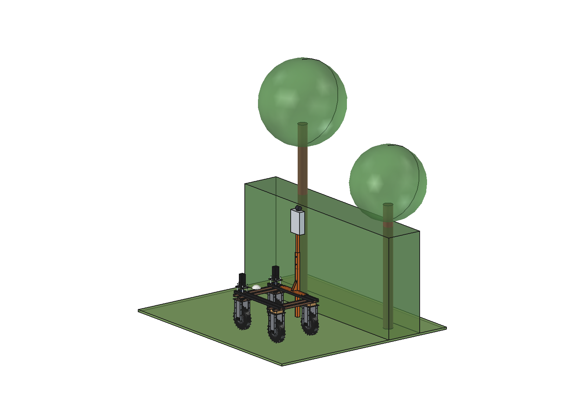
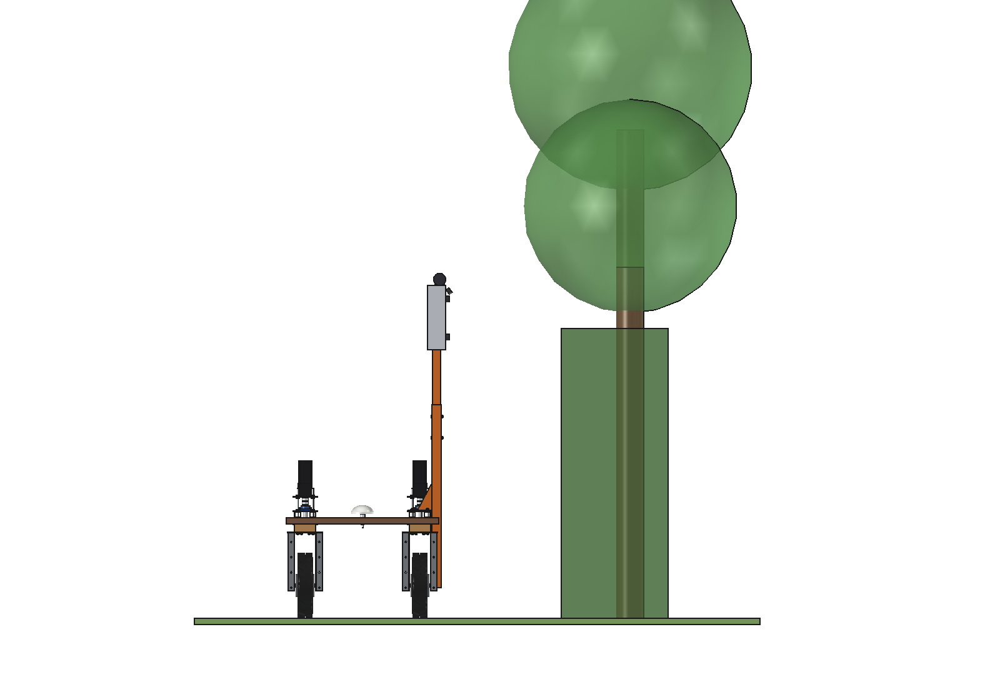
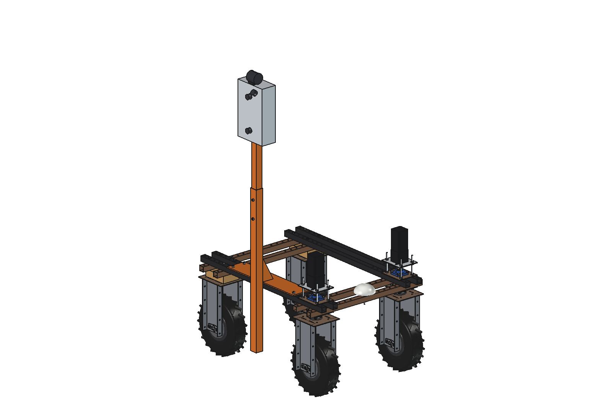
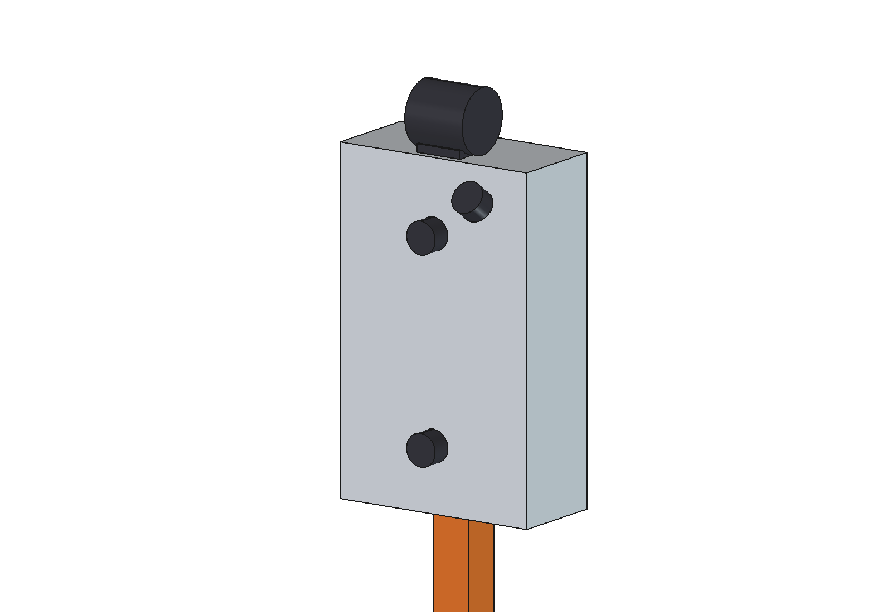

# Windbreak and tree-row inspector (simple)

The Bruut OpenAgbot (standard robot) drives along a hedgerow, windbreak or orchard row with the row ~1 m to the right
of the sensor head and logs it metre by metre:
- **profile**: a 2D lidar scans a vertical plane across the row (270 degrees, 10 Hz): height, width, density and gaps,
  one profile every 150 mm;
- **photos**: a stereo camera pair (one above the other) sees the row from 0.8 to 3.1 m; a third camera tilted up
  35 degrees sees the crowns up to ~4.3 m (dead wood, storm damage, flowering, fruit). The stereo pair measures the
  distance to every trunk, so each tree gets its own GNSS point and a status line with photos.

The head stands on the mast and base plate of the [fence inspector](../../fence%20inspector/simple/README.md)
(imported) with an extension tube to 2.1 m; nothing reaches into the row.

  

| Rear view at the row | On the robot |
| --- | --- |
|  |  |

## Build

- **From the fence inspector**: base plate 8 mm on the right upper beams (4 x M10 at y +-325), mast 60 x 60 x 3 at
  x 485, gussets. The lead screw, carriage and arm are not fitted.
- **Extension**: tube 50 x 50 x 3 inside the mast top (300 mm overlap, 2 x M10), up to 2.1 m.
- **Head**: aluminium box 120 x 260 x 420 clamped round the extension; 2D lidar on top (scan plane across the row),
  stereo pair (250 mm vertical baseline) and crown camera on the face towards the row.

Mass ~26 kg. Size 277 x 660 x 2060 mm (x, y, z); the robot is 2.27 m high with the head.

## Key figures (`wbi_calc.report()`)

| | |
| --- | --- |
| Lidar | 270 degrees: up to straight overhead; 6 mm between points at the row, 23 mm at the top of a 6 m tree; a profile every 150 mm at 1.5 m/s |
| Stereo pair | covers 0.8-3.1 m at the row, 0.7 mm per pixel, distance to a trunk +-1 mm |
| Crown camera | up to ~4.3 m at the row |
| Range | 5.4 km/h, ~260 W: ~7.3 h, ~40 km of row per charge |
| Load | centre of gravity 64 mm to the right (58.5 % on the right wheels); wind 15 m/s on the head: 18 N, 23 Nm at the base plate |

Why and how these come out: see [RATIONALE.md](RATIONALE.md), including the list *Estimated, not measured*.

## Files

| File | Contents |
| --- | --- |
| `wbi_params.py` | extension, head, sensor and work parameters (mast from `fin_params`), masses from the model |
| `wbi_parts.py` | extension, bolts, head, lidar, cameras; hedge and trees for the renders; mast parts from `fin_parts` |
| `build_wbi.py` | model tree (Mount, SensorHead), checks (`check_interference`, `check_holes`, `check_steering`), mass, `render_all()`, STEP |
| `wbi_calc.py` | lidar coverage and point spacing, camera coverage and stereo error, wind, range, side load |
| `run_in_freecad.py` | reload, build, print the key figures |
| `Windbreak_Inspector.FCStd`, `Windbreak_Inspector.step` | generated model (robot hidden in the FCStd) |
| `previews/` | images |
