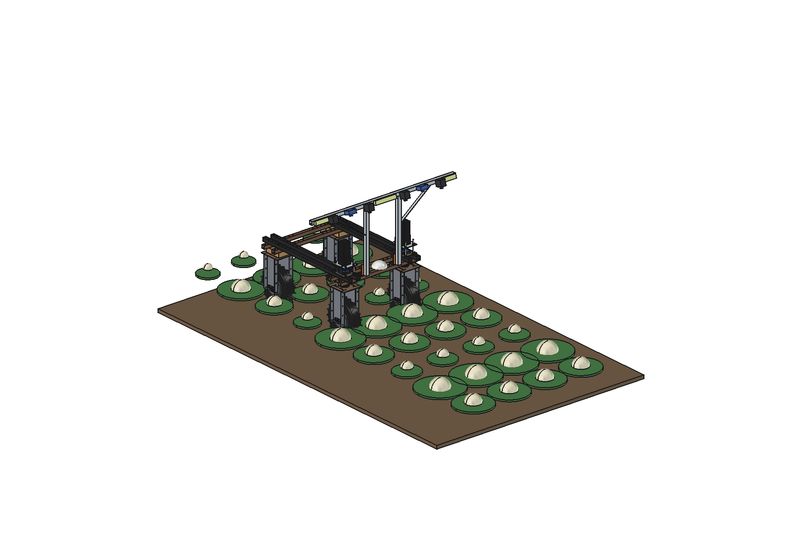
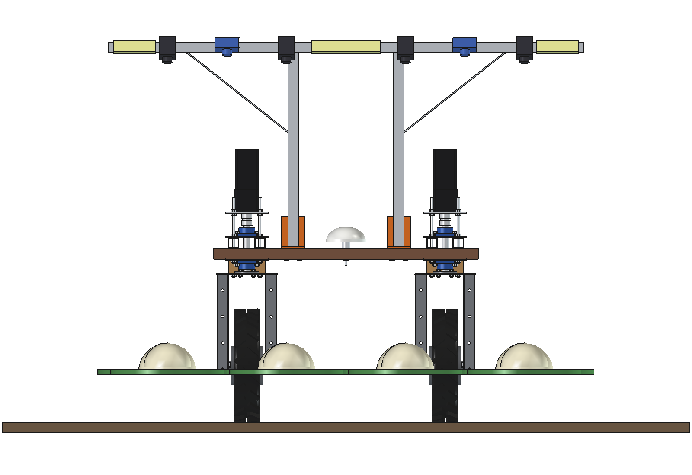
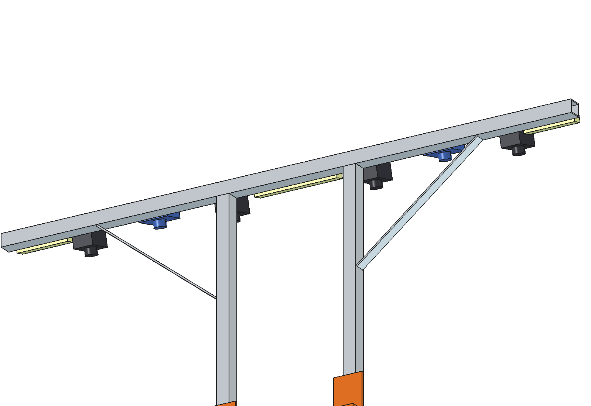

# Yield estimator (simple)

Counts and sizes the crop (cauliflower and cabbage heads, lettuce, pumpkins, plants) with the Bruut OpenAgbot
(standard robot) and logs every plant with its GNSS position, diameter, height and a ripeness class, so the harvest can
be estimated per row and per week.

The camera bridge of the [mole mapper](../../mole%20mapper/simple/README.md) (imported) carries:
- 4 RGB cameras (4K) looking down at 1.4 m, one per row (4 rows at 450 mm = 1.8 m);
- 2 depth (ToF) cameras that measure the height and the visible size of each head;
- 3 LED flash bars synchronised with the cameras, so sun and shade do not change the images.

  

| Front view over the rows | Bridge with cameras, depth cameras and LED bars |
| --- | --- |
|  |  |

## Build

- **Camera bridge** from `mole mapper/simple`: 2 brackets on the front outer lower beam, aluminium posts and a cross
  bar at 1.4 m, 2 stays.
- **Sensors** on the front face of the bar, tilted 15 degrees forward: RGB cameras at x -675, -225, 225, 675; ToF depth
  cameras at x +-450; LED flash bars at the middle and both ends.

Mass ~10 kg. Size 1800 x 190 x 848 mm (x, y, z) on the robot.

## Key figures (`yld_calc.report()`)

| | |
| --- | --- |
| RGB | 0.96 m wide per camera at the crop top (overlap between rows), 0.25 mm/px: a 100 mm head is 400 px; 5 frames per plant at 1 m/s and 10 fps |
| Depth | ToF 1.44 m wide, 2.3 mm/px, +-8 mm depth noise |
| Head mass from size | 100 mm ~250 g, 220 mm ~1.8 kg; +-12 % per head (spread at a given size dominates the 0.2-0.5 % size error) |
| Field estimate | +-0.4 % on the sum of 1000 heads (if the size-to-mass curve is calibrated) |
| Work rate | 1.8 m at 1 m/s: 0.65 ha/h, ~29 000 plants/h; ~250 W: ~7.5 h, ~4.9 ha per charge |

Why and how these come out: see [RATIONALE.md](RATIONALE.md), including the list *Estimated, not measured*.

## Files

| File | Contents |
| --- | --- |
| `yld_params.py` | sensor positions and work parameters (bridge from `mmp_params`) |
| `yld_parts.py` | cameras, depth cameras, LED bars (bridge from `mmp_parts`); crop rows for the renders |
| `build_yld.py` | model tree (CamBridge, Sensors), checks (`check_interference`, `check_holes`, `check_steering`), mass, `render_all()`, STEP |
| `yld_calc.py` | camera coverage and resolution, head mass error, field estimate, work rate |
| `run_in_freecad.py` | reload, build, print the key figures |
| `Yield_Estimator.FCStd`, `Yield_Estimator.step` | generated model (robot hidden in the FCStd) |
| `previews/` | images |
